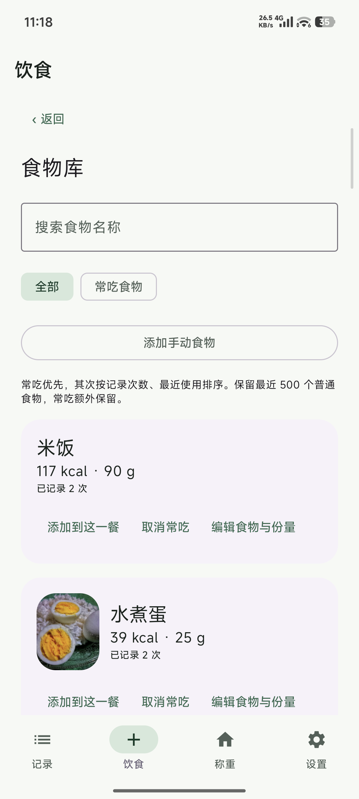

  

<h1 align="center">称伴 · ScaleMate</h1>
<h3 align="center">记下体重，也记下每一餐。</h3>

<table>
  <tr>
    <td width="48%" valign="middle">
      <strong>拍下这一餐，知道吃进了什么。</strong>  
      多图识别、分食描述、营养编辑，最后按你实际吃下的份量确认。
        
      <strong>站上体重秤，让数字自己落进记录。</strong>  
      连接蓝牙体重秤，读数稳定后自动保存，不必再照着秤手动输入。
        
      饮食与体重先留在手机，经你授权后写入 <strong>Health Connect</strong>，供 Google Fit 等兼容应用读取。
        
      <a href="https://github.com/rccoder/ScaleMate/releases/latest/download/ScaleMate.apk"><strong>下载称伴体验版 →</strong></a> 
      <a href="https://github.com/rccoder/ScaleMate/releases">版本与更新记录</a> · Android 14+ · 中文 / English
    </td>
    <td width="52%" valign="top">
      
    </td>
  </tr>
</table>

## 每一餐，先看清再保存

拍一张，或者把同一餐的几张照片一起交给称伴。一个人吃、和朋友分食、酱汁没蘸、饭剩了一点，都可以补充说明。AI 会把重复角度合并成一道菜，按你实际吃下的份量，给出热量、蛋白质、碳水和脂肪。

结果不是黑盒。你可以改食物、份量和营养，展开看 AI 如何理解你的描述，也可以直接切到手动记录。确认后，这一餐才会加入记录。

常见早餐、常去的几家店，星标一次，下次从食物库直接添加。

<table>
  <tr>
    <th width="33%">拍照，记录这一餐</th>
    <th width="33%">看懂估算，也保留决定权</th>
    <th width="33%">常吃的，下次直接加</th>
  </tr>
  <tr>
    <td></td>
    <td></td>
    <td></td>
  </tr>
  <tr>
    <td>一次选多张，重复角度合并识别。</td>
    <td>改份量、改营养，按实际情况确认。</td>
    <td>收藏常吃的早餐，让重复记录更省事。</td>
  </tr>
</table>

除了数字，还能看看 **“本次怎么吃”与“下次怎么选”**：这一餐怎么搭配、酱汁可以怎样少吃一点，下次又能换成什么做法。建议跟着这份食物走，确认权始终在你手里。

## 站上秤，体重自己记

打开称伴，站上已经连接的体重秤。新一轮测量会自动进来，读数稳定后，你可以选择 **5 秒自动保存**，也可以在倒计时里取消重测。

第一次添加秤时，会先做一次试称，对照手机和秤屏幕确认读数。设备设置完成以后，每天站上去就行。称重通过蓝牙完成，不需要配置 AI 服务。

目前支持 **云麦智能体脂秤 3 SE（YMBS-M263）**，当前读取体重。

<table>
  <tr>
    <th>站上秤，读数自动进来</th>
    <th>每次称重，都能回看</th>
    <th>自己的秤，自己管理</th>
  </tr>
  <tr>
    <td></td>
    <td></td>
    <td></td>
  </tr>
</table>

## 数据留在你的手机，去向由你决定

饮食与体重先保存在本机。无需注册称伴账号，也不必先连接健康应用。

需要同步时，分别授权称伴把饮食营养与体重写入 **Health Connect**，再到 Google Fit 等目标应用开启相应读取权限。写入成功不等于目标应用立即显示，显示效果还取决于对方的权限和数据类型支持。

拍照识别使用你自己的 AI 服务，支持 **OpenAI 兼容格式与 Anthropic 兼容格式**。可以保存多个服务、复制配置，并选择用于图片识别的模型。手动记餐、食物库和称重都不需要 AI；在线识别的图片会先移除位置信息，再发送给你选择的服务商。

## 从今天开始，记下一点

- **只想记一餐**：拍照、从相册选择，或者直接手动录入。
- **只想称一次**：在「称重」中添加体重秤，完成首次读数核对后直接上秤。
- **想连到健康应用**：需要同步时再分别授权 Health Connect，不必一开始全部配好。

## 下载与使用

[下载称伴 Android 体验版](https://github.com/rccoder/ScaleMate/releases/latest/download/ScaleMate.apk) · [版本与更新记录](https://github.com/rccoder/ScaleMate/releases) · [反馈问题与建议](https://github.com/rccoder/ScaleMate/issues)

需要 **Android 14 或更新版本**。称重时请保持 App 在前台；锁屏、离开 App 或切换页面会取消待确认的读数。

AI 营养数值属于估算，保存前请确认菜品、份量与营养；不能代替精确称量或专业评估。

以上均为实机界面，截图中的营养数值仅作功能展示。旧 Debug 签名包不能直接覆盖正式版；升级与签名详情见[版本与更新记录](https://github.com/rccoder/ScaleMate/releases)。

感谢 [openScale](https://github.com/oliexdev/openScale) 项目及其贡献者。公开的蓝牙体重秤协议解析实现，为称伴理解设备报文、实现体重读取提供了重要参考。

---

开发者入口：[开发指南](docs/开发指南.md) · [测试与验收](docs/测试与验收指南.md) · [发布指南](docs/发布指南.md)
