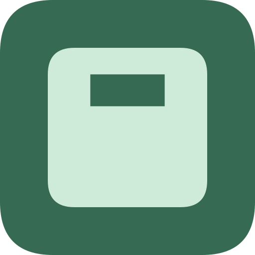
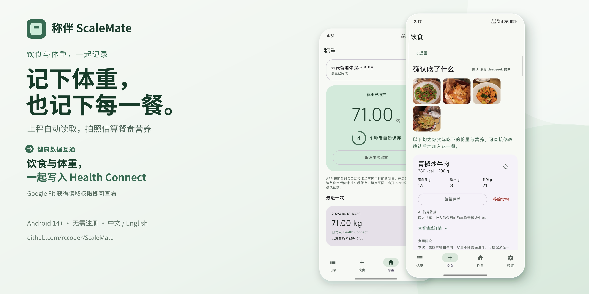
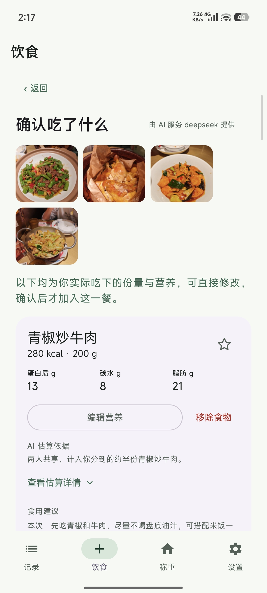
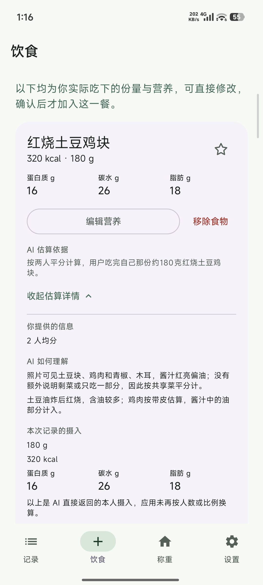
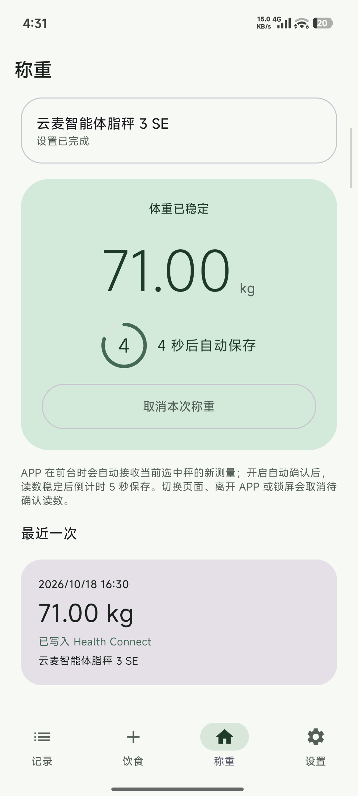
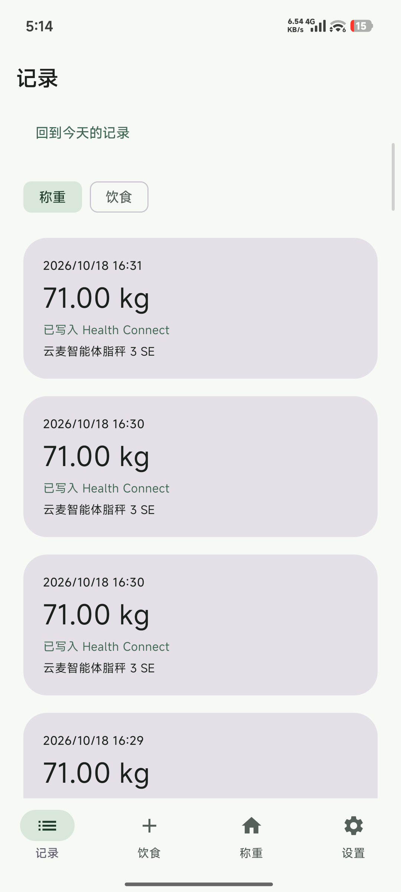
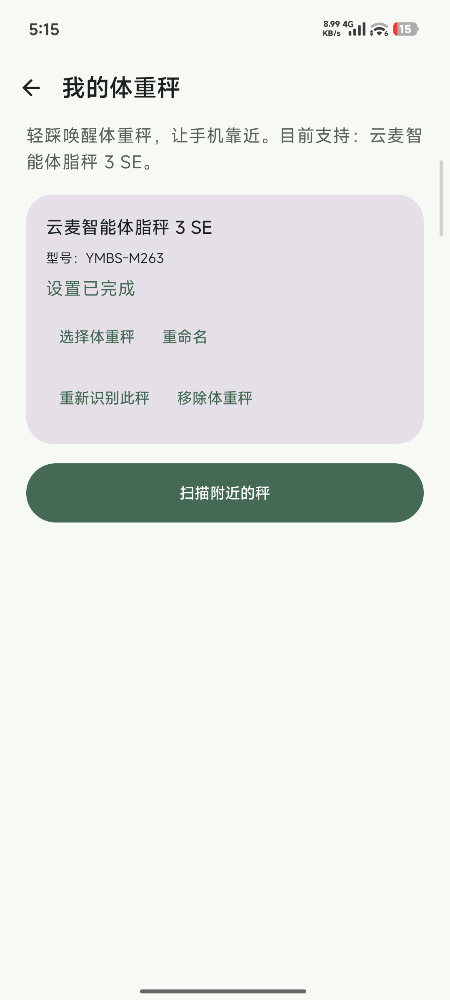

  

# 称伴 · ScaleMate

记下体重，也记下每一餐。

拍照估算一餐的营养，站上秤自动接收体重；确认后的饮食与体重先留在手机，经你授权后写入 **Health Connect**，供 Google Fit 等兼容应用读取。

> 当前正式版为 0.3.3：[查看版本说明](https://github.com/rccoder/ScaleMate/releases/tag/v0.3.3)

**Android 14+ · 中英双语支持 · 无需注册 · 自选 AI 服务**

  <a href="https://github.com/rccoder/ScaleMate/releases/latest/download/ScaleMate.apk"><strong>下载称伴正式版</strong></a>
  &nbsp;·&nbsp;
  <a href="https://github.com/rccoder/ScaleMate/releases">版本与更新记录</a>

## 每一餐，先看清再保存

拍一张，或者把同一餐的几张照片一起交给称伴。一个人吃、和朋友分食、酱汁没蘸、饭剩了一点，都可以补充说明。AI 会把重复角度合并成一道菜，按你实际吃下的份量，给出热量、蛋白质、碳水和脂肪。

结果不是黑盒。你可以改食物、份量和营养，展开看 AI 如何理解你的描述，也可以直接切到手动记录。确认后，这一餐才会加入记录。

常见早餐、常去的几家店，星标一次，下次从食物库直接添加。

以下为此前测试版的实机界面，展示识别确认、摄入说明和食物库能力；当前版的餐食录入已改为弹层，顶部营养摘要和布局有所调整。营养数值仅作功能展示。

1. **拍照后先确认**：多图识别、分食描述和营养编辑都在确认页完成。
2. **看懂 AI 的依据**：可以展开查看它如何理解人数、食用比例和你的补充说明。
3. **常吃的直接复用**：收藏过的食物会优先出现，下次不用重新录入。

  

除了数字，还能看看 **“本次怎么吃”与“下次怎么选”**：这一餐怎么搭配、酱汁可以怎样少吃一点，下次又能换成什么做法。建议跟着这份食物走，确认权始终在你手里。

> AI 营养数值属于估算。保存前请核对菜品、份量与营养；不能代替精确称量或专业评估。

## 站上秤，体重自己记

打开称伴，站上已经连接的体重秤。新一轮测量会自动进来，读数稳定后，你可以选择 **5 秒自动保存**，也可以在倒计时里取消重测。

第一次添加秤时，会先做一次试称，对照手机和秤屏幕确认读数。设备设置完成以后，每天站上去就行。称重通过蓝牙完成，不需要配置 AI 服务。

目前已接入以下体重秤，并统一只读取体重：

- **云麦**：智能体脂秤 3 SE、mini 系列、SE、X、mini 2S
- **小米**：小米体重秤 2、小米体脂秤 2
- **PICOOC**：连接型体脂秤、Mini Lite
- **荣耀**：体脂秤 AH100 / CH100
- **realme**：真我智能秤 RMH2011
- **Etekcity**：Fit 8S
- **FITINDEX**：FT-26R-W
- **OKOK**：V20、V11、VF0

除云麦智能体脂秤 3 SE 已完成实机称重验证外，其他型号目前完成了协议和模拟器交互验证，真实设备兼容性仍会因固件、BLE 广播或握手指令差异而逐步确认。同品牌的其他型号不因这份列表自动获得兼容承诺。

1. **读数自动进来**：连接体重秤后，站上去就会开始接收本次测量。
2. **稳定后自动保存**：可以选择 5 秒倒计时保存，也能在倒计时里取消重测。
3. **记录与设备都能管理**：回看每次体重和 Health Connect 状态，切换或重命名自己的秤。

  

## 数据留在你的手机，去向由你决定

饮食与体重先保存在本机。无需注册称伴账号，也不必先连接健康应用。

需要同步时，分别授权称伴把饮食营养与体重写入 **Health Connect**，再到 Google Fit 等目标应用开启相应读取权限。写入成功不等于目标应用立即显示，显示效果还取决于对方的权限和数据类型支持。

拍照识别使用你自己的 AI 服务，支持 **OpenAI 兼容格式与 Anthropic 兼容格式**。可以保存多个服务、复制配置，并选择用于图片识别的模型。手动记餐、食物库和称重都不需要 AI；在线识别的图片会先移除位置信息，再发送给你选择的服务商。

## 开始使用

- **只想记一餐**：拍照、从相册选择，或者直接手动录入。
- **只想称一次**：在「称重」中添加体重秤，完成首次读数核对后直接上秤。
- **想连到健康应用**：需要同步时再分别授权 Health Connect，不必一开始全部配好。

支持 **Android 14 及以上版本**，无需注册。

在「设置 → 当前版本」检查更新，可选择下载线路并少量试读测速。正式版默认不接收预览版；尝鲜需主动切换通道，Android 安装前仍会请求确认。公共代理的速度与可用性不作保证。

  <a href="https://github.com/rccoder/ScaleMate/releases/latest/download/ScaleMate.apk"><strong>下载称伴正式版</strong></a>

---

## 致谢

感谢 [openScale](https://github.com/oliexdev/openScale) 项目及其贡献者。公开的蓝牙体重秤协议解析实现，为称伴理解设备报文、实现体重读取提供了重要参考。
