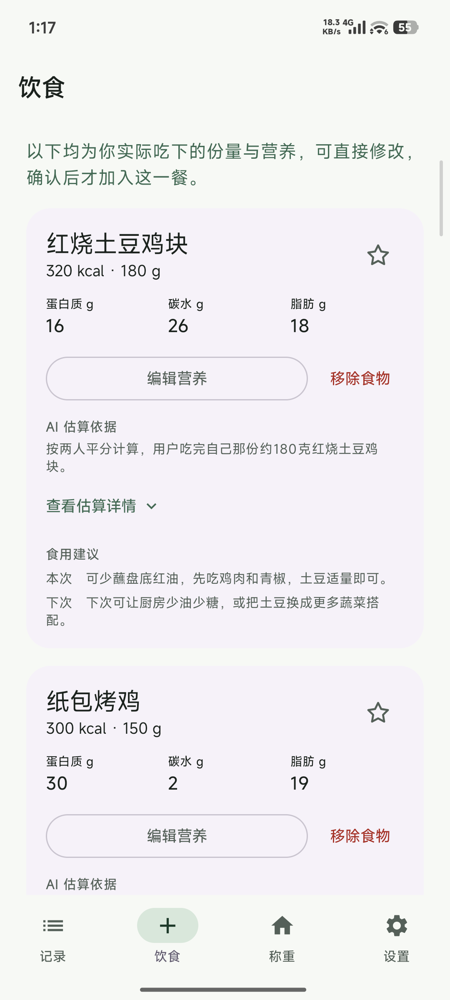
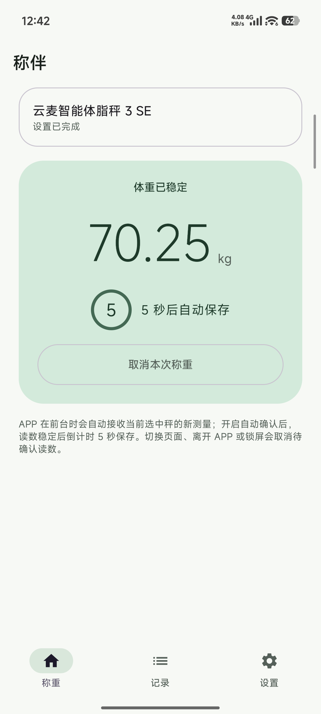
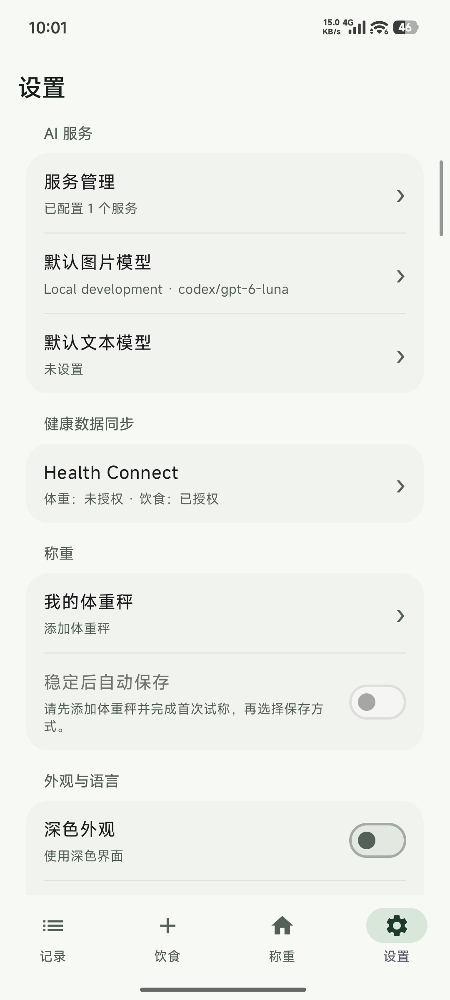

<p align="center">
  
</p>

# 称伴 · ScaleMate

### 记下每一餐、每次体重，让健康记录连起来。

称伴是一款 Android 饮食与体重记录工具。拍照估算一餐的营养，复用常吃的食物，上秤自动记录体重，再通过 **Health Connect** 将确认后的数据同步给 Google Fit 等健康应用。

从今天吃了什么，到最近的体重变化，都从「记录」首页开始。

**Android 14+ · 中文 / English · 无需注册 · 自选 AI 服务**

[下载已发布体验版](https://github.com/rccoder/ScaleMate/releases/latest/download/ScaleMate.apk) · [版本与更新记录](https://github.com/rccoder/ScaleMate/releases)

> 0.2.0 新增饮食 AI 与记录首页。请下载 0.2.0 或更新版本体验以下功能；旧版本的功能以对应 Release 说明为准。

## 一餐怎么吃，由你说明，AI 帮你记

拍照或从相册选择多张图片，把同一餐的菜品一起交给 AI。一个人吃、几个人均分、没吃蘸料、剩下多少，都可以通过标签和补充描述说明。AI 按你实际吃下的部分估算热量、蛋白质、碳水和脂肪，同一道菜的重复拍摄角度会合并识别。

分析完成后，在当前页面确认食物、份量和营养，也可以直接修改。每份食物都有简短的 **AI 估算依据**，展开可查看它如何理解你的说明；食用建议则分别告诉你「本次怎么吃」与「下次怎么选」。确认后再加入这一餐，保存时汇总营养并记录用餐时间。

- **不拍照也能记**：支持手动录入，无需配置 AI。
- **常吃的，直接复用**：历史食物统一收进食物库，星标收藏后优先展示，常用的食物更容易找到。
- **记录由你确认**：AI 结果可以编辑，确认保存后才成为正式记录。营养数值属于估算，不能替代精确称量或专业评估。

## 上秤，留下这次体重

在「称重」中添加体重秤，完成首次试称与读数核对。以后保持 App 在前台，站上秤即可接收测量，无需手动点击开始。

支持 **稳定后 5 秒自动保存** 或每次手动保存，倒计时内可以取消；也可以管理多台秤并为它们命名。

| 已支持的体重秤 | 型号 | 当前读取数据 |
| --- | --- | --- |
| 云麦智能体脂秤 3 SE | `YMBS-M263` | 体重 |

称重期间需保持 App 在前台。锁屏或离开称重页面会取消尚未确认的读数。

## 先记在手机，再同步到健康应用

「记录」首页汇总当天已记录的饮食、体重和待同步状态。数据先保存在本地，暂时不连接 Health Connect，也能开始记录。

体重与饮食分别授权，确认后的记录可写入 Health Connect。同步状态可以回看，失败后可以重试。Google Fit 等应用在开启 Health Connect 连接、获得对应数据的读取权限后，可读取其支持的记录；写入成功不代表目标应用会立即显示。

## AI 服务，你自己选

使用自己的 API 密钥接入服务，支持 **OpenAI 兼容格式**和 **Anthropic 兼容格式**。可保存多个服务、复制现有配置，并分别设置默认图片模型与文本模型。

模型 ID 可以手动填写；服务支持模型列表查询时，也能直接查询、搜索和选择。拍照分析需要支持图片的模型，未配置时会在使用入口提示，手动记录仍然可用。AI 调用费用由所选服务决定。

记录保存在手机本地，API 密钥使用 Android Keystore 加密保护。使用图片分析时，餐食照片与补充描述会发送给你选择的 AI 服务；上传前会处理图片并移除 EXIF 信息。Health Connect 的写入权限独立管理。

## 界面预览

以下为开发版实机截图，营养数值仅作功能展示。界面会随迭代调整。

<table>
  <tr><th>确认食物与营养</th><th>自动记录体重</th><th>按能力管理设置</th></tr>
  <tr>
    <td></td>
    <td></td>
    <td></td>
  </tr>
</table>

## 开始使用

1. **先选你要记录的内容**：饮食可直接手动录入或选择已有食物；拍照分析时再配置图片 AI。称重则在「称重」中添加设备并完成首次试称。
2. **需要同步时再连接**：在设置中授权 Health Connect 写入饮食或体重，并在 Google Fit 等目标应用中开启对应读取权限。
3. **从记录首页回看**：查看今天的记录与同步状态，继续添加下一餐或下一次体重。

支持中英文、深色模式与壁纸配色。AI 生成的食物名称与说明遵循应用语言，默认跟随系统；也可在设置中切换中英文。

## 接下来：健康 AI 分析

计划结合 Health Connect 中的运动、睡眠、心率等数据，提供常见问题入口、日常对话与主动提醒；也计划支持导出 **JSON 数据与问询 Prompt**，方便带到其他 AI 中分析。

这些能力仍处于规划阶段，尚未在当前 App 中实现。具体方向见 [健康 AI 分析 PRD](docs/称伴健康%20AI%20分析产品需求文档.md)。

## 从源码构建

使用 JDK 17、Android SDK 36，并在 `local.properties` 配置 `sdk.dir`：

```sh
# 构建当前源码
./gradlew :app:assembleDebug

# 构建可与正式版共存的饮食开发版，数据相互独立
./gradlew -PfoodDev :app:assembleDebug
```

APK 位于 `app/build/outputs/apk/debug/app-debug.apk`。应用使用 Kotlin、Jetpack Compose 与 Material 3，主要代码在 `app/`。

[开发指南](docs/开发指南.md) · [发布指南](docs/发布指南.md) · [饮食功能实现与验收](docs/testing/饮食功能实现与验收.md) · [称重实现与测试](docs/实现与测试.md)

产品与设计：[功能规划总述](docs/称伴%20AI%20功能规划总述.md) · [食物 AI 记录 PRD](docs/称伴食物%20AI%20记录产品需求文档.md) · [健康 AI 分析 PRD](docs/称伴健康%20AI%20分析产品需求文档.md) · [原型与设计](design/)

## 致谢

感谢 [openScale](https://github.com/oliexdev/openScale) 项目及其贡献者。公开的蓝牙体重秤协议解析实现，为称伴理解设备报文、实现体重读取提供了重要参考。
