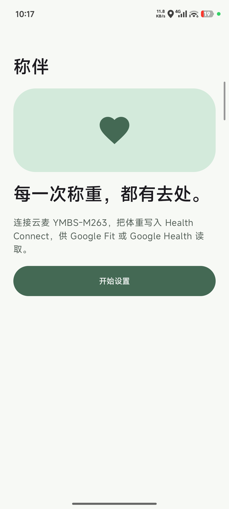
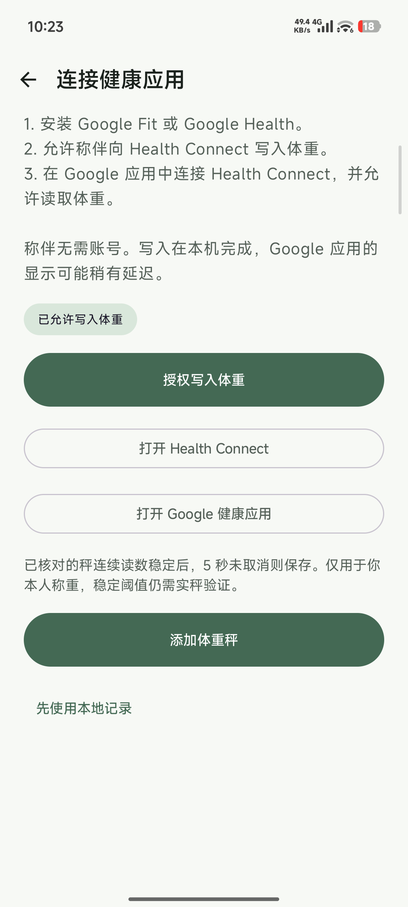
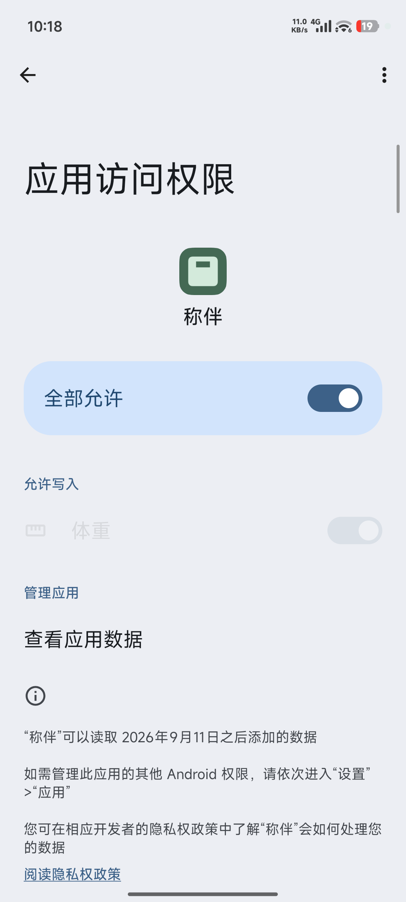
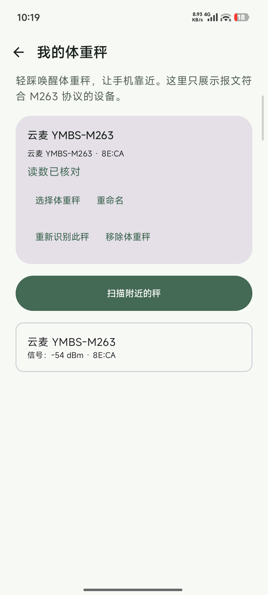
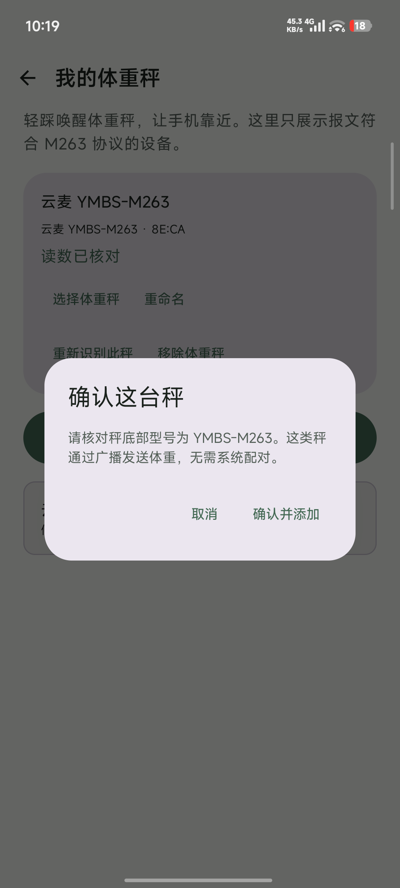
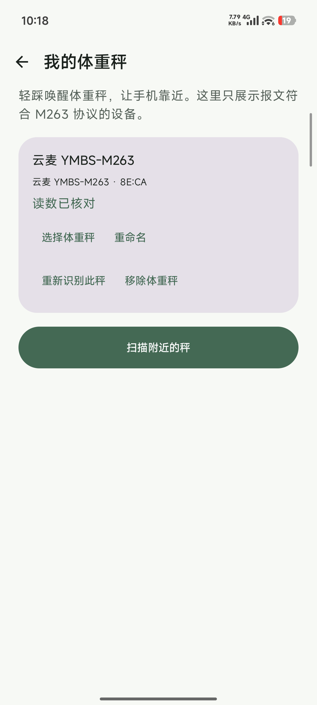
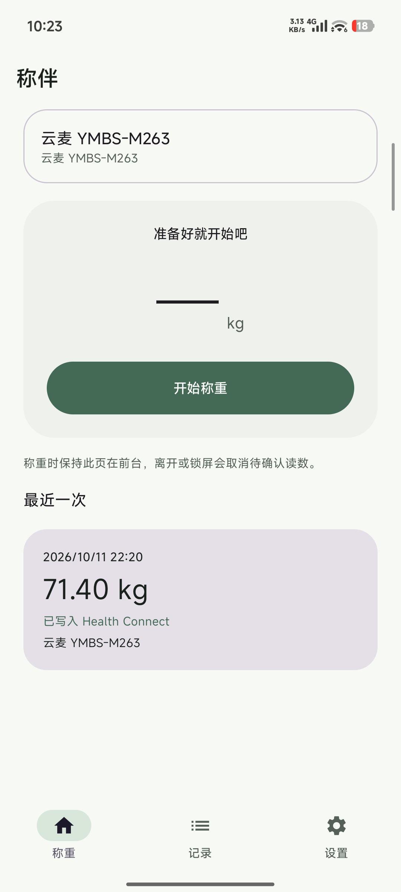
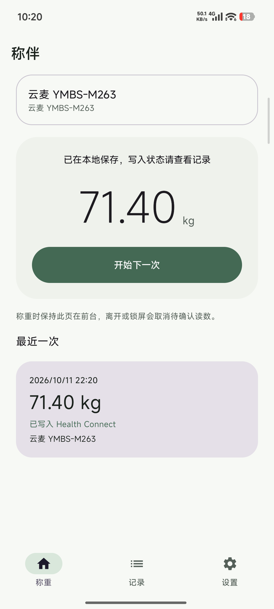
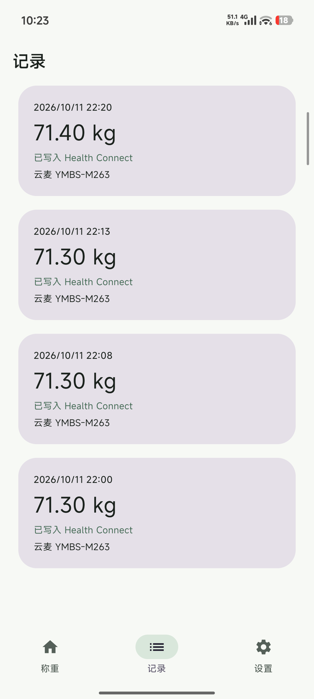
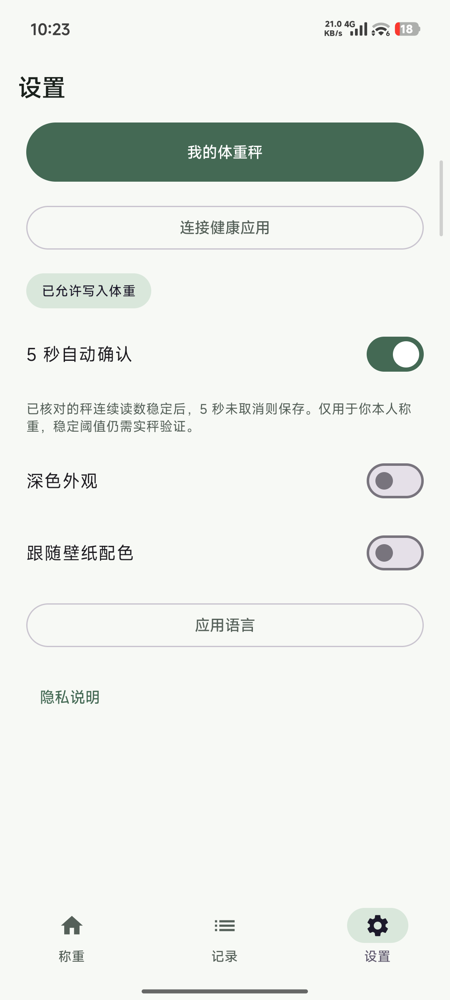

# 称伴 · ScaleMate

### 站上秤，让体重回到你的健康记录里。

喜欢用 Google Fit，却发现家里的体重秤无法同步？称伴为它们搭一座桥。连接体重秤，接收每次测量，把确认后的体重送到你常用的健康应用。

**目前支持云麦 YMBS-M263 · Android 14+ · 中文 / English**

[下载体验版](https://github.com/rccoder/ScaleMate/releases)

## 每天称重，少一步手动记录

打开称伴，站上体重秤，手机随即显示体重。读数稳定后，你可以手动确认；核对过设备后，也可以开启 **5 秒自动保存**。需要重测？倒计时内随时取消。

确认后的体重会先保存在手机，再通过 **Health Connect** 同步，供已授权的 Google Fit／Google Health 读取。每次测量的同步状态，都能在记录里查看；写入失败时，也可以重新尝试。

## 熟悉的秤，顺手的体验

- **连接你的秤**：唤醒设备，扫描发现，核对型号后添加。支持管理多台秤，为它们取个好记的名字。
- **看清这次测量**：大字号实时体重，稳定后再确认，每次保存都由你掌握。
- **留下每次记录**：体重、时间和同步状态集中呈现，方便回看。
- **按你的习惯使用**：Material 3 界面，中英文切换、深色模式与壁纸配色。

称伴无需注册账号。暂时不连接健康应用，也可以先把体重保存在本地。

## 从第一次连接，到每天称重

首次引导带你完成健康授权与设备添加。以下截图来自真实 Android App，称重和记录页面展示实际测量结果。

<table>
  <tr>
    <th>首次进入</th>
    <th>健康同步引导</th>
    <th>Health Connect 权限</th>
  </tr>
  <tr>
    <td></td>
    <td></td>
    <td></td>
  </tr>
  <tr>
    <th>发现附近的秤</th>
    <th>确认型号并添加</th>
    <th>管理已绑定的秤</th>
  </tr>
  <tr>
    <td></td>
    <td></td>
    <td></td>
  </tr>
  <tr>
    <th>称重首页</th>
    <th>保存与同步</th>
    <th>历史记录</th>
  </tr>
  <tr>
    <td></td>
    <td></td>
    <td></td>
  </tr>
</table>

## 三步开始

1. **连接健康应用**：按首次引导授权称伴写入体重，并在 Google 健康应用中开启 Health Connect 的体重读取权限。
2. **添加体重秤**：允许附近设备权限，轻踩唤醒秤，扫描并确认底部型号为 YMBS-M263。无需在系统蓝牙设置里配对。
3. **站上去，确认体重**：保持称伴页面打开，首次核对手机与秤屏幕的读数并保存。之后可开启 5 秒自动确认。

## 从一台秤开始

当前版本专注于 **云麦 YUNMAI YMBS-M263 的体重同步**，真实称重与 Google 健康应用同步流程已完成实测。未来希望连接更多体重秤与健康应用。

现在提供的是 **0.1.0 测试版**，需要 Android 14 或更新版本。称重期间请保持 App 在前台，锁屏或离开页面会取消待确认的读数。Google 健康应用需获得体重读取权限，显示可能稍有延迟。

[下载称伴体验版](https://github.com/rccoder/ScaleMate/releases)

## 致谢

感谢 [openScale](https://github.com/oliexdev/openScale) 项目及其贡献者。项目公开的蓝牙体重秤协议解析实现，为称伴理解设备报文、实现体重读取提供了重要参考。感谢他们让更多体重秤能够与开放的健康生态连接。

---

了解项目：[产品需求](docs/ScaleMate%20产品需求文档（首版）.md) · [开发指南](docs/开发指南.md) · [发布指南](docs/发布指南.md) · [实现与测试记录](docs/实现与测试.md)
