

  

# 称伴 · ScaleMate

### 站上秤，让体重回到你的健康记录里。

喜欢用 Google Fit，却发现家里的体重秤无法同步？称伴为它们搭一座桥。连接体重秤，接收每次测量，把确认后的体重送到你常用的健康应用。

**目前支持云麦智能体脂秤 3 SE · Android 14+ · 中文 / English**

[下载体验版](https://github.com/rccoder/ScaleMate/releases/latest/download/ScaleMate.apk)

## 每天称重，少一步手动记录

打开称伴，站上当前选中的体重秤，APP 会自动接收新一轮测量并显示体重，无需点击“开始称重”。首次添加秤时，完成试称和读数核对，再选择手动保存或 **5 秒自动保存**。日常称重时，读数稳定后按所选方式保存。需要重测？倒计时内随时取消。

确认后的体重会先保存在手机，再通过 **Health Connect** 同步，供已授权的 Google Fit／Google Health 读取。每次测量的同步状态，都能在记录里查看；写入失败时，也可以重新尝试。

## 熟悉的秤，顺手的体验

- **连接你的秤**：唤醒设备，扫描发现，核对型号后添加。首次试称确认读数，再选择保存方式；支持管理多台秤和自定义名称。
- **看清这次测量**：大字号实时体重，稳定后再确认，每次保存都由你掌握。
- **留下每次记录**：体重、时间和同步状态集中呈现，方便回看。
- **按你的习惯使用**：Material 3 界面，中英文切换、深色模式与壁纸配色。

称伴无需注册账号。暂时不连接健康应用，也可以先把体重保存在本地。

## 从第一次连接，到每天称重

以下为 2026-10-17 当前源码构建在 Android 手机上的实际界面，从清空应用数据后的首次使用开始拍摄。先展示首次设置，再展示日常称重与记录。健康连接按步骤说明操作；添加秤后，首次试称、读数核对和保存方式选择一起完成设备设置。截图中的应用名称为“称伴”，试称页面展示实秤读数。已发布安装包的界面可能与当前源码存在差异。

### 第一次设置

<table>
  <tr><th>首次进入</th><th>连接健康应用</th><th>开启健康应用读取</th></tr>
  <tr>
    <td>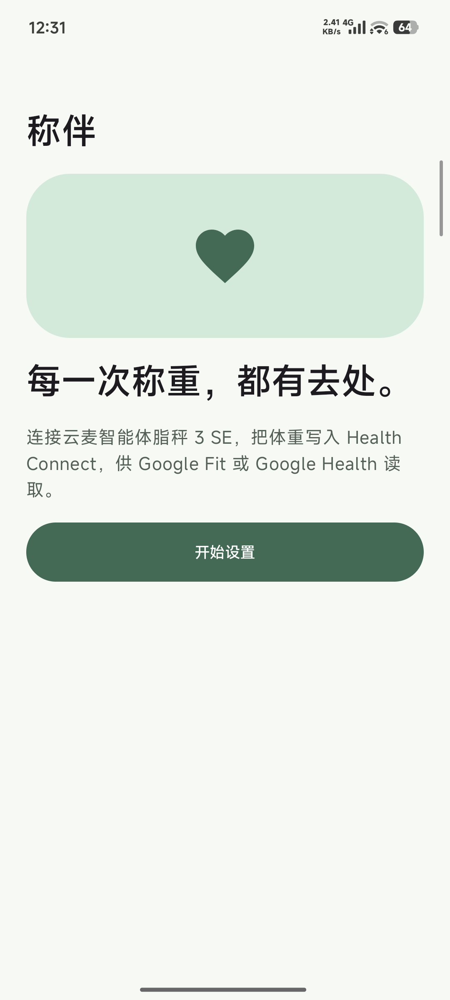</td>
    <td>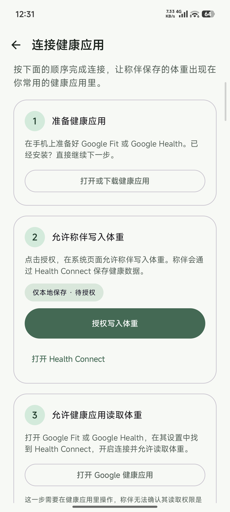</td>
    <td>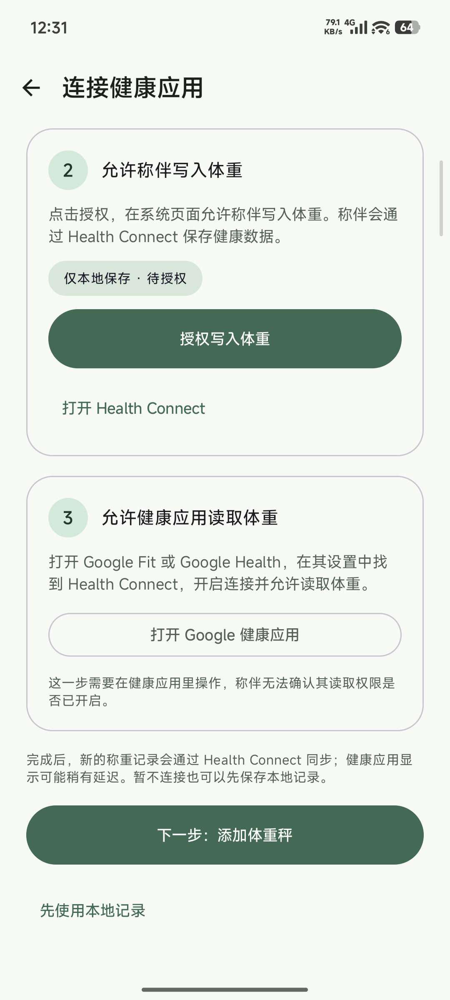</td>
  </tr>
  <tr><th>发现体重秤</th><th>确认型号</th><th>首次试称</th></tr>
  <tr>
    <td>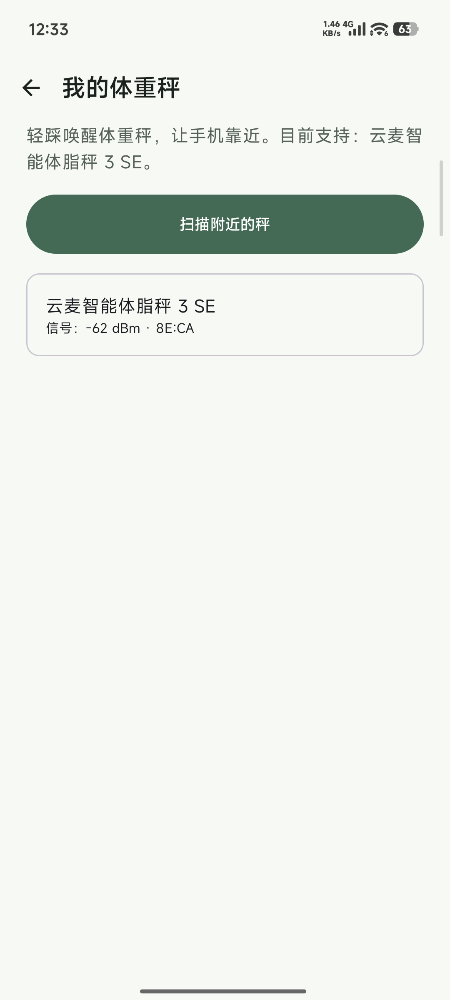</td>
    <td>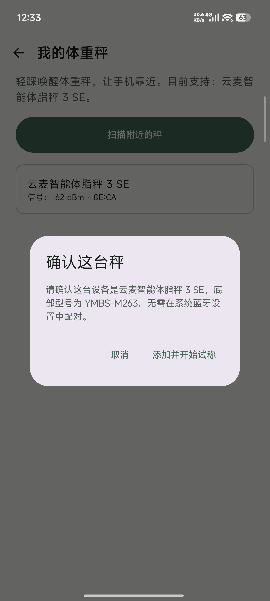</td>
    <td>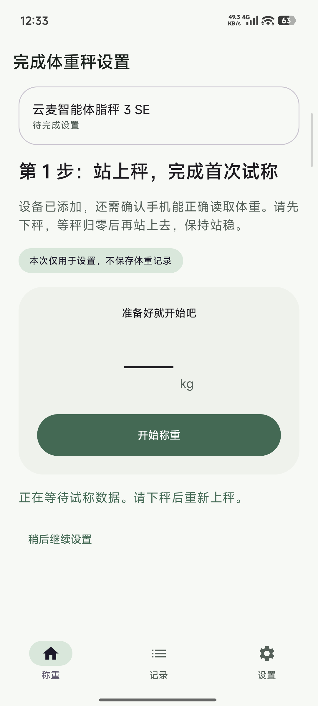</td>
  </tr>
  <tr><th>核对实秤读数</th><th>选择日常保存方式</th><th>设备设置完成</th></tr>
  <tr>
    <td>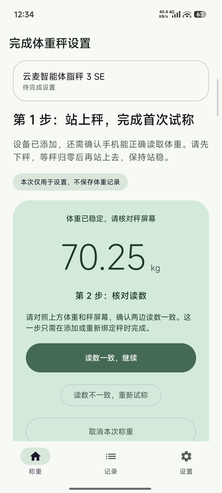</td>
    <td>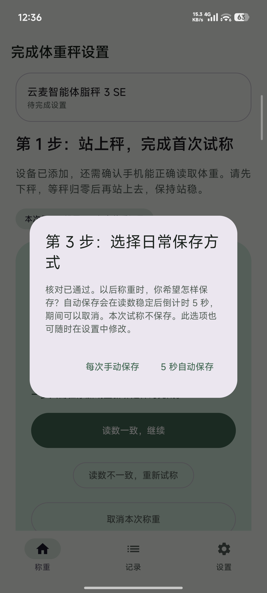</td>
    <td>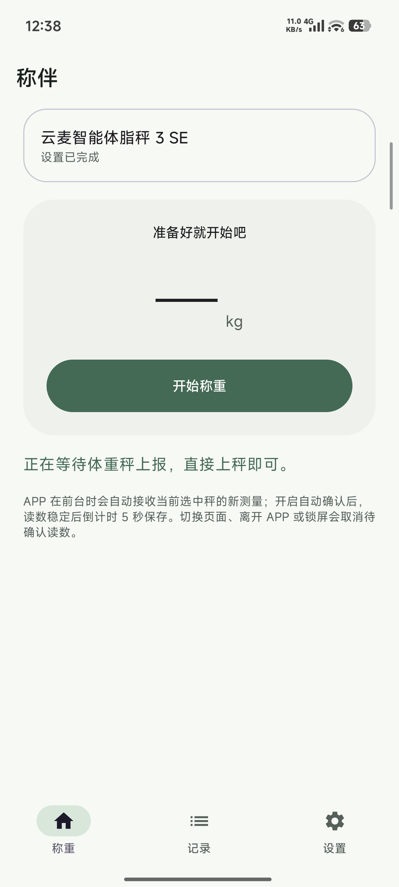</td>
  </tr>
</table>

### 每天称重与查看记录

完成设置后，保持 App 在前台，直接上秤即可自动接收体重。下面展示同一次实秤测量的倒计时、保存结果，以及授权后写入 Health Connect 的记录。保存结果图拍摄于授权之前，因此显示“已本地保存 · 待授权”；后续记录页显示实际写入成功状态。

<table>
  <tr><th>日常称重首页</th><th>稳定后倒计时</th><th>本次已保存</th></tr>
  <tr>
    <td>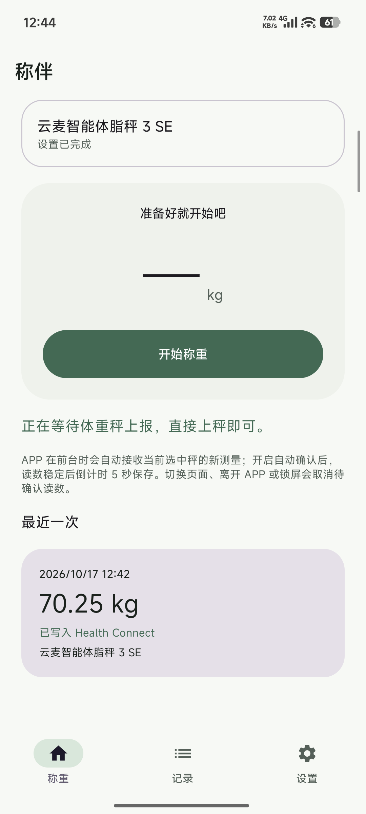</td>
    <td></td>
    <td>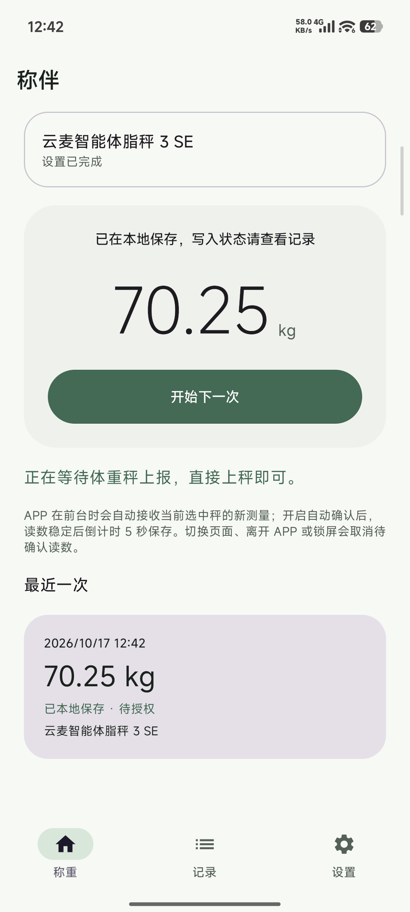</td>
  </tr>
  <tr><th>历史记录与同步状态</th><th>单次称重详情</th><th>设备管理</th></tr>
  <tr>
    <td>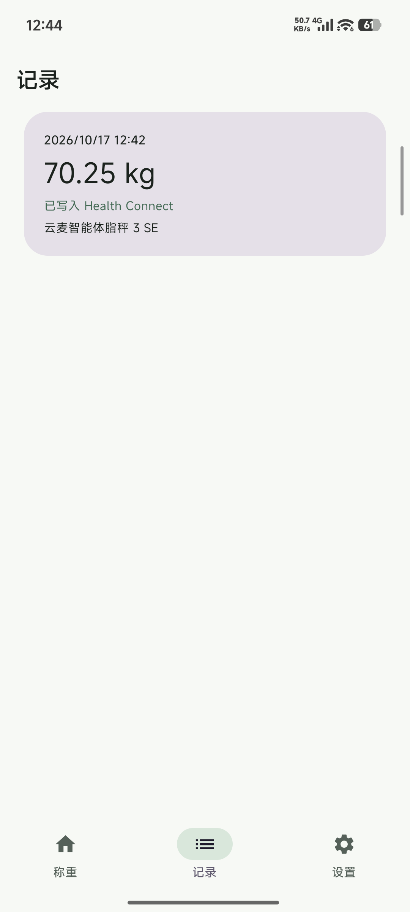</td>
    <td>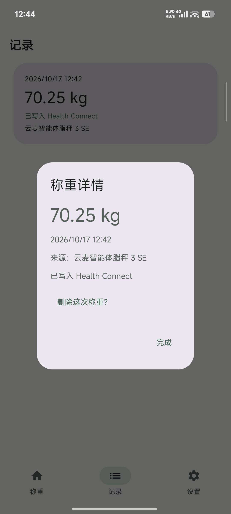</td>
    <td>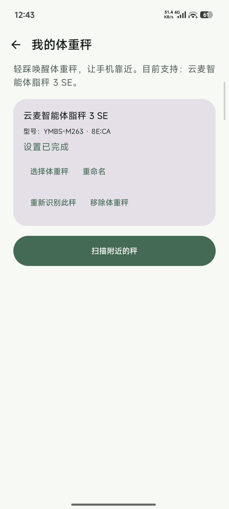</td>
  </tr>
</table>

保存方式和外观可随时在设置中调整：

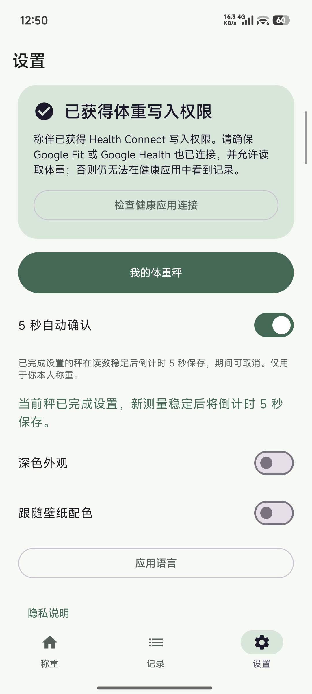

## 从设置到日常称重

1. **连接健康应用**：按页面步骤准备 Google Fit／Google Health，授权称伴写入体重，再到健康应用开启 Health Connect 连接及体重读取权限。暂时不连接也可先使用本地记录。
2. **添加体重秤**：允许附近设备权限，轻踩唤醒秤，扫描并确认底部型号为 YMBS-M263。无需在系统蓝牙设置里配对。
3. **完成首次试称**：下秤，等秤归零后重新站上去。读数稳定时，对照手机与秤屏幕，点击“读数一致，继续”。这次仅用于设置，不保存体重记录。
4. **选择保存方式**：选择“5 秒自动保存”或“每次手动保存”，完成设备设置。以后可在设置中修改；中途退出的设备显示“待完成设置”，可以稍后继续。
5. **开始日常称重**：下秤后开启新一轮测量，保持 App 在前台，直接上秤即可。选择自动保存时，稳定后倒计时 5 秒，期间可取消；完成设置的秤无需每天核对。

重新绑定设备后需要重新试称和核对。保存方式是应用内统一设置，各台秤都需先完成自己的首次设置。

## 从一台秤开始

当前版本专注于 **云麦智能体脂秤 3 SE 的体重同步**，真实称重与 Google 健康应用同步流程已完成实测。未来希望连接更多体重秤与健康应用。

| 产品名称 | 英文界面名称 | 底部／内部型号 |
| --- | --- | --- |
| 云麦智能体脂秤 3 SE | YUNMAI Smart Body Fat Scale 3 SE | `YMBS-M263` |

添加秤时显示好记的产品名称，确认页面同时提供内部型号，方便核对。你仍然可以为每台秤取自己的名字。更多型号会逐步加入这张对照表。

现在提供的是 **体验版**，由 GitHub CI 构建并使用固定发布密钥签名，需要 Android 14 或更新版本。称重期间请保持 App 在前台，锁屏、离开 App 或切换页面会取消待确认的读数；App 在前台时会继续等待下一轮测量。Google 健康应用需获得体重读取权限，显示可能稍有延迟。

[下载称伴体验版](https://github.com/rccoder/ScaleMate/releases/latest/download/ScaleMate.apk) · [版本与更新记录](https://github.com/rccoder/ScaleMate/releases)

## 致谢

感谢 [openScale](https://github.com/oliexdev/openScale) 项目及其贡献者。项目公开的蓝牙体重秤协议解析实现，为称伴理解设备报文、实现体重读取提供了重要参考。感谢他们让更多体重秤能够与开放的健康生态连接。

---

了解项目：[产品需求](docs/ScaleMate%20产品需求文档（首版）.md) · [开发指南](docs/开发指南.md) · [发布指南](docs/发布指南.md) · [实现与测试记录](docs/实现与测试.md)
