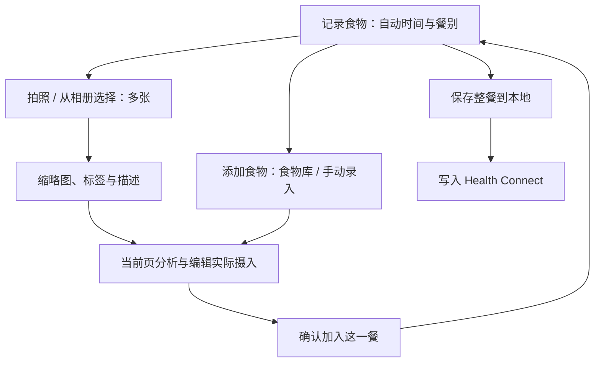

# 称伴食物 AI 记录产品需求文档

> 在现有 ScaleMate Android App 内，把“添加一组餐食照片”变成可校正、可保存、可写入 Health Connect 的饮食记录。首版完成拍照／相册识别、手动补充、确认、日汇总、修改删除和营养同步闭环。配套文档：[总述](10-称伴%20AI%20功能规划总述.md)、[健康 AI 分析 PRD](12-称伴健康%20AI%20分析产品需求文档.md)。日期：2026-10-17；状态：核心功能已实现，具体行为以当前代码为准；实现与验收摘要见 [饮食验收](testing/2026-10-18-01-饮食功能实现与验收.md)。

---

## 目录

- [一、问题与目标](#一问题与目标)
- [二、范围与成功标准](#二范围与成功标准)
- [三、入口与主流程](#三入口与主流程)
- [四、识别与校正规则](#四识别与校正规则)
- [五、记录与 Health Connect 同步](#五记录与-health-connect-同步)
- [六、数据模型与项目接入](#六数据模型与项目接入)
- [七、异常与隐私](#七异常与隐私)
- [八、验收与交付](#八验收与交付)

---

## 一、问题与目标

用户希望用称伴记录“吃了什么、摄入多少”，把饮食与已有体重记录连起来，不必为了写入 Google 健康生态再维护另一个饮食 App。

目标用户是希望管理体重、日常摄入或蛋白质的人。首版服务个人记录，不包含家庭多人账户、临床营养治疗或对特定疾病开具饮食处方。

核心承诺：拍照后给出可解释的营养估算，用户能修正份量、食材和数值，再保存并同步。照片不能可靠测出重量、烹饪油和隐藏配料；不把估算包装成检测结果。

本功能独立于体重秤绑定和健康 AI 分析；无需先有秤、先导入历史或启用教练。

---

## 二、范围与成功标准

### 2.1 功能优先级

| 级别 | 功能 |
| --- | --- |
| P0，首版必须 | 拍照／多张相册图片识别；多食物拆分；可编辑名称、份量、时间、餐别；热量、蛋白质、碳水、脂肪；确认保存；本地历史与今日汇总；NutritionRecord 写入、编辑重试、删除；拍照后标签与自定义描述；统一食物库复用（常吃标记）；离线手动记录 |
| P1，后续增强 | 营养标签识别、条码与食物数据库、餐前餐后对比、常用组合餐、更多营养素、自然语言独立记餐入口 |
| 暂不纳入 | 连续录像、全自动无确认写入、以照片判断过敏安全、自动医疗饮食计划、无用户份量说明的自动推断他人摄入、强制上传照片社区 |

首版采用用户自带 API Key，可配置多个服务；食物拍照／相册识别必须选择已声明支持图片的模型。没有视觉服务时通过“添加食物”使用手动录入与食物库复用，不调用文本模型替代识图。服务设置与切换遵循总述第四章。

### 2.2 可衡量目标

以下是候选验收目标，不是已达到的成绩：

- 常规餐食在识别结果返回后，用户可在一页完成核对和保存；不强制填写非必要营养项。
- 已配置且可用的参考模型：正常网络下识别目标 P95 ≤ 30 秒，45 秒超时可重试或手动录入；实测记录模型、网络和图片大小。
- 经用户确认后，固定样例的数值换算、日汇总和 Health Connect 单位映射全部精确通过；每次重复重试只产生同一餐的一条平台记录。
- 视觉质量用不少于 40 张自有或授权图片评测，覆盖家常混合菜、便当、饮品、单食物及非食物。主要可见食物识别可用率目标 ≥ 85%；失败样本必须可校正。份量不可见时不得仅靠该指标承诺营养误差。
- 有营养标签或称重配方的子集另测热量／宏量误差，记录中位相对误差和严重偏差，不把开放餐食宣称为“误差不超过 X%”。模型和公开准确度承诺在数据评测后定案。

不增加默认远程行为追踪；记录耗时、识别失败和用户修正仅用于本地诊断，远程评测须另有清楚用途和同意。

---

## 三、入口与主流程

### 3.1 页面

本功能集成在以“记录”为首页的称伴中：首次欢迎不要求绑定秤、连接 Google Fit 或配置 AI。记录首页可快捷开始一餐，饮食 Tab 保留完整功能。拍照没有视觉服务时提供配置／手动／常吃三条路径；保存时未授权或平台不可用，先本地成功，再按实际阻碍引导，不丢弃草稿或要求重录。

| 页面 | 主要内容 |
| --- | --- |
| 饮食首页 | 日期、已记录摄入合计、餐次列表、“记录食物”及继续草稿；不放 AI 服务或常吃／历史并列入口 |
| 记录食物弹层 | 与首页按钮同名；覆盖在当前记录／饮食列表上，默认时间与餐别、已确认食物摘要、保存。只有一个突出“添加食物”按钮，点开底部三选一：拍照识别、从相册选择、手动记录 |
| 弹层内照片添加 | 每批最多 6 张圆角缩略图，右上角 × 移除；分食标签与描述。AI 服务放在标题同一行，用小字“由 AI 服务 xxx 提供”，可点选切换；不独占图下方一行 |
| 同页识别与核对 | 明确分析中／中断／完成状态；结果在当前添加页直接修改名称、实际份量与营养，确认后才进入餐食摘要 |
| 食物库 | 全部／常吃筛选、搜索、使用次数与缩略图、手动录入；常吃是标记，不是另一套数据 |
| 餐食详情／记录 | 已保存食物与合计、平台状态、编辑／删除／再吃一次；历史列表不展示图片 |

首页写“已记录摄入”，不默认写“今日实际摄入”。不提供“记录完整”标记；始终按已记录部分展示，不推断少记的餐食为未进食。

### 3.2 主流程

首次使用在线识别前说明图片将发送到当前模型服务，按总述的 AI 服务同意设计执行。申请系统相机权限仅在直接调用相机能力需要时；相册使用系统 Photo Picker，不申请整个相册读取权限。

照片尚未产生结果时，页面返回会终止请求并丢弃本批图片与描述，回到记录食物页，允许立即重新选择手动或其他方式；迟到结果不能悄悄追加。已有分析结果时返回，提示是否放弃本次添加。进程意外中断仍可恢复草稿。已确认加入餐食的其他项目不受本批返回影响。

手动记录从三选一直接进入填写页，并提供“从食物库选择”入口。直接手动取消回记录食物页；从食物库进入手动则回食物库。餐食底部明确标记“本餐总计”，没有食物时不展示空总计卡片。草稿不进入今日正式汇总、不写入 Health Connect。

保存成功必须先反映本地结果；Health Connect 暂不可用时显示“已保存，待授权／待同步”，不要求重新拍照。

---

## 四、识别与校正规则

### 4.1 拍照后补充信息与标签

拍照／选图后先进入补充页，用户可跳过标签直接分析；也可多选标签、填写自定义描述再开始分析，避免先消耗一次请求后才收集份量信息。常用预设支持参数输入：

| 分组 | 预设示例 | 作用范围 |
| --- | --- | --- |
| 分食 | 自己吃、2 人均分、自定义人数 | 照片中共享菜的默认分配；个人主食／饮品可单独覆盖 |
| 食用补充 | 米饭只吃自己那份的一半等 | 作为文字说明交给 AI 分析，不再引入应用自动比例换算 |
| 烹饪补充 | 少油、少酱、不喝汤 | 作为重新估算依据，不直接套固定热量折扣 |
| 指定食物 | 米饭只吃 1/3、去皮等 | 对识别后某食物项生效；未识别前先保留为描述 |

同组互斥值（例如 2 人与 3 人均分）单选，不同组可多选。标签必须能取消、改参数并在结果页回看；自定义内容为本次描述，不强制存入全局标签。自定义常驻标签可后续再做。

**AI 直接负责最终本人摄入。** 下列份量示例是 AI 理解输入的规则，应用不执行这些分摊公式。 照片、人数、标签和补充描述完整提交给 AI，由 AI 理解整份、共享、个人主食、剩余和没吃的成分，直接返回本人实际吃下的克数及营养。应用校验、展示、汇总、保存，不再除人数或乘食用比例。

- “2 人均分、米饭只吃了 1/3”默认按自己分到的那份计算，即整份的 1/6；输入提示与结果页明确说明。只有明确写“整份米饭的 1/3”才按整份的 1/3。此默认规则已由用户确认。
- 采用绝对比例“照片中这碗的 1/3”时覆盖米饭的默认分配；采用相对比例“我分到这份的 1/3”时才在 1/2 上继续乘 1/3。共享菜和个人饭分别设作用范围。
- 输出合同固定为 `calculationMode: personal`、`personalGrams`、`personalNutrients`。仅选择两人均分时默认吃完本人份额；AI 应返回整份的一半，应用原值保存，不再自行换算。旧份值、人数或比例字段不能影响新结果。
- 纯描述如“米饭没吃完”不能强制变成某个比例，列为待确认。新描述与标签冲突时定位到具体食物让用户确认，不自动叠乘两份相同含义。
- 用户可手动修改实际份量与营养；修改克数时按已有营养密度缩放属于用户明确编辑。改变分食、剩余、烹饪或隐藏食材说明后，由用户主动重新分析。重新分析前明确提示会替换本批未确认结果与修改；已确认加入餐食的其他食物不受影响。

### 4.2 识别输出与可编辑结果

每份食物包含名称、建议份量、单位、可选克数、四项营养、信息来源、估算假设及待确认问题。允许“无法识别”或“缺少份量”，不能强制模型填满所有数值。

- 多张图片默认为同一餐的不同菜品或角度；同菜重复角度必须合并，避免重复计入。可返回多个食物；用户可删除误识别项、继续添加遗漏项，纠正“牛肉”误判为“猪肉”。
- 模型直接返回本人实际摄入克数与营养，应用按 4.1 校验并原值展示、汇总和保存，不执行人数或食用比例换算。
- 更改克数时按原有每克估算线性换算，显示沿用原估算；更改食物／烹饪方式时需要重新估算或手动填写，不沿用旧营养密度。
- “碗／份／杯”若没有可靠换算，显示假设重量并让用户确认，不暗中假定每碗一样重。
- 对油、酱料、汤底和隐藏食材给出明确假设；支持用户补一句“少油”“没喝汤”等后重新估算。
- 数值置信度不做未经校准的百分数；用“已知标签／用户输入／AI 估算／份量待确认”等依据说明。
- 只有模型确有合理范围时才显示区间；不凭空生成“±10%”精度。最终写入点估计值在确认页可见。

### 4.3 数值校验

| 规则 | 处理 |
| --- | --- |
| 内部统一 kcal、g；标签可输入 kJ | 显式按 1 kcal = 4.184 kJ 换算；不把 cal 当 kcal |
| 负值、非有限数、字段类型错误 | 拒绝该输出，保留图片和用户已编辑内容，可重试／手动 |
| 缺失值与零 | 缺失存 null，不自动补零；界面显示“未提供” |
| AI 识别路径 | 请求四项营养；缺项时提示补全或明确选择保留缺项 |
| 手动最小记录 | 名称、时间、至少一项有效营养值；缺少其他项可保存，但合计提示不完整 |
| 宏量与热量不一致 | 用 4×蛋白质+4×碳水+9×脂肪作粗校验，显著不符时提示核对；纤维等可导致差异，不强行重写标签值 |
| 份量异常或克数已知时宏量和明显超过食物重量 | 提醒核对，禁止静默写入；合理例外由用户修正数据或说明 |

所有整餐合计在本地按最终已确认的食物项计算，显示层按 kcal 整数、g 一位小数；存储保留计算精度，舍入不逐项累积。

### 4.4 结果展示与逐项编辑

识别、手动与食物库复用都在各自的添加／核对页编辑实际摄入值，确认后才进入这一餐摘要。一餐可以混合多个批次和来源；摘要页不内联修改数值，编辑某项会进入专用核对页，确认后替换原项。

结果逐项展示名称、份量、可选克数、热量、蛋白质、碳水与脂肪及估算说明。数值框均明确为实际摄入，模型与客户端不会重复扣减。未知营养保持 null 并提示不完整，不当作零。

照片在补充、分析及结果核对中保持缩略图；确认后的食物库保留压缩缩略图，历史餐食列表不展示图片。分析结果未确认时不进入整餐合计，整餐未保存时不进入今日合计或 Health Connect。

### 4.5 统一食物库与常吃标记（用户已确认）

- 常吃与历史食物合并为一个食物库，“常吃”只是标记。每次成功保存新餐后自动收录；选择、取消、编辑旧餐不增加次数，同一新餐内同名食物只计一次。
- 同名合并为一条。名称做首尾空白、连续空格、全半角与大小写归一化；不同做法通过不同名称区分。
- 普通条目更新为最近一次确认的份量、营养与照片；常吃条目保留保存的基准，只有主动编辑食物库条目才更新。新餐改份量不覆盖常吃基准，也不改历史。
- 排序：常吃优先；同组使用次数降序，再按最近使用时间降序。
- 保留最近 500 个普通条目，常吃额外保留、不自动删除。取消常吃后纳入普通条目的容量管理。清理食物库不删除已保存餐食。
- 常吃保留缩略图。复用不需要网络、图片模型或 Key；选中后先核对本次摄入，再加入餐食。
- 每次复用生成新项并使用最终确认营养作为新基准，旧分食系数不再应用一次。整餐“再吃一次”使用当前时间、重新推断餐别、生成新 ID，不沿用旧同步状态。
- 旧版本常吃模板和餐食历史迁入统一食物库，迁移只执行一次，不重复累计次数。

---

## 五、记录与 Health Connect 同步

### 5.1 平台映射

首版一餐对应一条 NutritionRecord，食物明细保存在称伴本地；平台记录保存整餐合计，避免按单项加总和整餐再写造成双重摄入。

| 本地字段 | 平台含义 |
| --- | --- |
| 餐食标题／食物摘要 | mealName，界面不承诺目标应用显示每个食物项 |
| 时间、时区 | 用户确认的用餐时段与 zone offset；仅有时点时采用不超过 1 分钟的内部表示规则，确认后保持稳定 |
| 早餐／午餐／晚餐／加餐／未指定 | 对应平台 mealType；时间推断只是默认，可修改 |
| energyKcal | 平台 Energy；当前原生 API 使用 `Energy.fromCalories(kcal * 1000)` |
| proteinG、carbsG、fatG | 对应 Mass.fromGrams；未知不写成 0 |
| mealId、revision | 带业务前缀的 clientRecordId 与递增 clientRecordVersion |
| 记录方式 | 用户确认的手动录入方式，不伪造体重秤设备元数据 |

健康分析从 Health Connect 读取到本应用 NutritionRecord 时，不再把本地同餐加一次；未同步的本地餐食只能以明确去重规则作为补充。

### 5.2 保存、修改与删除

- 与现有称重一致：先本地持久化，再写平台；沿用可重试状态的产品语义，平台结果只表述为“已写入 Health Connect”。
- 正式包首次同步时按需申请 WRITE_NUTRITION；拒绝后继续本地记餐。仅记饮食不请求其他健康读取权限。
- 重试沿用 mealId、用餐时间和 revision。编辑递增 revision；异步返回旧版本时不得把新版本标为已同步。
- 用户修改餐食后本地立即生效，平台未更新时标识“修改待同步”。删除和更新以单餐互斥方式串行执行。
- 删除可选“仅本地”或“本地及称伴写入的平台记录”。后者先保存删除任务，平台确认成功后清理；失败可重试。只删除本应用记录。
- 平台未写入的本地餐食删除后取消待写任务；即使存在在途写入，也要以删除墓碑最终清理，不能在重启后恢复已删除餐食。
- 重装或本地清空不能保证找回食物项和图片；后续可读取平台整餐数据，但不得假称能完整恢复本地明细。
- 本地写入不依赖网络；目标 Google 应用展示可能延迟，其已导入副本不保证随平台删除而消失。

有限退避自动重试与手动重试分开计数，权限错误不循环弹窗。食物模块的任务不沿用体重记录类型的硬编码扫描。

---

## 六、数据模型与项目接入

### 6.1 建议实体

| 实体 | 关键字段 |
| --- | --- |
| Meal | id、revision、timeStart/timeEnd、zoneId/offset、mealType、title、totals、status、platformId、attempts、deletedAt |
| FoodItem | id、name、实际份量／克数／营养、source、assumptions、eatingAdvice、nextTimeAdvice、positiveFeedback、estimateContext（输入、解释、AI 原始本人摄入快照）、libraryId；旧 factor 字段兼容历史数据，新 AI 结果固定 factor=1 |
| MealDraft | id、图片私有引用、标签／参数／作用范围、additionalText、歧义确认状态、serviceId/configVersion、识别状态、已编辑内容、createdAt、expiresAt |
| FoodLibraryEntry | id、唯一归一化名称、实际份量与营养快照、photos、favorite、useCount、lastUsed |
| FoodBatch | id、kind、photos、description、tags、shareCount、results、status、editingItemId；结果确认后才提交到 MealDraft |
| NutritionSyncTask | mealId、targetRevision、operation、state、nextAttemptAt、lastError |

草稿保留私有原图（去除 EXIF），最多 24 小时；食物库只保留压缩缩略图，用于再次选择和常吃展示。原图不随正式餐食长期保留；无食物库或草稿引用的文件按清理策略回收。

### 6.2 当前项目改动清单

| 位置 | 计划改动 |
| --- | --- |
| `ScaleMateApp.kt` | 新饮食入口；拆分 FoodScreen、MealEditor、MealDetail 等组件；记录页增加分类 |
| 新 `FoodViewModel`、`FoodRepository` | 草稿、识别任务、校正、保存及独立同步状态 |
| `data/Store.kt` 及新业务 Store | 按实际发布顺序递增版本，显式建新表和索引；不删除原 scales／measurements |
| 新 `platform/NutritionOutput` | 原生 HealthConnectManager 写入／更新／删除，复用现有回调与协程模式 |
| `MainActivity.kt`、Manifest | 按需申请营养写权限与所选拍照方案权限，新增网络权限；不再以 WRITE_WEIGHT 代表营养权限 |
| 新 AI 适配层 | 视觉服务选择、标签与文本补充、原份营养和份量解释的结构化输出；共享多服务配置与能力路由 |
| `PrivacyActivity.kt`、strings 资源 | 图片用途、模型接收方、本地保留、中英文提示和写入状态 |

数据库迁移策略需与健康 PRD 统筹：若两个功能同版发布，可一次升级；分版发布必须有连续版本迁移，不能两边都独占“版本 2”。

称重候选在启动相机／离开前台时按现有规则取消，返回后恢复现有等待称重行为；不得为了拍照绕过称重稳定和确认机制。

---

## 七、异常与隐私

| 异常 | 用户结果 |
| --- | --- |
| 无视觉服务／服务余额不足 | 保留草稿，提供手动输入／常吃食物及服务设置；不向纯文本模型发送照片，不静默切换服务 |
| 非食物／图片模糊／份量不明 | 说明原因并请求必要补充，不编造数值 |
| 上传失败／超时／用户取消 | 终止任务，不写入；重试不新建第二餐 |
| 相机中断／进程被杀 | 恢复可用草稿或明确说明未保存；不后台自动提交 |
| 平台权限撤销／不可用 | 本地保存并标待授权；其他功能继续可用 |
| AI 返回越界字段或夹带指令 | 只解析约定食物字段；模型文字不作为执行命令 |

图片仅发送食物识别必要内容，压缩并去除 EXIF 位置信息；提示用户尽量避免拍入人脸、票据和个人信息。餐食照片、模型凭据及完整响应不进普通日志。服务端与供应商的保留／训练政策不能由客户端凭空保证；实际接入时披露并选择符合用途的服务。

识别“花生”等不能作为无过敏原保证；首版不提供药物、疾病或特殊人群的自动营养处方。

---

## 八、验收与交付

### 8.1 验收用例

1. 从 0.1.1 升级后原有称重功能、设备、记录和设置保留；无须绑定秤即可进入饮食。
2. 一图多食物可增删改，半份和克数换算正确；未知营养不当作零，食物变更不套用旧营养密度。
3. 500 kcal、蛋白质 30 g、碳水 50 g、脂肪 20 g 的合成餐写入平台单位正确，目标 Google 应用实机可读；其界面显示差异记录到兼容说明。
4. 同餐重试、断网、进程退出、先编辑后旧请求返回、写入中删除，不产生重复或复活记录。
5. 修改后递增版本，删除只影响本应用该餐；删除失败保留追踪和重试入口。
6. 拒绝相机、模型发送或营养写入权限，分别可走相册／手动／仅本地路径。
7. 今日合计只计正式未删除餐食；跨日与时区一致；仅分析已记录部分，不据此判断饮食达标或饥饿，也不增加完整性标记。
8. 取消识别不计餐、不写健康数据；服务失败可重试且不覆盖用户已经修改的字段。
9. 中英文、大字体、深色模式、网络慢及无障碍读屏均可完成确认保存。

10. “2 人均分＋米饭 1/3”默认得到整份 1/6，明确“整份的 1/3”时得到整份 1/3；共享菜不误用米饭比例，模型与本地不重复扣减。
11. 标签互斥与自定义描述冲突可定位解决，取消或改份量只本地计算；更改烹饪说明重新分析前提示替换本批修改，不影响已确认批次。
12. 食物库复用无需网络／Key 即可再次添加；新时间、新 ID、无旧同步状态，历史和常吃基准不被新餐修改。
13. 水煮牛肉等逐项展示 kcal 和实吃份量，展开可编辑宏量；混合多个来源后整餐合计正确，添加行为不提前写入平台。
14. 服务 A 无视觉、B 有视觉时，图片识别只能选 B；声明与实际不符保留草稿，用户可切换，不暗中将照片发给其他服务。

### 8.2 交付包与开放决策

交付包括正式 `app/` 内功能、数据库迁移、合成样本、营养单位与并发同步测试、模型图片评测记录和正式包实机验证。测试工具 APK 不作为交付替代品。

AI 接入已确定为首版 BYOK、多服务和按能力路由，不再保留官方额度作为本功能的发布阻塞项。标签命名、默认选项和视觉服务兼容名单按本文方案评审与验证；不把产品建议误标为用户已逐项确认。

参考：[NutritionRecord](https://developer.android.google.cn/reference/android/health/connect/datatypes/NutritionRecord)、[Health Connect 写入与记录版本](https://developer.android.com/health-and-fitness/health-connect/write-data)、[Google Fit 连接说明](https://support.google.com/fit/answer/12830119?hl=en)。平台支持不等于任意 Google 应用版本显示全部字段，必须以正式包实测为准。

本轮补充验收：多图重复角度合并、缩略图全过程、当前页确认、取消／迟到／重复点击不追加、重启中断恢复、食物库常吃排序、同名合并与计数、500 普通条目边界、常吃基准保护；验证记录见 `docs/testing/2026-10-18-01-饮食功能实现与验收.md`。

本轮视觉与导航补充：卡片使用 22dp 圆角，食物图片与追加块使用 12dp 圆角；拍照取消若没有导入图片，不留下空批次；原生相册取消也不创建批次。

## 2026-10-18 操作层级调整

- 添加方式弹层的容器、标题区和各选项行使用相同主题底色；图片追加的两选一弹层沿用同一组件。
- 照片缩略图序列末尾放同等尺寸的大“＋”块，打开拍照识别／相册选择两选一，不在图片下方重复显示两个按钮；达到 6 张上限后不再显示追加块。
- 分析结果卡右上角放收藏星标，实心表示已存为常吃，空心表示未存，保留无障碍说明。常吃基准和计数规则不变。
- 高频操作“编辑营养”与“移除食物”并列置于卡片内；营养包括热量、蛋白质、碳水和脂肪，仍可修改名称与份量。支持移除最后一个待添加食物，并返回记录食物页；修改已有项时移除作用于当前餐食草稿，保存后才影响正式记录。
- “修改说明并重新分析”先说明新结果会替换本批未确认结果，然后进入标签和补充说明编辑；用户主动开始分析后才发请求，不声称可以编辑模型的完整系统提示词。
- 手动记录页顶部提供显著整行“从食物库选择”入口，含图标、说明和箭头；其下用“或手动填写以下信息”明确区分两种录入方式。

确认结果与记录食物页面共用同一食物卡片组件与视觉层级，包括收藏星标、编辑营养主操作、移除次操作；不同页面仅绑定各自的编辑／移除回调，既有确认与保存时机保持不变。

## 分析语言与图片细节

分析开始时通过 Android LocaleManager 读取系统语言及应用语言覆盖，选择 BCP 47 语言代码并固定到本次请求。应用跟随系统时使用系统语言；显式设置应用语言时使用该语言。名称、份量文字与估算说明必须采用指定语言，不从用户描述、标签或图片文字猜测语言，也不受其中要求切换语言的文字影响。JSON 字段、枚举、单位和数值换算不变。只作用于新分析，不自动翻译或改名已有餐食与食物库。

缩略图及图片追加块圆角收敛为 12dp，避免小图过圆；食物卡片仍为 22dp。移除控件使用视觉尺寸 24dp 的半透明深色圆钮、14dp 白色 ×，向图片内侧收进，外层保留独立点击区域，不再贴边使用大白色按钮。

### 食物卡片的估算依据与食用建议

核对分析结果与记录食物两处共用卡片。操作按钮下分别显示「AI 估算依据」和「食用建议」，使用低强调度标题与正文，不增加嵌套卡片。估算依据解释份量、做法假设和不确定性。

AI 独立返回 `assumptions`、`eatingAdvice`（本次怎么吃）、`nextTimeAdvice`（下次怎么选）、`positiveFeedback`（有依据的正向反馈）。本次与下次建议分别最多一两句，前面显示轻量的“本次／下次”文字标签；任一为空就隐藏该项。两项建议均为空时，可单独显示一句有依据的正向反馈，不带本次／下次标签。所有内容均为空时隐藏整个食用建议区。

优先给具体可执行建议：本次尊重已经决定吃这份食物，考虑实际个人份量及少酱、不喝汤等已说明行为，避免重复提醒；下次可以讨论是否适合经常选择、做法轮换、份量与搭配，尽量提供可行替代，不武断规定频率或否定本餐。正向反馈只针对实际搭配或明确行为，不推断整体饮食健康、不虚构习惯、不机械追加鼓励。

不推断疾病、过敏或减重目标，不给依赖精确营养数字的建议；没有可靠内容则返回空字符串。所有文本遵循指定的系统／应用语言。建议随草稿、餐食及食物库快照保存，复用时沿用但不声称重新分析；旧数据缺少建议时正常显示，不额外调用 AI 补写。

### 整餐建议与记录详情的展示

整餐食用建议顶部展示当前食物合计的能量、蛋白质、碳水和脂肪：能量突出，三项宏量营养并排展示，并保留分析耗时及服务返回的 Token 信息。分析核对页按本批结果合计，已确认的餐食草稿和历史详情按当前整餐食物合计；修改份量、营养或移除食物后重新汇总，不在 AI 建议正文中固化可能过时的数字。缺项显示未提供，不按零计算，也不额外调用模型补算。

建议使用低饱和背景、清楚的留白与正文层级，避免把大段文字都放在深色卡片中。Prompt 在整餐整体评价中结合本人摄入，说明主要能量来源和蛋白质、碳水、脂肪的搭配；不给缺乏个人目标依据的热量高低评判，不重复逐项数值。数值摘要由应用保证可见，即使模型未返回建议也不丢失营养合计。

已保存餐食从记录或饮食列表点击后，直接覆盖在当前页面上，以固定高度、内容可滚动的底部详情面板展示，不切换到饮食 Tab，也不先半展开再伸展。面板出现即保持稳定位置，内部滚动不改变其高度或底下的 Tab；关闭仍返回原列表，只有主动修改／再吃一次才打开餐食编辑弹层。顶部固定餐食详情、时间餐别和关闭入口，内容依次为餐食名称、整餐营养与建议、实际同步状态、可展开的单项食物明细；底部保留修改与再吃一次主操作。删除作为独立的次操作，另弹确认，保留仅删本地／同时删 Health Connect 的区别；不在阅读详情时直接删除。编辑、再吃一次仍沿用已有草稿冲突提示，不覆盖用户草稿。

饮食 Tab 始终进入饮食首页，不因有草稿而强制打开编辑。记录页和饮食页点击“记录食物”时，若存在有内容草稿，先选择“继续未完成的餐食”或“清空草稿，重新开始”；继续才恢复相应照片／核对／餐食编辑步骤，重新开始则创建新餐、清空上一餐的照片、说明、结果、建议和时间餐别，不继承旧草稿。空草稿直接开始新餐，不多问一次。饮食首页保留显式继续草稿入口；同一餐的照片追加、食物添加不触发新餐清空。

记录食物、添加照片、分析核对、手动录入和食物库选择放在同一个固定底部弹层中，原列表与 Tab 保持不动；弹层标题随步骤更新，使用标题栏返回箭头和关闭按钮，移除正文中的文字返回。箭头返回上一步，已有分析结果被放弃前仍需确认；关闭则保留有内容草稿，空草稿不保留。确认保存成功后关闭弹层，原列表立即显示本地结果，不额外跳到饮食 Tab。悬浮绿色对号、结果提示和滚动到底部提示保留在弹层内，不显示在底下的首页或其他子页面。录入弹层打开时暂停秤广播接收，关闭后按原页面和前台状态恢复。

餐食详情背景覆盖到屏幕底部，只有内部文字与按钮避开系统导航／手势安全区域，不在弹层下方留下露出原页面的空条。可点击食物标题的水波纹按圆角裁剪，与卡片形状协调。

### 估算依据与本人摄入（最新方案）

每份食物保留分析时的分食人数、标签、补充原文以及 AI 的理解。AI 输出一句 `intakeSummary` 作为默认摘要，完整说明在“查看估算详情”展开：①你提供的信息；②AI 如何理解；③本次记录的摄入（AI 返回的本人克数与营养快照）。关键歧义由 `contextWarning` 保持默认可见，食用建议独立展示。展开／收起使用标准上下箭头图标。

AI 负责全部食用语义和分配：单独吃、多人均分、个人碗／饮料、剩余比例、没吃蘸料／汤等。仅选两人均分默认吃完本人份额，不能擅自再计半份；不同食物的个人说明优先于整餐默认人数。少酱、不喝汤调整对应成分，不给全餐统一打折。应用不根据人数或比例二次处理 AI 输出，仅验证字段、有效数值与图片关联并汇总保存。

合同固定 `calculationMode: personal`，每项返回 `personalNutrients`、可空 `personalGrams`、`personalPortion`、`intakeSummary`、`contextInterpretation`、`contextWarning` 及依据与建议字段。不接受旧 whole-only 合同；夹带旧人数／食用比例也不会改变本人营养。用户手动编辑后以当前值为准，AI 快照保留在详情中。旧记录原值兼容、旧详情保留；旧待确认结果提示重新分析，不自动改动历史记录。

### AI 服务的模型选择与复制

新增／编辑服务保留模型 ID 输入框，并提供可选“获取模型列表”。使用当前格式、地址与已填写或加密保存的密钥查询；结果可搜索并选择，选择只填入模型 ID，不推断图片能力。接口不支持、空列表、查询失败均允许手动输入；关闭查询保留编辑内容，不要求先保存服务。模型列表支持分页与数量限制，不跟随重定向。

已有服务行右侧提供“复制”，打开带副本名称的新建表单，沿用地址、格式、模型、图片能力和密钥。密钥在本机按新服务 ID 重新加密，不回显明文；保存才创建记录，取消不产生副本。副本独立修改与删除，不影响原服务或默认图片／文本模型；授权确认状态重新开始。

接口参考：[OpenAI Models](https://developers.openai.com/api/reference/python/resources/models)、[Anthropic List Models](https://platform.claude.com/docs/en/api/models/list)。
