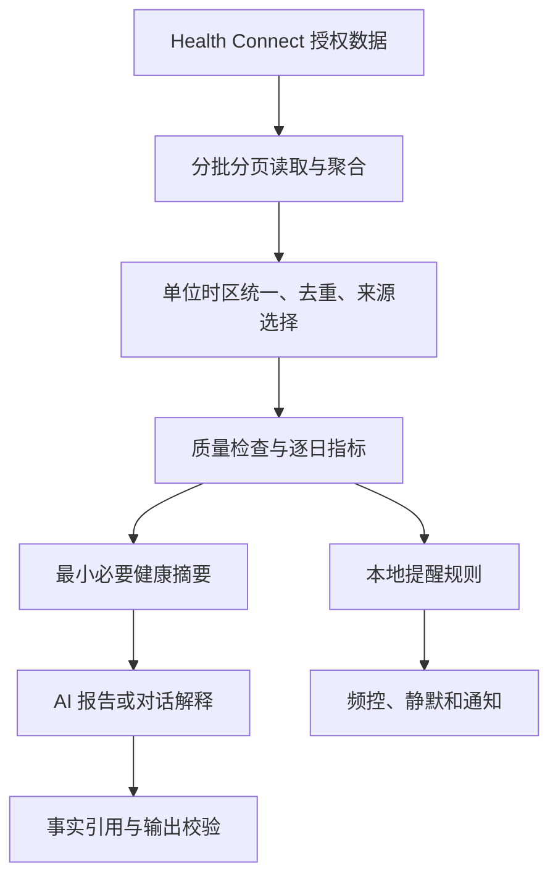

# 称伴健康 AI 分析产品需求文档

> 在现有 ScaleMate Android App 内，以 Health Connect 实际读取到的各类健康数据为统一输入，提供综合健康分析、日常对话和主动提醒。首版必须包含对话和提醒，报告是解释依据而非唯一交付。配套文档：[总述](10-称伴%20AI%20功能规划总述.md)、[食物 AI 记录 PRD](11-称伴食物%20AI%20记录产品需求文档.md)。初稿：2026-10-17；确认修订：2026-10-18；状态：主体代码已接入但当前产品默认关闭，2026-10-25 用户决定暂不开放；`BuildConfig.HEALTH_AI_ENABLED=false` 时不显示分析、对话、导出和提醒入口，也不注册提醒任务。重新开启前须再次确认范围并完成实机／真实 AI 验收；本需求及 [保留的设计原型](../design/ai-prototype/README.md)不代表当前正式功能。

---

## 目录

- [一、目标与产品边界](#一目标与产品边界)
- [二、首版范围与数据输入](#二首版范围与数据输入)
- [三、首次使用与页面](#三首次使用与页面)
- [四、数据处理与分析规则](#四数据处理与分析规则)
- [五、报告与日常对话](#五报告与日常对话)
- [六、主动提醒](#六主动提醒)
- [七、数据模型与当前项目接入](#七数据模型与当前项目接入)
- [八、隐私与异常](#八隐私与异常)
- [九、验收与交付](#九验收与交付)

---

## 一、目标与产品边界

### 1.1 用户价值

用户不只想看指标，还想知道“最近睡得怎样”“今天适合怎么安排”“为什么这几天觉得累”，并能继续追问、得到适合自己的下一步建议。

称伴提供三层体验：**看懂数据、随时提问、在值得关注时主动提醒**。不用购买称伴会员；首版由用户配置 API Key，自由选择文本服务，第三方调用费用由用户承担；无需配置 Key 也能导出数据与 Prompt 给其他 AI，不能把 API 费用隐藏成无限免费承诺。

首版面向成年人一般健康和运动生活管理，不做疾病诊断、药物调整、临床监护、急救报警或高强度训练处方。没有年龄信息时不套用成人目标，先解释适用条件；未成年人和特殊健康情况采用通用信息并建议专业指导。

### 1.2 已验证基础与限制

已从真实手机通过原生 Health Connect API 读到睡眠阶段、心率采样、RMSSD HRV、运动和步数；本地统计可以处理阶段覆盖、时间序列和逐晚摘要。测试中也出现历史缺失和午睡，已证明不能按记录条数直接当作天数或把午睡混入夜间平均。

上述读取来自早期独立验证，不代表当前正式 App 已有读取能力。本次接入前的发布基线为 0.3.0（versionCode 7）、SQLite v4，仅有体重／营养写入权限和饮食 AI 服务。当前工作区已增量升级 SQLite v5，并增加分类读取、历史／后台读取和通知的权限声明；独立健康模块复用原服务配置，实现读取、统计、报告／对话、导出和本地规则提醒。权限声明及本地模拟测试不代表真实手机已授权或端到端验收通过。

本功能不读取 Google Health／Google Fit 页面，不依赖抓屏，不获取 Google 账号密码；也不承诺读取其云端全部数据或全部历史。Google Health 与 Health Connect 通过授权共享数据，页面可见不等于接口可读。所有数据结论以 Health Connect 已共享、已授权且实际读取到的数据为依据，来源也可包含其他已连接的应用，不只筛选 Google 应用写入的记录。[Google Health 与 Health Connect 说明](https://support.google.com/googlehealth/answer/14506680?hl=en-GB)

### 1.3 用户已确认的实现约定（2026-10-18）

| 项目 | 已确认要求 |
| --- | --- |
| 分析对象 | 综合分析所选时间范围内全部已授权、实际可读的健康数据类别，不再以原先七类数据为首版上限 |
| 统一数据来源 | 只分析 Health Connect 读取结果及其本地缓存；称伴本地尚未同步的饮食、体重和草稿不补入分析或导出。称伴记录成功写入平台后，再通过同一读取入口参与 |
| 权限 | 现有写入权限不能代替读取权限。读取授权集中在“设置 → 健康数据与授权”，只分两层：①选择需要分析的数据类别并授权；②可选的更早历史。后台读取和通知只在用户开启主动提醒后作为条件权限申请。向 AI 发送健康数据另行说明和同意，不沿用食物图片用途的同意 |
| 默认时间 | 最近 7 天，并读取此前 21 天作为可用的个人基线；基线不足如实说明 |
| 范围选择 | 首版支持 7 天、28 天、90 天、自定义和全部可读取历史；较长范围分段汇总。类别与时间独立选择，默认 7 天不缩减数据类别 |
| 主动提醒 | 首版用户主动开启，本地规则发现值得关注的变化后提醒；点开查看依据并可请求 AI 解释。不在后台自动调用付费模型或发送健康摘要 |
| 后续能力 | 定时 AI 综合分析是后续可选能力，单独开启并说明数据发送与费用，不属于本次首版交付 |

本节取代旧稿对七类数据和直接读取本地餐食的限制／建议；下文具体质量阈值、检查时间和保留期若仍标为草案，不因本次确认自动成为已确认参数。目标、问题和用户主动补充的感受仍可作为明确标记的用户自报上下文，不作为设备测量数据。

---

## 二、首版范围与数据输入

### 2.1 功能范围

| 级别 | 范围 |
| --- | --- |
| P0，首版必须 | 各类可读数据接入与按类别授权；数据来源与完整度；今日概览；默认 7 天综合分析与可用基线；28／90 天、自定义及全部可读取历史的分段分析；日常多轮对话与预设问询；JSON 与配套 Prompt 导出；个人目标；本地规则主动提醒及关闭／反馈；分析历史；数据与会话删除 |
| P0，缺失降级 | 任意类别无记录或未授权时按实际可用数据分析，不补零、不以称伴本地未同步记录补缺，不阻断基础对话 |
| P1 | 计划执行追踪、用户确认的长期偏好记忆、可选定时 AI 综合分析 |
| 暂不纳入 | 医疗诊断与风险评分、自动改写外部健康记录、后台无限轮 Agent、实时异常心率报警、默认上传全量原始数据 |

### 2.2 数据覆盖与分类读取权限

首版目标是覆盖设备当前 Health Connect 提供、用户选择授权且能实际读取的全部健康数据类型。以下七项保留既有统计设计，作为常见类型示例，不构成白名单或完整清单：

| 数据 | 读取内容 | 用途与缺失处理 |
| --- | --- | --- |
| SleepSessionRecord | 起止、阶段区间 | 夜间／午睡、睡眠时长、作息；无分期只报告会话时段，不称作实际睡眠 |
| HeartRateRecord | 样本时间与 bpm | 睡眠心率、分时趋势、运动时段关联；不把全天均值当静息心率 |
| HeartRateVariabilityRmssdRecord | 时间、RMSSD ms | 同来源、同指标个人趋势；缺失时不推断恢复差 |
| ExerciseSessionRecord | 类型、起止、可用分段 | 运动频率和时段；未知类型不编造成跑步或力量训练 |
| StepsRecord | 平台日聚合与覆盖范围 | 活动趋势；记录数不等于步数 |
| WeightRecord | 时间、kg、来源 | 体重趋势，尊重用户的主来源选择 |
| NutritionRecord | 热量、宏量、时间、来源 | 已记录摄入及与其他数据的关联，不等于完整实际摄入 |

其他类别同样按实际可用能力接入，包括活动距离／消耗／速度等、身体测量、饮水及其他营养字段、静息心率／血氧／呼吸／体温／血压／血糖等生命体征，以及平台可提供的身心健康、生理周期、运动路线和医疗记录。缺少记录不阻断其他类别，不能仅因没有出现在旧表中就忽略已授权数据。

实现时维护数据类型清单及对应读取适配、权限、系统可用性、单位、汇总和导出规则；新增／特殊类型须检测实际 API 能力，医疗记录、路线等按各自读取和授权机制处理，不假定同一个通用接口能读取所有字段。尚未适配的类型明确标注“暂未支持”，属于覆盖缺口，不能宣称已经全量接入。验收逐项核对实际覆盖。

读取授权入口统一放在“设置 → 健康数据与授权”，不在健康首页和数据页重复一套复选框。页面只呈现两个层级：**分析所需的数据**（选择常用类别或更多类别，再进入系统授权）及**可选权限**（更早历史）。选择常用类别不强制全选，用户可以拒绝／撤销任一类别，按实际权限降级。运动路线若存在待确认记录，保留逐条路线同意的条件区块；后台读取与通知只在健康 → 主动提醒开启后出现，未开启时不打扰用户。READ_SLEEP、READ_HEART_RATE、READ_EXERCISE、READ_STEPS、READ_HEART_RATE_VARIABILITY、READ_WEIGHT、READ_NUTRITION 等只是对应常见类别的示例，不能只申请这七项便称覆盖全部数据。

现有 WRITE_WEIGHT／WRITE_NUTRITION 仅用于保存同步，不代表已经允许读取同类数据。新增读取授权与原有写入状态分别显示；只使用称重／饮食记录的用户不因健康分析规划被要求增加读取权限。医疗记录、路线等类别单独解释字段与用途，由用户明确选择后申请相应权限，不因选择普通活动主题而顺带申请。

需要更早历史时才说明并请求 READ_HEALTH_DATA_HISTORY；后台提醒需要时再申请 READ_HEALTH_DATA_IN_BACKGROUND，先检查系统／组件是否支持。不把二者视为基础读取权限已包含。通知在用户开启提醒时请求 POST_NOTIFICATIONS。

---

## 三、首次使用与页面

### 3.1 首次流程

健康页 → 说明 Health Connect 数据来源与 AI 用途 → 进入设置 → 健康数据与授权 → 选择分析类别并请求系统读取权限 → 可选申请更早历史 → 返回健康页刷新并展示范围、来源和质量 → 选择时间范围 → 配置／选择 AI 服务 → 独立确认健康摘要的接收服务和用途 → 用户请求生成首次分析并进入对话。读取完成后，无 Key 或不同意向 AI 发送时仍可查看本地指标、导出平台读取结果和使用本地规则提醒。后台读取与通知不在首次授权中询问。

可选个人背景：年龄或年龄段、睡眠目标、关注目标（作息／活动／体重／饮食）、工作作息、自报限制。缺失时少做判断，不强制收集姓名、生日、性别和病史。涉及能量需要估算时再说明并收集必要信息；首版不自动开出热量赤字或营养处方。

没有健康数据时仍可进行一般健康知识对话，明确“尚未结合你的数据”；可以继续授权或等待来源 App 同步。无秤用户可以正常使用。

### 3.2 页面结构

| 页面 | 内容 |
| --- | --- |
| 健康首页 | 最新读取时间、覆盖数据、今日重点、个人目标、对话入口、最近报告和提醒 |
| 设置 → 健康数据与授权 | 分析类别选择、系统读取授权、各类别支持情况、条件性的运动路线同意及可选的更早历史；体重／营养写入权限另列 |
| 对话页 | 消息、类别与时间范围、引用卡片、取消生成、建议问题与已用模型 |
| 分析报告页 | 7／28／90 天、自定义及全部可读取历史的范围选择、结论、证据、局限、行动建议及继续追问 |
| 提醒设置 | 开关、时段、静默时间、主题、频率、权限状态和最近提醒原因 |
| 隐私与数据页 | 发送范围、服务接收方、本地保留、删除／导出入口 |

健康首页不是打开就强制联网生成全文；先呈现由 Health Connect 读取结果计算的本地指标和已有报告。首页只直接展示关键指标，默认最多 5 个类别，其余折叠为“查看全部指标”；覆盖状态默认只列有数据、部分数据或读取失败的类别，无记录类别折叠为“查看全部类别”，避免几十个空卡片淹没分析和对话入口。进入健康页刷新平台数据，模型调用由用户明确请求触发；首版提醒任务不触发后台模型调用。底部导航沿用当前记录、饮食、称重、设置的顺序，在称重与设置之间加入健康；原型截图不作为恢复旧导航顺序或已撤回的饮食完整性标记的依据。

---

## 四、数据处理与分析规则

### 4.1 本地优先的分析链路



模型不得自行重新求和海量心率点来生成“事实”。确定性代码负责时间计算、均值／中位数／分位数、样本量和基线比较，模型只能引用提供的事实，或明确提出未验证的可能解释。

### 4.2 读取与来源

- 默认分析最近 7 个已完成的本地自然日和最近 7 个起床日的夜间睡眠；今日活动另列为“截至当前”，不混入完整日均值。为了建立基线可读取此前 21 天，缺失如实显示。
- 时间选择统一支持 7 天、28 天、90 天、自定义和全部可读取历史，适用于报告、问询与导出；特定预设问题可显示并使用自己的范围。类别与时间分别控制，默认综合分析纳入所选窗口内全部已授权、实际可读类别的摘要，不能固定只送睡眠／心率／HRV。
- 个人基线按指标和被评估日期计算，使用该日期之前 21 天的可比数据，不将被评估样本放入自身基线。默认读取窗口可覆盖 7 天分析和此前 21 天；可比数据不足时说明限制，不虚构正常范围。
- 28／90 天、自定义和全部历史按类别、日期分批读取并分段汇总，再形成综合摘要；不把全量原始采样点塞进一次模型请求。展示读取进度、实际范围、缺口和取消入口，不静默截断后声称分析全部。
- “全部可读取历史”只表示当前授权和系统实际可访问的历史；需要额外历史权限时按需请求，失败时显示实际可用范围，不以本地缓存保留期或默认 7 天作为产品硬上限。
- 分页读取所有结果，取消任务时停止续页。接口失败和零记录是不同状态，不把请求失败存为 0。
- 累计步数使用 Health Connect aggregate；尊重平台支持的来源优先级和去重，不手动把所有来源的 StepsRecord 相加。来源筛选后结果口径变化要注明。
- 原始记录先按来源与 ID 去重；多来源重叠不自动认为两份不同活动。心率／HRV 首版选择一个主来源，不能把不同设备 RMSSD 与其他 HRV 指标混合比较。
- 睡眠阶段重叠与重复会话需要选主来源并检测；不能认为平台对所有原始字段都自动去重。
- 体重允许用户选择可信来源；显示每个点的来源，测试数据不自动作为正式产品趋势样本。饮食以平台记录来源、记录 ID 和可用的客户端记录 ID／版本去重，只处理平台读取结果，不与本地餐食表拼接；不同来源的近似记录不直接认定为同一餐。
- 保留 UTC 原始时刻和原始 zone offset；自然日使用报告的时区。睡眠按起床日期归属，跨时区时显示采用的时区和口径。

### 4.3 睡眠

- 分开“记录时段”“设备估计的睡眠时长”“清醒”“未分期”，不能用结束减开始直接代表睡着多久。
- 已知阶段：清醒、浅睡、深睡、REM、未细分睡眠；unknown 和缺口不归为浅睡或清醒。各阶段有重叠时先修正或标记不可用，不重复计算。
- 每个起床日主要睡眠默认选择最长会话；其他为补充睡眠，用户可纠正夜班／分段作息。午睡单列，同时可提供全天合计。
- 展示入睡／起床波动、时长分布、分期覆盖；睡眠阶段仅作设备估计，不按一次“深睡比例低”诊断。

### 4.4 心率与 HRV

- 睡眠心率只取有明确睡眠标记区间的样本。为减少采样密度差异，先按分钟形成中位数，再计算夜间分布；标明算法版本。
- 睡眠会话没有分期时，仅称“该睡眠记录时段内心率”；静息心率无专门记录时不自行改名。
- 心率范围报告分位数和持续时间，单点峰值单独标注，不把瞬时极值作为异常疾病证据；首版不执行实时报警。
- HRV 仅比较同主来源 RMSSD、相近夜间窗口。每晚先求中位数，再形成多晚基线，避免样本多的一晚权重更大。
- 同一晚至少 12 个有效 HRV 点且跨越 2 小时，作为趋势比较候选；不足时仍展示点值但标记覆盖有限。该门槛是工程质量假设，不是医疗标准，需用多设备样本校准。
- 不把 RMSSD 与 SDNN 或别人的数值比较后下“健康／不健康”结论。

### 4.5 完整度与基线

| 情况 | 呈现与规则 |
| --- | --- |
| 某日无记录 | “未获取”，不能说没睡、没走路或没吃饭 |
| 今日未结束／来源未同步 | “截至当前／待同步”，不与完整日直接比较 |
| 睡眠阶段覆盖 < 90% 或重叠未解决 | 限制睡眠时长和阶段判断，展示缺口 |
| 夜间心率分钟覆盖 < 80% | 不触发基于夜间心率变化的提醒 |
| 过去 21 天不足 7 个可比夜晚 | 不形成个人变化阈值，只报告可用数据 |
| 基线可用 | 使用之前 21 天至少 7 个有效夜晚的逐晚指标中位数；不把当前夜晚放进基线 |
| 饮食可能仅记录部分摄入 | 只分析“已记录摄入”，不判断实际热量赤字、蛋白质不足或漏餐 |

90%、80%、7 晚等是可配置的质量门槛草案，界面不将其包装成临床标准。数据完整度是“记录覆盖”，不是“传感器准确度”。

---

## 五、报告与日常对话

### 5.1 报告输出合同

每份报告包含：时间范围与时区、可用数据及质量、最多 3 条重点、逐条事实引用、可能解释、局限，以及 1～3 条可执行建议。综合报告结合所选范围内各可用类别及其时间关系，不能固定生成睡眠周报；某项不能形成结论时说明数据限制。支持用户“继续问这份报告”。

每条个性化结论绑定 evidenceId，可点开查看对应日期、指标、算法、来源名称与覆盖情况；医疗或通用健康知识引用经审核资料库的真实来源链接，模型不能自行编造文献。没有资料依据时改为保守生活建议，不输出诊断结论。

例：“这 7 个起床日中，3 晚设备估计睡眠不足你的目标；入睡时间波动比起床时间大。可以先固定起床时间，尝试让入睡更稳定。”只在数据满足前提且目标适用时生成。

“不一定、可能”不能替代事实依据；发现饮食缺失、前周缺 3 晚时，应明确说无法作完整对照。一次运动与次日 HRV 同时变化，只能说时间上相邻，不能说已证明因果。

### 5.2 日常对话 P0

- 首版支持多轮消息、逐步返回、停止生成、重试与会话历史；可问睡眠、活动、心率趋势、饮食和目标执行。
- 每次回答显示当前 AI 服务／模型和所用数据截至何时，若缓存超过 6 小时且用户问“今天／昨晚”，先尝试刷新；刷新失败使用旧数据并显著标明，不能假称已拿到新数据。
- 用户可指定日期和主题；范围超出可访问历史时说明限制并提供可用范围，不臆造缺失数据。
- 询问睡眠只发送相关睡眠与必要心率摘要；询问营养不默认附加完整心率曲线。会话上下文窗口受控，长会话压缩必须保留数据日期与不确定性。
- 用户提到“昨晚喝酒／加班／感冒”作为自报上下文单独标记，不写成传感器事实；长期保存偏好需用户确认，首版默认仅在当前会话使用。
- AI 提出调整目标或提醒，只能生成建议卡片，用户点击采纳才修改设置。模型不直接改体重、营养记录或开启通知。
- 无数据或在线服务不可用时，本地指标和旧报告仍可查看；普通知识问答也必须区分“未结合个人数据”。

### 5.3 常见预设问询 P0

健康首页、空会话与输入框附近提供“常见问题”。首屏建议 4 项，其余按睡眠／活动／心率／饮食／综合展开；问题可编辑、可选日期，点击后进入输入框预览并由用户发送，不自动消耗 API 调用。

| 预设问题 | 默认范围 | 需要数据／缺失时处理 |
| --- | --- | --- |
| 昨晚睡得怎么样？ | 最近一个起床日 | 睡眠；心率与 HRV 有则补充，无则只分析睡眠 |
| 最近一周最值得改善的是什么？ | 最近 7 天 | 至少一类数据，说明覆盖和不能判断部分 |
| 最近的活动量怎么样，怎么调整？ | 最近 7 个完整日 | 步数／运动；只有一种时缩小分析范围 |
| 最近睡眠期间的心率有什么变化？ | 最近 7 晚 | 心率＋睡眠；不偷换为静息心率，基线不足不作长期变化结论 |
| 最近恢复相关指标怎样？ | 最近 7 晚及可用基线 | HRV／睡眠／夜间心率；不足时列出可见事实，不给恢复分或诊断 |
| 今天已记录的饮食有哪些特点？ | 今日截至当前 | 从 Health Connect 读取的 NutritionRecord；不补入本地未同步餐食，不判断实际摄入不足 |
| 体重趋势怎样，和作息有什么关系？ | 可用的最近 28 天 | 体重及可用睡眠／活动，数据少时不声称关联成立 |

数据缺失仍可点击查看缺失说明，不需要先调用 AI。用户选择“继续以一般问题提问”时明确进入未结合个人数据的问答。问题也可复用为外部 AI 导出 Prompt 的问询部分。

### 5.4 多服务选择

健康分析与对话读取总述中的能力默认服务；报告生成页和输入区可改为“仅本次”，也可显式设为健康能力默认，不影响食物视觉服务。使用无视觉能力的文本模型即可处理健康摘要。

会话消息记录每次回答的 serviceId、modelId 和配置版本；切换服务保留本地历史，但下一次发送前让用户知道哪些会话摘要和健康范围将给新接收方，允许新开会话。不能在后台把完整旧会话静默转发给另一家服务。已生成报告不因服务删除而消失。

### 5.5 导出 JSON 与问询 Prompt P0

**开放出口是首版独立能力：不要求 Key、不调用模型、不要求先有 AI 报告，离线也能导出已经从 Health Connect 读取并缓存的数据。** 不导出称伴本地尚未同步的饮食、体重或草稿来补缺。读取尚未缓存的数据仍需相应 Health Connect 权限；无法读到的类别明确列出，不能把离线旧缓存称作最新数据。

用户路径：健康页或报告／问询旁“导出给其他 AI” → 选择时间、时区、类别与摘要／明细 → 选择预设问题或填写自定义问题 → 预览范围、字段与大小 → 导出。提供分别保存 JSON、保存 Prompt、复制 Prompt 和系统分享；可选打包两文件，但标准 JSON 与纯文本必须各自可取。

独立导出默认最近 7 天、当前时区、用户已选择授权的可读类别、摘要模式；从报告／问询进入时继承其类别与时间范围，并允许调整。支持 28 天、90 天、自定义和全部可读取历史。基线作为单独说明的比较窗口，若导出基线应标明其日期，不能混入分析期总量。原始明细是主动选择项，包含逐阶段睡眠和逐点心率／HRV等；展示预计体积，大文件分批写盘，支持取消。超过首版单包上限时建议缩短范围或输出带清单的分片标准 JSON，不静默截断。上限初步建议 50 MB，可按设备性能验证后调整，分片不是损失记录的理由。

**JSON 合同：** UTF-8，合法标准 JSON，带 schemaVersion、exportId、exportedAt、dataAsOf、queryWindow、timezone、mode、units、dataSources、coverage、missingData、metrics 或 records、algorithmVersions 和 warnings。摘要与原始模式字段可不同但必须声明，不把选定字段导出称为平台全部数据。分片携带 exportId、partIndex、partCount 与清单，方便校验总数。

- 时间为 ISO 8601，原始时刻 UTC，日归属与时区口径明确；睡眠阶段编码、HRV 为 RMSSD、kcal 与 g 等都有解释。
- 来源使用可理解的 App 名称或用户选定别名。默认不导出平台记录 ID、设备标识、来源包名、姓名和 API Key；包内需要关联时生成仅本次有效的匿名 ID。
- 缺失值使用 null 和原因，区分未授权、未同步／无记录、读取失败和不支持；缺口不写 0。记录数、采样点数与有效天数分开说明。
- 用户可选附带目标和自报背景，默认不附完整会话；饮食注明“仅为已记录摄入，不代表全天实际摄入”，模板估算不变成真实测量。
- 用户主动选择带详细来源的诊断导出是后续独立选项，首版开放导出不需要保留敏感内部标识才能被其他 AI 理解。

**Prompt 合同：** 纯文本，包含用户问题、所选日期和数据类别、JSON 文件名／分片说明、字段与单位解释、缺失和估算限制，以及期望输出格式。要求外部 AI 引用日期与指标、分开事实／可能解释／建议，不补造缺失数据、不诊断、不把相关当因果。Prompt 指向同一 exportId；问询涉及未导出的类别时提前提示并允许调整范围，不静默拓宽健康数据导出。

Prompt 使用固定模板结合本地元数据生成，无需任何模型。内置对话与外部导出复用同一数据快照和统计口径；相同范围不能导出另一套不一致的数字。Prompt 是阅读和分析说明，不假定所有外部 AI 都能加载大文件，也不保证外部服务会遵守要求；提供大文件拆分和摘要模式建议。

下面是摘要文件形状的合成示例（不含真实健康数据；实际类型与版本在实现时固化）：

```json
{
  "schemaVersion": "1.0",
  "exportId": "example-export",
  "exportedAt": "2026-10-17T05:00:00Z",
  "dataAsOf": "2026-10-17T04:55:00Z",
  "mode": "summary",
  "queryWindow": {"start": "2026-10-15T16:00:00Z", "end": "2026-10-16T16:00:00Z"},
  "timezone": "Asia/Shanghai",
  "units": {"sleepMinutes": "min", "sleepHeartRateMedian": "bpm", "hrvRmssdMedian": "ms"},
  "dataSources": [{"id": "source-1", "name": "示例手表应用"}],
  "coverage": {"validSleepNights": 1, "requestedDays": 1},
  "missingData": [{"category": "nutrition", "reason": "not_authorized"}],
  "metrics": [{
    "date": "2026-10-16",
    "sourceId": "source-1",
    "sleepMinutes": 450,
    "sleepHeartRateMedian": 60,
    "hrvRmssdMedian": null
  }],
  "algorithmVersions": {"sleep": "1", "heartRate": "minute-median-v1"},
  "warnings": ["HRV 未获取，不以零代替；仅一晚，不能判断长期趋势。"]
}
```

配套 Prompt 示例：

```text
请分析随附 JSON 中的数据，回答：昨晚睡得怎么样？
导出标识：example-export；数据文件：health-example-export.json。
时区：Asia/Shanghai；范围与数据截至时间以文件元数据为准。
先检查 schemaVersion、单位、coverage、missingData 和 warnings。
区分睡眠时长与会话时段；hrvRmssdMedian 为 RMSSD，null 不是零。
请输出：可确认的事实、数据局限、最多三条可执行的生活建议。
引用对应日期和指标；不补造缺失，不用单晚数据诊断或判断长期趋势。
```

导出预览显示“文件包含你的健康数据，请自行选择分享对象”。使用系统文件保存／分享，临时文件分享完成或取消后尽快清理，遗留临时文件最长 24 小时清理；明确系统另存／用户分享出去的副本不会随 App 内删除而被撤回。

---

## 六、主动提醒

### 6.1 首版产品行为

用户已确认首版主动提醒由本地规则触发：用户主动开启后定期读取 Health Connect 新数据，达到某主题的条件才通知；用户自选作息计划可按计划提示。后台不调用付费模型、不向 AI 服务发送健康摘要；无网络或无 Key 也可在平台数据可用时提醒。它不是实时医疗监护。开启页同时选择主题、每日检查时间和静默时段。

默认一天最多 1 条健康提醒，用户可调整主题、静默或关闭；用户主动请求的对话不计入。检查时间 10:30、静默 22:00～09:00、同一主题 72 小时内不重复为参数草案，可修改。系统调度为尽力而为，不承诺整点到达。

无明显变化、数据未更新、不可比较或权限不足时保持安静。不会每天发一条“今天也要加油”，也不会因为没有餐食记录而提醒“你没吃饭”。

### 6.2 首版触发策略草案

| 主题 | 触发前提与条件 | 内容与限制 |
| --- | --- | --- |
| 睡眠目标 | 用户已设置适用睡眠目标；连续 3 个有效主睡眠均低于目标至少 30 分钟 | 引用实际时长，建议安排休息；不做睡眠疾病判断 |
| 恢复关注 | 主来源和基线满足质量门槛；连续 2 晚 HRV 中位数较基线下降 ≥ 20%，且夜间心率中位数上升 ≥ 5 bpm | 建议结合体感、优先休息；不显示疾病风险或强制训练建议 |
| 活动目标 | 用户主动设置步数目标，过去 7 个完整日中至少 5 日有可比数据，连续 3 个有效日低于目标的 70% | 温和建议适量活动，不把无记录当久坐 |
| 自选作息提醒 | 用户明确设置睡前提示时间 | 按计划提示，可暂停；不依赖在线模型和健康数据完整度 |

变化阈值为**产品试验参数，不是医学异常阈值**。验收使用合成数据验证触发逻辑，灰度用提醒有用／不准／太频繁反馈校准。暂不启用基于单个异常值或瞬时心率的提醒。

同次检查多个主题触发时合并为一条，优先用户选择的主要目标。提醒标识包含主题、证据范围和规则版本，重复 Worker、重启或旧任务重试不重复推送。

### 6.3 后台实现与降级

- 新增 WorkManager 作为尽力调度器；用户开启后才注册任务，关闭后取消未执行任务。无需精确闹钟和常驻前台服务。
- 系统支持且用户允许后台健康读取时，Worker 读取增量／必要窗口，本地生成摘要并执行规则。若新数据触发则通知；原始数据不因通知自动上传。
- 使用本地规则和经过审核的模板措辞生成提醒；点击先查看对应依据，再由用户请求 AI 深入解释或继续对话。只打开通知不自动联网计费；未同意健康摘要发送时先完成用途说明，无服务或无网络时仍可查看依据。
- “定时 AI 综合分析”留作后续独立可选能力，默认关闭，需明确开启并说明发送范围、频率与费用。首版不注册后台模型分析任务，也不以自动上传摘要生成文案来实现提醒。
- 后台权限不支持或被拒绝时，最近一次前台数据不能冒充新数据；健康变化提醒仅在前台刷新后评估。用户自选的时间提醒仍可调度，设置页清楚标记该降级。
- 没有通知权限时在健康页显示提示卡，不声称能后台通知；省电限制／来源 App 未同步造成延迟时展示最近成功检查时间，不不断弹系统设置。
- 暂停／关闭某主题即时生效；“不准确”反馈展示证据并允许修正目标／主来源，不把用户反馈直接写回外部健康记录。

### 6.4 通知内容

锁屏默认只显示“称伴有一条健康建议”，不暴露心率、体重或睡眠细节；用户可选择显示摘要。点击直达对应建议和证据，而不是泛化首页。没有可用证据的旧通知应显示“数据已更新，原建议可能不再适用”。

---

## 七、数据模型与当前项目接入

### 7.1 建议实体

| 实体 | 关键字段 |
| --- | --- |
| HealthPermissionState | 每类授权、历史／后台能力、上次检查时间 |
| HealthMetricSummary | 日期／时区、指标、数值／单位、覆盖、来源、算法版本、evidenceId |
| HealthSnapshot | id、读取范围、截至时间、类别与质量、内容 hash；作为一次分析固定输入 |
| HealthReport | id、snapshotId、模型／提示词版本、结论／引用、生成状态和时间 |
| CoachConversation／Message | 会话、角色、正文、snapshotId、serviceId/modelId/configVersion、证据、取消／失败状态；自报上下文分离 |
| HealthExportManifest | exportId、schemaVersion、snapshotId、queryWindow、mode、selectedCategories、units、coverage、分片数量／记录数；只保存必要追踪，不长期保留明细文件 |
| QuestionPreset | id、标题、问题模板、所需／可选类别、默认时间窗、适用条件、模板版本 |
| PersonalGoal | 主题、目标、适用范围、用户确认时间 |
| ReminderSettings／Event | 主题、时段、频率、规则版本、证据窗口、去重键、状态、反馈 |

暂存原始明细只用于本地计算，默认计算完成即释放；按需缓存最多 24 小时，超期清除。摘要与报告默认本地保留 90 天，会话保留至用户删除；这些是产品保留期建议，设置中明示并支持提前清除。导出仅由用户显式操作，不自动复制真实数据到公共 Download。

删除摘要／历史会话同时清理派生报告索引；新分析不从已删除会话恢复个人背景。外部模型服务留存按所选服务政策说明，不能承诺本地删除等于远端所有副本已删除。

### 7.2 当前项目改动清单

以已发布的 0.3.0、SQLite v4 为接入基线，当前工作区已增量升级为 v5；保留历史版本逐级迁移覆盖，不能按旧稿数据库 v1 或“尚无 AI 客户端”的描述重复建设。现有 `food/AiClient.kt`、`AiWire.kt`、`AiSecrets`、`AiService`、`FoodStore` 中的服务配置可抽取为共享能力；`defaultText` 可承接健康默认服务。原饮食请求保持单次模式，健康路径已增加多轮／流式文本能力；原 `consentVersion` 仍用于食物图片用途，健康模块独立保存服务版本与类别同意状态，不能复用为已同意发送健康历史。

| 位置 | 实现方向 |
| --- | --- |
| `ScaleMateApp.kt` | 增加健康导航与数据、报告、对话、提醒设置页面；复用 Material 3 和语言主题 |
| 新 `HealthViewModel`、`CoachViewModel` | 页面状态、刷新／生成取消、会话和提醒反馈；称重 `AppState` 不承担所有新状态 |
| 新 `platform/HealthReader` 与类型适配 | 按数据类型维护能力与权限，分页读取／适用的聚合、特殊类别读取、来源和时间范围、取消和错误区分；统一输入来自平台，不回查本地餐食／体重表补缺 |
| 新 `core/HealthMetrics`、`HealthQuality` | 按类别计算指标、跨类别时间关系、个人基线、覆盖与证据；睡眠／午睡和心率时间序列沿用前述质量要求，其他类别明确各自口径；纯计算逻辑可使用合成数据测试 |
| 新 `core/ReminderPolicy` | 确定性触发、静默、主题去重和频控，规则版本化 |
| 新 AI 服务层 | 共享多服务和能力默认配置；健康对话／报告当次选择；请求固定配置版本；无视觉模型可以分析文本健康摘要 |
| 新 `HealthExportRepository`、`PromptBuilder` | 基于同一快照输出版本化 JSON 和纯文本 Prompt；摘要／明细、脱敏、流式写盘、分片清单与系统分享 |
| `data/Store.kt` 与新业务 Repository | 显式升级并建新表，保存摘要、报告、会话、目标和提醒事件；保留原有数据 |
| `MainActivity.kt`、Manifest | 在现有体重／营养写入之外，按用户选择类别请求读取；历史／后台／通知按需请求，onResume 刷新各类权限和失效任务 |
| `app/build.gradle.kts` | 按实现引入 WorkManager 和经过评审的网络／序列化依赖；不要求整体迁移现有技术栈 |
| `PrivacyActivity.kt` 与中英文资源 | 新 AI 数据处理说明、服务方、通知隐私与保留／删除策略 |

背景健康读取不依赖 `ScaleViewModel.foreground()` 的 BLE 会话；避免 Worker 和称重共用一个长时间持有的互斥锁。网络任务不在主线程运行，心率原始点不整体塞进 Compose state。

---

## 八、隐私与异常

### 8.1 模型输入约束

首次开启 AI 分析前，明确摘要类别、接收服务和用途；用户可查看发送示例与数据范围。健康类别读取授权和向模型发送同意是两层不同控制，前者不自动代表后者。现有食物图片发送同意不覆盖健康分析；增加发送类别或切换接收服务时补充说明和同意，已同意的服务／用途／类别不逐次重复确认。本地规则提醒不依赖同意向 AI 发送数据。

默认不发送姓名、精确地址、平台记录 ID、设备标识、来源包名或原始全量心率；发送必要的日期、时区、日指标、覆盖、目标及当前问题。可提供用户主动选择的短时细节窗口，不默认上传整份导出 JSON。

用户切换服务后说明新接收方。服务商隐私／保留／训练安排在实际选型时验证，不以“自带 Key”免除说明。若通过 Play 发布，按实际类别和用途更新声明；第三方 AI 同样受相关数据用途要求约束。[政策依据](https://support.google.com/googleplay/android-developer/answer/18258653?hl=en)

### 8.2 失败与安全边界

| 情况 | 行为 |
| --- | --- |
| 权限部分拒绝／撤销 | 按可用类别降级；停止相关后台任务；旧报告标明历史数据范围 |
| 来源未同步／整天缺失 | 显示未知，不填零、不生成基于缺失的健康提醒 |
| 模型超时／余额／额度不足 | 保留问题与本地指标，可重试；不重复保存两条同一请求回复 |
| 长会话／数据过大 | 本地摘要、分页和有界上下文；不静默截断关键日期后给全量结论 |
| 模型数字与事实不一致／引用失效 | 拒绝该段结果或回退本地事实卡；不展示无证据的个性化判断 |
| 健康记录标题／用户消息夹带命令 | 作为不可信数据处理，不能改变隐私、权限或执行平台写入 |
| 用户询问诊断或药物调整 | 说明能力边界，提供适当就医建议，不从手表数据诊断 |
| 用户主动报告胸痛、晕厥、明显呼吸困难等急症表现 | 优先建议立即寻求医疗帮助，不继续生成训练建议；不依赖指标“正常”排除症状 |

日常回答无需反复塞入长篇免责声明；只有相关风险和数据局限时简短说明。原始健康数据不进日志和远程错误追踪，反馈默认仅发送问题类别、规则版本及用户自选的补充内容。

---

## 九、验收与交付

### 9.1 核心验收用例

1. 从当前 0.3.0 原地升级后旧数据和称重链路保留，并覆盖早期版本逐级迁移；拒绝全部健康读取仍可称重、记餐和使用通用对话。
2. 使用合成样本覆盖：多页心率、重复来源、交叠睡眠、跨午夜、午睡、夜班、时区变化、缺失阶段和部分授权。
3. 已知 8 小时会话含 30 分钟清醒时，睡眠显示 7 小时 30 分；午睡单列；无分期时不伪造实际睡眠。
4. 同一心率曲线改变采样密度后，分钟汇总趋势保持一致；HRV 不混来源或指标，基线不足时不出恢复变化阈值结论。
5. 多来源步数通过平台聚合验证去重；记录数、采样点数、步数和有效天数分别展示。
6. 任一个性化结论能回到有效 evidenceId；模型生成错误数值／虚构来源时被拦截，前周缺失不当完整基线。
7. 首版能连续日常对话、停止／重试，明确数据截至时间；自报信息与设备事实可区分，AI 不直接修改目标或外部健康记录。
8. 主动提醒必须端到端通过：支持后台且已授权时可在新数据到达后触发；拒绝／不支持后台权限时展示降级，不伪装最新数据。
9. 同一主题重复 Worker、进程重启、多主题同触发、静默、每日上限、72 小时去重、暂停开关均按规则执行；默认无变化不通知。
10. 通知锁屏不泄露指标；点击可回溯证据，数据更新后旧建议说明有效性。
11. 服务不可用时本地趋势和本地规则提醒仍工作；未同意云端分析时，网络请求中没有健康摘要。
12. 真实健康数据不进入仓库、普通日志或默认远程反馈；用户可删除／导出报告和会话，导出说明字段范围。

13. 预设问题可编辑后发送，问题范围与数据类别匹配；缺失数据不隐式转为个人结论，点击预设不立即联网计费。
14. 无 Key 且无已生成报告时，可离线导出缓存数据 JSON 与 Prompt；两文件引用同一快照和 exportId，所有 JSON 可解析，单位与缺失原因明确。
15. 原始明细与摘要导出字段范围如实声明；大数据分片清单与总记录数一致，取消不残留可分享的半成品，不静默少页。
16. 导出不包含 API Key、完整对话和平台标识；选择系统分享前可预览类别／体积，切换外部 AI 不受称伴限制。
17. 同一问题可在内置对话与导出 Prompt 使用相同统计口径；跨服务切换不静默转发旧会话或健康摘要。
18. 体重／营养仅有写入授权时，健康页仍提示相应读取未授权；部分拒绝、历史／后台不支持或拒绝时分别降级，不混成一个“已连接”。
19. 除原有七类外，合成样本和实机实际可用类别分别核对类型覆盖、单位、来源、摘要和导出；综合报告纳入全部已选可读类别，不能遗漏其他类别后宣称全量分析。
20. 本地未同步餐食、体重与草稿不出现在健康摘要、提醒依据或健康导出中；成功写入平台并由读取链路取回后才参与，重复读取不重复统计。
21. 默认 7 天分析与此前 21 天基线分别标明；7／28／90 天、自定义和全部可读取历史均可选择，类别不随默认时间被缩成七类，缺少基线如实说明。
22. 长范围分页、分段汇总、取消和部分读取失败均保留准确范围；全部历史受限时说明边界，不把有限缓存或截断结果称为全部历史。
23. 提醒任务无后台 AI 请求，无 Key／断网时本地规则可用；点击通知先展示证据，用户请求 AI 解释并完成健康数据同意后才联网。只曾同意食物图片的配置不能跳过健康数据同意。

本轮实现与本地测试结果见 [2026-10-19 本地验证记录](testing/2026-10-19-01-健康%20AI%20功能实现与本地验证.md)。当前发送前采用 160 KB 的摘要输入上限，长历史先本地分组汇总；仍超限时保留问题并明确提示未发送，可缩小范围或导出。读取按三天窗口分页，单类型单窗口暂限 10 万记录／100 万采样点；触及限制按部分失败说明，不能当作完整读取。它们是当前工程边界，不是已完成全设备性能验收的结论。

### 9.2 质量与性能目标

候选目标：本地最近 7 天分析在已缓存摘要时 2 秒内呈现；参考设备读取／计算 28 天数据目标 15 秒内完成，数据量大时展示真实阶段和取消入口。模型首次响应目标 P95 ≤ 10 秒，完整回复目标 ≤ 45 秒，具体按选定服务测量。

离线合成回归集不少于 30 个场景，涵盖缺失、变化、稳定、反例和诱导问题；确定性指标与提醒规则应全部通过。涉及个人结论的评测要求：核心数字与时间范围一致、无捏造证据、无诊断／药物处方。未达成时缩小输出范围或关闭相关规则，不能靠提示词宣称已解决。

模型评测和规则评测分开；首版不公布未经校准的“恢复分”“健康分”。用户反馈记录“有帮助／不准确／太频繁”，后续灰度评估有用率与误提醒，不用点击率作为唯一成功指标。

### 9.3 交付依赖与待定项

交付切片：全部可用类别的读取适配与指标 → 多时间范围综合报告、日常对话及导出 → 本地规则主动提醒与后台降级 → 覆盖回归与正式包验收。饮食、体重和其他类别从读取切片起按平台实际数据参与联合分析，不等待本地饮食／称重功能开启，也不另加本地表拼接。完整首版必须走完提醒切片；定时 AI 综合分析留作后续能力。

首版 AI 方案已按用户决定收敛为 BYOK、多服务、能力默认与当次选择，不依赖官方额度或自建推理后端。导出 JSON 和 Prompt 是不依赖模型调用的并行交付项。实际服务协议兼容名单通过端到端测试确定；后台是否可用运行时检测，不把系统限制作为取消整个提醒功能的理由。

参考：[Health Connect 数据类型](https://developer.android.com/health-and-fitness/health-connect/data-types)、[原始读取与额外权限](https://developer.android.com/health-and-fitness/health-connect/read-data)、[聚合与去重](https://developer.android.com/health-and-fitness/health-connect/aggregate-data)。通用健康知识的实际资料库与更新机制在实现时另行审核；PRD 不把工程阈值当医学证据。
