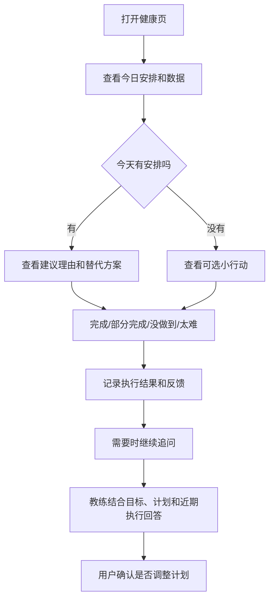

# 称伴健康教练：目标、计划、追问与记忆产品需求文档

> 目标是把健康页从“展示数据、给出一条今日建议”推进为“了解我的目标、记得我的安排、能持续回答我问题”的个人健康教练。
> 初稿：2026-11-02；状态：P0 主闭环已在 `codex/health-coach-follow-through` 工作区实现并在模拟器通过固定响应和真实模型验收，尚未发布；完整 P1／P2 能力仍未实现。已发布的 `v0.4.2` 不因工作区进展自动获得这些能力。
> 本文是 [健康 AI 分析 PRD](12-称伴健康%20AI%20分析产品需求文档.md) 的后续教练能力切片。现有完整健康分析、旧对话、报告、导出和提醒仍由 `HEALTH_AI_ENABLED=false` 关闭；本文不要求恢复这些旧入口。健康教练需要独立开关、独立同意范围和独立验收。

---

## 目录

- [一、产品定义](#一产品定义)
- [二、当前基础与要解决的问题](#二当前基础与要解决的问题)
- [三、核心用户流程](#三核心用户流程)
- [四、信息架构与页面](#四信息架构与页面)
- [五、目标、事实与记忆模型](#五目标事实与记忆模型)
- [六、数据是否足以支撑目标](#六数据是否足以支撑目标)
- [七、追问与连续对话](#七追问与连续对话)
- [八、周计划与每日决策](#八周计划与每日决策)
- [九、运动后的完成与有效性评估](#九运动后的完成与有效性评估)
- [十、AI 输入、输出与安全边界](#十ai-输入输出与安全边界)
- [十一、隐私、同意与数据生命周期](#十一隐私同意与数据生命周期)
- [十二、异常与降级](#十二异常与降级)
- [十三、分期交付](#十三分期交付)
- [十四、验收标准](#十四验收标准)
- [十五、待确认决策](#十五待确认决策)

---

## 一、产品定义

### 1.1 一句话定位

称伴健康教练帮助用户完成一个持续闭环：

> **我知道自己现在怎样，也知道自己想去哪里；教练和我一起定下可执行的安排，每天告诉我下一步做什么，并在我完成后一起判断是否需要调整。**

它不是健康指标解释器，也不是只会回答问题的通用聊天窗口。用户不需要每次重新介绍目标、时间和身体情况。

### 1.2 核心价值

| 用户问题 | 产品回答 |
| --- | --- |
| 我现在的身体状态怎么样？ | 基于已授权、实际读取的数据展示事实、时间范围和缺口，不用缺失数据补零 |
| 我的目标是什么？现在是否在靠近目标？ | 保存用户确认的目标，展示已知进展和不能判断的部分 |
| 这些数据够不够支持目标？ | 明确区分“可以开始安排”“只能看趋势”“还缺少判断依据” |
| 我今天应该做什么？ | 结合周计划、近期完成情况和当天上下文，给出一个可执行动作 |
| 我做了，够不够？ | 分开判断计划完成、目标相关量和训练质量，不把一条运动记录当成全部答案 |
| 我能继续问吗？ | 从当前建议、数据卡片或计划继续追问，教练保留相关的目标和安排 |
| 它记得我吗？ | 只记住用户确认的目标、偏好和计划，并允许查看、修改、忘记 |

### 1.3 产品边界

本产品面向成年人的一般健康、体重管理和运动生活安排，不提供：

- 疾病诊断、疾病风险评分、用药调整、急救或临床监护。
- 仅凭体重、体脂、HRV、心率或一次运动推断疾病、损伤或恢复状态。
- 保证用户在某个日期达到体重、体脂或运动表现目标。
- 自动给用户增加高强度训练、热量赤字或营养处方。
- 未经用户确认，自动修改目标、周计划、健康记录或外部应用数据。

如用户存在未成年、孕期、伤后恢复、慢性病或其他特殊健康情况，教练只能提供一般信息，明确建议咨询专业人员；不把成人通用规则套用到特殊人群。

### 1.4 产品原则

1. **事实先行**：设备测量、用户自报、用户确认目标和 AI 推测必须分开。
2. **一个主行动**：今日页默认只给一个最重要的行动，避免把健康页变成任务清单。
3. **计划稳定**：周计划在用户确认后保持稳定；数据变化可以触发调整建议，但不能每天悄悄重写计划。
4. **先解释再行动**：建议必须能说明依据和不确定性；数据不足时先说明缺什么。
5. **不惩罚用户**：没做到不等于失败，不用补做、羞辱或连续催促。
6. **记忆可见可控**：长期记忆必须经过确认，可编辑、可删除、可关闭。
7. **主动发送最小上下文**：只发送回答当前问题所需的目标、计划、近期执行和相关健康事实。

---

## 二、当前基础与要解决的问题

### 2.1 当前已有能力

| 能力 | 当前状态 | 本 PRD 的使用方式 |
| --- | --- | --- |
| 蓝牙称重与饮食记录 | 已有核心功能 | 不改变称重和饮食的核心产品边界 |
| Health Connect 读取与本地缓存 | 已发布健康读取、全量／增量同步 | 作为健康事实的首选来源，保留来源、时间和覆盖范围 |
| 今日建议 | `0.4.2` 已发布一次性健康教练建议 | 作为入口基础，不把它描述成完整对话教练 |
| 短期行动闭环 | 工作区已补齐目标、追问、候选确认和记忆，尚未发布 | 本 PRD 的 P0 实现基础；发布状态以实际版本为准 |
| 健康 AI 分析、旧对话、报告、导出、提醒 | 代码保留，`HEALTH_AI_ENABLED=false` | 不直接恢复旧入口；需要重新评审是否复用 |

### 2.2 当前缺口

当前“今日建议”主要回答“今天可以做什么”，还缺少：

- 结构化的身体目标：例如目标类型、目标值、目标期限、优先级和用户确认状态。
- 对“我现在怎么样”和“目标是否可达”的连续回答。
- 从一条建议继续追问的上下文。
- 长期保存且可管理的目标、偏好、限制和计划记忆。
- 一周训练安排，以及每天“照常、缩短、改天、休息”的决策。
- 运动后的计划完成度、目标相关量和训练质量分层评估。
- 数据缺失时明确告诉用户“现在能判断什么、不能判断什么”。

### 2.3 设计取舍

本 PRD 不新增一个独立的“AI 教练”底部 Tab。教练能力嵌入健康页和今日建议，避免和称重、饮食、健康数据争夺导航；用户从当前问题或当前计划进入追问，减少“打开聊天窗口后不知道问什么”的空转。

---

## 三、核心用户流程

### 3.1 首次建立教练关系

1. 用户进入健康页，看到已读取的数据和可用的健康指标。
2. 用户点击“设定目标”或“让教练了解我”。
3. 先展示已能从 Health Connect 读取的事实；缺失的身高、体脂等信息只在需要时询问，并标注为用户自报。
4. 用户选择目标：
   - 体重趋势；
   - 体脂趋势；
   - 增加活动量；
   - 改善睡眠规律；
   - 提升力量或运动表现；
   - 先保持健康，不设具体数值。
5. 用户填写或选择：
   - 目标值和期限是否明确；
   - 每周可运动的天数和通常可用时间；
   - 可用器械、喜欢的运动和明确不喜欢的运动；
   - 需要教练避开的运动限制或身体不适。
6. 教练展示“我目前知道的”和“我还不知道的”，让用户确认。
7. 教练提出第一版一周计划和今日行动，用户确认后才生效。

首次流程不应变成一张长问卷。建议最多 4 个步骤，其他信息在后续追问中按需补充。

### 3.2 日常使用



### 3.3 典型追问

- “我现在这个状态，离目标还差什么？”
- “我的数据够不够判断体脂目标？”
- “今天有点累，周一三五的计划还要做吗？”
- “我只有 20 分钟，今天的健身怎么改？”
- “我今天已经走路了，还需要做力量吗？”
- “这周只完成了两次，算不算够？”
- “上周说周五改周六，现在还记得吗？”
- “我不喜欢跑步，以后不要安排跑步。”

每个问题都从当前目标、计划和可用事实出发；不能把每次提问都当成全新的通用问答。

---

## 四、信息架构与页面

### 4.1 健康首页

健康首页保留现有紧凑卡片结构，不重新堆叠重复的日期和说明文字。

| 区域 | 内容 |
| --- | --- |
| 今日 | 今日计划、为什么是它、一个主要行动、完成／调整／太难／追问入口 |
| 近期 | 本周计划完成情况、目标趋势、近期数据缺口、最近一次评估 |
| 指标 | 现有健康小卡片；点击查看依据、来源和记录详情 |
| 教练入口 | “问问教练”、最近一次计划、我的目标与记忆 |

默认展示“今日”；“近期”使用用户选定的时间范围。缺失数据不显示为 0，今天未结束的数据明确标为“截至当前”。

### 4.2 目标与记忆页

从健康页进入，显示：

- 当前主目标和可选次目标；
- 目标来源、用户确认时间、目标期限；
- 身高、体脂等自报资料及其来源；
- 训练偏好、可用时间、器械和限制；
- 当前周计划；
- “教练记住的内容”及每一项的最后更新时间；
- 修改、删除、忘记和关闭记忆入口。

页面使用“我知道的”和“我不确定的”两组，不用“AI 已经全面了解你”这类无法验证的文案。

### 4.3 对话页

对话页不是独立的无状态聊天窗口，包含：

- 当前会话消息；
- 当前目标、周计划和数据截止时间；
- 可点击的事实引用；
- “本次回答使用了哪些数据”；
- 取消生成、重试、新开会话；
- 建议追问的快捷入口；
- 待确认的计划调整或记忆更新卡片。

默认展示最近一段对话摘要，不把完整历史无限拼接进每次请求。用户可以查看、删除会话，也可以选择“只用于本次回答，不记住”。

### 4.4 计划确认与修改

AI 只能提出计划修改，不能直接生效。修改卡片必须显示：

- 原安排；
- 建议改成什么；
- 为什么改；
- 仅影响本周还是一次性改变长期偏好；
- 确认和取消按钮。

例如：“周五力量训练改到周六 30 分钟”，不能悄悄把长期周一三五改成二四六。

---

## 五、目标、事实与记忆模型

### 5.1 四类信息必须分开

| 类型 | 示例 | 规则 |
| --- | --- | --- |
| 设备事实 | 昨晚睡眠 7 小时、今天 6,800 步、最近体重 71.8 kg | 来自 Health Connect 实际读取或缓存，带来源、时间和覆盖范围 |
| 用户自报 | 身高 175 cm、今天很累、家里有哑铃 | 明确标记为本人填写，不伪装成设备测量 |
| 用户确认目标 | 12 周内把体重降到 70 kg、每周运动 3 次 | 只有用户确认后才成为教练目标 |
| AI 推测／建议 | “可能是最近睡眠不足”“建议周三改成散步” | 只能作为解释或建议，不能自动变成事实或计划 |

健康测量不复制到“AI 记忆”中成为第二份真相。教练记忆保存目标、偏好、计划和引用关系；测量值继续从健康缓存读取，确保能显示原始时间和来源。

### 5.2 建议的数据实体

| 实体 | 关键字段 | 用途 |
| --- | --- | --- |
| `CoachGoal` | id、类型、目标值、期限、优先级、状态、用户确认时间 | 保存目标，支持修改和归档 |
| `CoachProfile` | 身高、体脂自报、可用时间、器械、偏好、限制 | 保存长期背景，字段分别标来源 |
| `WeeklyPlan` | 周起始日、版本、目标、状态 | 一周内稳定的安排 |
| `PlanItem` | 日期、类型、时长、目的、强度或难度、替代方案 | 今日和本周的执行单位 |
| `PlanExecution` | 计划项、完成状态、完成时间、来源、用户反馈 | 记录完成、部分完成、没做到、太难 |
| `MemoryItem` | 类型、内容、来源、确认状态、有效期、最近使用时间 | 可管理长期记忆 |
| `ConversationSummary` | 目标引用、已确认决定、未解决问题、最近反馈 | 支持跨天追问，不重复发送完整历史 |

### 5.3 目标状态

每个目标至少处于以下状态之一：

- **草稿**：AI 或用户提出，尚未确认；
- **进行中**：用户确认，当前计划引用；
- **暂停**：用户主动暂停，不继续生成每日行动；
- **已达成**：用户确认或按明确目标值判断，不能由模型单方面宣布；
- **已归档**：用户结束或替换目标，保留历史但不影响当前建议。

P0 建议支持一个主目标和一个可选次目标。不要一次显示多个互相竞争的目标，避免用户每天收到互相矛盾的训练建议。

### 5.4 记忆的分类与有效期

| 记忆类型 | 示例 | 默认生命周期 |
| --- | --- | --- |
| 长期偏好 | 不喜欢跑步、周一三五晚上有空、家里有哑铃 | 直到用户修改或删除 |
| 身体背景 | 身高、用户自报体脂、明确限制 | 直到用户修改；测量类优先使用健康数据 |
| 当前目标 | 12 周体重趋势、每周三次力量 | 目标结束、暂停或归档 |
| 临时状态 | 今天疲劳、这周出差、暂时膝盖不舒服 | 默认当天或用户指定日期，过期不参与建议 |
| 计划与反馈 | 本周完成两次、觉得某动作太难 | 用于近期调整；建议保留最近 8–12 周 |
| 对话摘要 | “用户更愿意午休时散步”“上周决定周六替代周五” | 默认最近 90 天，可关闭或删除 |

任何由 AI 从对话中推断出的偏好，例如“用户可能不喜欢跑步”，必须先作为待确认记忆展示，用户确认后才进入长期记忆。

### 5.5 记忆操作

- “记住这件事”必须显示将保存的内容、用途和有效期。
- “暂时不要记住”只影响当前会话或当前字段。
- 修改目标时展示旧目标、新目标和生效时间。
- 删除记忆后，后续请求不得继续使用；历史回答保留当时的引用说明。
- 关闭长期记忆后，教练仍可使用当前健康事实和当前会话，但不能声称记得过去偏好。
- 用户可分别删除对话、记忆、计划；删除计划不应删除健康记录。

---

## 六、数据是否足以支撑目标

### 6.1 先判断“能做什么”，再给建议

每次生成计划或回答目标问题前，本地代码先计算数据充分度：

| 状态 | 含义 | 用户可见表达 |
| --- | --- | --- |
| 足够制定计划 | 有目标、时间安排和最低限度的身体背景 | “可以先按这个安排开始” |
| 足够观察趋势 | 有连续测量，但不足以判断全部结果 | “可以看变化，但不能据此确认体脂或训练效果” |
| 只能做一般建议 | 只有零散数据或没有历史 | “还没有足够个人数据，先给一般性建议” |
| 不足以判断 | 关键字段缺失或来源不一致 | “目前不能判断，需要补充 X 或继续记录” |

### 6.2 目标与数据能力

| 目标／问题 | 可以基于什么判断 | 不能直接推断 |
| --- | --- | --- |
| 体重趋势 | 同一来源、相近测量条件下的多次体重记录 | 体重下降不等于减脂；单次变化不能代表长期趋势 |
| 体脂趋势 | 同来源、同测量方式的体脂记录及日期 | 不能从体重公式反推真实体脂；不同设备不可直接横比 |
| 活动量 | 完整日的步数、运动时长、距离或能量记录 | 今日未结束的数据不能当完整日；设备未记录不等于没活动 |
| 力量训练 | 运动类型、时长、用户补充的动作／组数／次数／负重／主观用力 | 一条“力量训练”记录不能证明训练部位或有效刺激 |
| 睡眠规律 | 夜间睡眠、午睡、入睡／起床时间和覆盖范围 | 一次深睡比例低不等于睡眠障碍；HRV 不能单独决定恢复 |
| 饮食与体重关系 | Health Connect 中实际可读的营养记录和体重记录 | 称伴本地未同步餐食不能补缺；已记录摄入不等于实际全部摄入 |
| 目标是否达成 | 用户确认的目标、日期、实际测量和缺口 | 模型不能保证目标可达成，也不能把预测写成事实 |

### 6.3 数据新鲜度

- 今日问题先使用最近一次同步；显示“数据截至某时”。
- 缓存超过 6 小时或用户明确问“今天／昨晚”时，尝试刷新 Health Connect。
- 刷新失败仍可使用旧数据回答，但必须显著标明“未取得更新数据”。
- 用户自报“今天很累”不能写成睡眠、HRV 或疾病结论。
- 读取失败、无记录、未授权、来源尚未同步必须分别显示，不能统一显示为 0。

### 6.4 最小补充原则

只有缺失信息会改变结论时才追问，例如：

- 判断力量训练是否完成：询问是否完成了当天计划，或是否愿意补充动作和组数。
- 判断体重趋势：询问是否使用同一台秤、测量时间是否相近。
- 判断体脂：先说明没有同来源体脂记录，不能仅凭体重补算。
- 判断当天是否适合训练：先看计划和近期负荷；必要时询问主观疲劳或不适，不用一个 HRV 值做医学裁决。

---

## 七、追问与连续对话

### 7.1 从具体上下文进入

提供四个主要入口：

1. 今日计划卡：“为什么是它？”／“问问教练”。
2. 指标卡：“这对我意味着什么？”／“和目标有什么关系？”。
3. 近期页：“这周完成得怎么样？”。
4. 目标与记忆页：“调整目标”／“教练记住了什么？”。

从卡片进入时自动带入相关目标和时间范围，用户不需要重复描述。

### 7.2 每次请求的上下文包

模型只接收当前问题需要的内容：

- 当前用户问题；
- 当前主目标和可选次目标；
- 当前周计划和最近执行；
- 与问题相关的健康事实；
- 用户已确认且未过期的记忆；
- 数据时间、来源、覆盖和缺失；
- 最近几条对话摘要，而不是无限历史。

不把全部健康记录、全部原始会话或全部私人资料无差别发送。用户可以查看本次发送范围。

### 7.3 回答结构

教练回答建议由本地渲染为以下结构：

1. **结论**：直接回答用户问题。
2. **依据**：引用哪些日期、指标和计划。
3. **限制**：哪些数据缺失或不能判断。
4. **下一步**：最多一个主要行动，必要时给一个替代方案。
5. **可追问**：提供 2–3 个与当前上下文相关的后续问题。

如果用户问“我能不能达到目标”，回答必须同时包含：

- 当前已观察到的趋势；
- 目标与当前状态的差距；
- 数据是否足够判断；
- 不承诺具体结果。

### 7.4 对话中的计划修改

当用户说“周三没空”“今天太累”“把周五改到周六”时：

1. 识别这是临时调整还是长期偏好；
2. 展示原计划和拟修改内容；
3. 询问用户确认；
4. 确认后生成新的计划版本；
5. 下次对话引用新版本，不继续引用旧安排。

AI 不能直接写入计划或健康记录。未确认的修改只存在于草稿状态。

### 7.5 会话记忆

- 同一会话保留最近消息和结构化决定；
- 跨天继续时，优先加载目标、计划和摘要，不加载所有原始消息；
- 用户可以新开会话；新会话仍可使用已确认的长期目标和偏好；
- 用户说“忘记这件事”时，删除对应记忆并从后续上下文中移除；
- 历史回答中的旧数据不会被更新成新数据，必须显示当时的截止时间。

---

## 八、周计划与每日决策

### 8.1 周计划生成

周计划由用户和教练共同确认，至少包含：

- 一周的训练／活动目标；
- 每周安排的天数和日期；
- 每次预计时长；
- 训练目的，例如活动、力量、恢复或习惯；
- 可接受的替代方案；
- 休息日和不可用日。

P0 不要求用户填写复杂训练动作库，但必须允许用户补充“今天做了什么”和“是否觉得太难”。

### 8.2 示例

用户确认：

> 目标是增加活动并保持力量；周一、三、五晚上各 30 分钟；家里有哑铃；周五如果加班可以改到周六。

今日页显示：

> 今天按计划是 30 分钟力量训练。你本周已完成 1 次；最近没有新的睡眠或活动记录，因此今天不根据恢复指标自动减量。如果今天时间不足，可改成 15 分钟基础动作。

按钮：

- 开始／查看安排；
- 完成；
- 今天太难；
- 改到其他时间；
- 问问教练。

### 8.3 每日决策顺序

本地规则和 AI 按以下顺序判断：

1. 今天是否有用户确认的计划？
2. 本周已经完成了什么？
3. 今天的数据是否完整、是否足以支持调整？
4. 用户是否自报疲劳、疼痛、时间冲突或其他限制？
5. 保持原计划、缩短、替换、改天或休息，哪个更符合目标和安全边界？

睡眠、心率、HRV 只能作为辅助信息。不得用单次 HRV、单次心率或一个“恢复分数”决定是否能训练，也不输出医学结论。

### 8.4 未完成与补做

- 没做到不自动生成“补练”任务。
- 可以在本周剩余时间内提出一次替代安排，但必须由用户确认。
- 不把一次漏做解释成缺乏自律。
- 连续多次没做到时，优先降低计划难度或重新确认目标，而不是增加提醒频率。

---

## 九、运动后的完成与有效性评估

### 9.1 三层判断

| 层级 | 问题 | 可用依据 |
| --- | --- | --- |
| 执行 | 今天／本周做了没有？ | 用户确认、Health Connect 运动记录、计划项 |
| 目标相关量 | 是否完成本周安排的频率、时长或活动量？ | 计划、完整日记录、运动会话 |
| 训练质量 | 这次训练是否可能支持力量／耐力目标？ | 动作、组数、次数、负重、RPE、心率或用户描述 |

只有第一层可以由“完成”按钮直接确认。第二、三层需要更多数据，不能混为一谈。

### 9.2 不同类型运动的评估

**步行、跑步、骑行等有氧活动**

- 可以判断记录到的时长、距离、运动类型和可用心率区间；
- 没有完整记录时，不声称达到某个强度；
- 不把设备估算的热量消耗当作唯一达标依据；
- 多来源记录先去重，无法确定是否同一运动时请用户确认。

**力量训练**

- Health Connect 通常只能证明“发生过一段运动”，不一定提供动作、组数、次数、负重和主观用力；
- 用户只记录“力量训练 40 分钟”时，只能判断时长，不判断胸背腿是否练够；
- 需要时最多补问 3 项：主要动作、组数／次数、最后是否吃力；
- 允许用户只点“完成”，但回答必须降低结论强度。

**睡眠和恢复**

- 用睡眠时长、规律性和用户自报疲劳解释安排；
- HRV 只在同来源、同口径和足够覆盖时作为趋势参考；
- 不生成“恢复分数”或“可以／不可以训练”的医学裁决。

### 9.3 回答文案规则

推荐：

> 按目前记录，你本周完成了 2 次计划中的力量训练，计划执行到 2/3。每次只有 40 分钟的运动记录，没有动作和组数，因此我只能判断你完成了训练，不能判断训练量是否足够支持力量目标。

不推荐：

> 你的运动量不足，需要继续加练。

前者区分记录和结论，后者把缺失数据当作事实。

---

## 十、AI 输入、输出与安全边界

### 10.1 输入合同

发送给模型的内容必须结构化，至少包含：

```text
goal
currentPlan
recentExecution
relevantFacts
confirmedMemories
dataCoverage
missingData
userQuestion
```

每个事实包含：

- 指标名称和值；
- 单位；
- 本地日期／时间；
- 来源类型和可展示来源；
- 覆盖范围或缺失状态；
- 是否为用户自报；
- 是否仍在有效期内。

### 10.2 输出合同

建议模型返回结构化结果，由应用校验后再展示：

```text
answer
observations[]
dataGaps[]
suggestedActions[]
proposedPlanChange?
memoryCandidate?
```

应用必须校验：

- 引用的指标真实存在于本次输入；
- 数值、单位和日期没有被模型改写；
- 计划修改只作为待确认草稿；
- 记忆候选只作为待确认项；
- 不出现输入中不存在的来源或设备；
- 不输出诊断、保证性目标或未提供的医学依据。

### 10.3 语气和长度

- 默认 2–4 段，先回答用户问题；
- 不重复所有指标；
- 不连续追问超过一个问题；
- 不只说“继续保持”，必须给出与目标相关的具体下一步；
- 对数据不足保持诚实，不用模糊的“可能”掩盖缺失；
- 中文和英文都保持同样的事实边界。

---

## 十一、隐私、同意与数据生命周期

### 11.1 三层权限

1. **读取健康数据**：用户选择类别并完成 Health Connect 授权。
2. **向 AI 发送健康摘要**：与食物图片同意分开，说明接收服务、模型和发送范围。
3. **保存教练记忆**：目标、偏好、计划和对话摘要单独说明，用户可以选择不保存。

新增目标、长期记忆或计划上下文后，不能沿用旧版本的健康摘要同意。实现时应使用新的同意版本，并在服务、发送类别或上下文范围变化时重新确认。

### 11.2 发送与不发送

- 只发送当前问题相关的最小必要上下文。
- 默认不发送原始心率采样、全部历史记录、来源包名、平台记录 ID 和医疗记录。
- 不把本地未同步的餐食、体重或草稿补入健康事实。
- 用户切换 AI 服务时，明确新接收方和本次会发送的目标／记忆摘要。
- 删除会话不等于删除健康记录；删除记忆不等于删除计划或测量数据，页面分别说明。

### 11.3 默认保留

- 目标和长期偏好：直到用户修改、删除或归档。
- 临时状态：到期自动失效，不参与后续建议。
- 计划和执行：建议保留最近 8–12 周用于近期评估。
- 对话摘要：默认最近 90 天，可关闭；原始长对话不无限保存。
- 健康测量：遵循现有健康缓存和数据删除规则，不因教练记忆保留而延长。

具体天数可在实现评审时调整，但必须在隐私页和记忆页显示，不能藏在代码里。

### 11.4 后台与通知

P0 不新增后台自动调用 AI、定时主动推送或自动改写计划。同步数据只更新本地事实；只有用户主动打开健康页或发出请求时才调用模型。

未来如增加提醒，必须单独评审触发条件、后台读取权限、通知内容、频率、静默时间和关闭方式，不把本 PRD 当作提醒功能上线许可。

---

## 十二、异常与降级

| 情况 | 产品行为 |
| --- | --- |
| 没有 AI 服务 | 保留目标、计划、完成记录和本地指标；只有用户主动追问时提示配置 |
| AI 超时／限流／返回无效 | 保留旧计划和旧回答；允许重试；不删除用户记录 |
| 用户取消生成 | 停止请求，保留已确认目标和计划；不显示半截结论 |
| 健康数据过期 | 今日问题先刷新；失败时使用旧数据并标明截止时间 |
| 用户撤销健康授权 | 受影响类别从后续上下文移除；计划和历史保留，但说明依据不可再读 |
| 同一运动多来源重复 | 去重或请用户确认，不自动累计成两次 |
| 用户自报与设备冲突 | 并列显示来源，以用户确认的上下文继续，不静默覆盖测量值 |
| 目标和计划冲突 | 展示冲突，要求用户选择主目标；不自动生成互相矛盾的行动 |
| 记忆冲突 | 显示旧记忆、新记忆和更新时间，由用户确认替换或并存 |
| 模型提出计划修改 | 进入待确认卡片，不直接写入计划 |
| 用户说“不记得了”／“忘记” | 删除指定记忆，后续请求不再携带；历史对话可保留当时引用 |

---

## 十三、分期交付

### 13.1 P0：可用的个人教练闭环

P0 必须包含：

- 健康事实与用户自报分层；
- 一个主目标＋可选次目标；
- 最多 4 步的目标／时间／器械／限制设置；
- 健康页的今日计划、近期计划和追问入口；
- 一个可确认的一周计划；
- 完成／部分完成／没做到／太难反馈；
- 从今日建议、指标和计划进入的连续追问；
- 经用户确认的长期记忆和临时状态；
- 记忆查看、编辑、删除、关闭；
- 对体重、活动、力量训练的基本“能判断／不能判断”说明；
- 失败、过期、撤销授权和取消的降级；
- 中英文、深色模式和大字体支持。

### 13.2 P1：更细的执行评估

- 力量训练动作、组数、次数、负重和 RPE 的轻量补充；
- 多目标切换与目标进度视图；
- 跨周计划调整建议；
- 更丰富的运动类型和器械偏好；
- 训练完成后的可选简短复盘；
- 计划版本历史和更细的周回顾。

### 13.3 P2：后续能力

- 用户主动开启后的本地提醒；
- 经单独同意和成本提示的定时综合分析；
- 更完整的长期趋势与跨月目标复盘；
- 与更多可验证设备的动作级数据接入；
- 更成熟的跨周自适应计划。

P2 不代表已承诺上线，也不改变当前 `HEALTH_AI_ENABLED=false` 的边界。

---

## 十四、验收标准

### 14.1 场景验收

1. 首次进入只看到已读取数据；没有身高、体脂时明确说明，不显示 0 或猜测值。
2. 用户能设置一个主目标、目标期限、每周可用天数和可用时间，并确认第一版周计划。
3. 今日页能说明“今天为什么做这个”，且只给一个主要行动。
4. 用户点击“完成”后，重新打开 App 仍能看到本周完成记录。
5. 用户问“我现在怎么样，离目标还差什么”，回答包含当前事实、差距和数据限制，不保证结果。
6. 用户问“我的数据够不够”，回答能区分可制定计划、可观察趋势和不能判断。
7. 用户问“今天要不要按周一三五计划做”，回答能引用当前计划、近期完成和当天自报上下文。
8. 用户问“今天只走了一点路，够吗”，不会把部分日步数当成完整日，也不会把热量消耗当唯一结论。
9. 用户只记录“力量训练 40 分钟”，回答明确不能判断动作、组数和有效训练量，并只在必要时询问补充信息。
10. 用户说“把周五改到周六”，系统显示待确认修改；确认后新计划生效，未确认时旧计划不变。
11. 用户说“记住我周一三五晚上有空”，系统先展示记忆内容并等待确认；确认后下次对话仍能引用。
12. 用户删除记忆后，下一次请求不再发送该内容，界面也不声称仍记得。
13. 用户撤销某类健康授权后，相关事实不再出现在新回答或发送范围中。
14. AI 服务失败、取消或超时不会删除目标、计划、完成记录和旧回答。
15. 今日数据过期时，回答显示数据截止时间；刷新失败不冒充最新数据。
16. 设备记录与用户自报冲突时，来源并列显示，由用户确认，不静默覆盖。

### 14.2 质量门槛

- 所有健康事实必须可追溯到来源、日期和覆盖范围。
- 模型回答中的个性化数字必须来自输入事实，不能自行计算未提供的健康结论。
- 计划修改和记忆写入必须有用户确认状态。
- 缺失数据、零值、读取失败、未授权在 UI 和模型输入中保持不同状态。
- 健康教练不输出诊断、疾病风险评分、恢复分数、药物建议或保证性目标。
- 本地规则和确定性代码负责日期、单位、去重、完成状态和进度；模型负责解释、组织和提出建议。
- 今日问题在本地缓存可用时先展示本地数据；AI 首 Token 目标为常见网络下 3 秒内，超时必须可取消并保留状态。该目标不是对所有第三方服务的硬保证。
- 中英文、深色模式、大字体和读屏路径均需验收。

### 14.3 测试分层

- JVM／Robolectric：目标状态、记忆生命周期、计划版本、完成状态、数据充分度、隐私删除和 Prompt 输入结构。
- 模拟器固定响应：首次设置、今日计划、追问、计划修改、记忆确认、记忆删除、撤销授权、失败重试。
- 模拟器真实 Health Connect 合成数据：今日／近期切换、来源去重、缺失和过期状态。
- 真实 AI：至少覆盖目标评估、周一三五决策、运动后评估、计划修改和记忆候选五个场景；记录实际模型、耗时和失败边界。
- 真实手机：Health Connect 授权、真实数据读取、覆盖升级和用户已有目标／计划／记忆保留。Mock 或固定响应不能替代真实 Health Connect 和真实模型验收。

---

## 十五、待确认决策

以下问题建议在实现前确认；括号内为本文建议：

1. **目标数量**：P0 是否只允许一个主目标＋一个次目标？（建议是，降低建议冲突。）
2. **首次设置方式**：表单还是对话？（建议混合：结构化字段负责必要事实，对话负责偏好和补充。）
3. **记忆保留**：对话摘要默认 90 天、计划反馈保留 8–12 周是否合适？（建议先按此范围实现并显示。）
4. **体脂数据**：没有同来源体脂记录时，是否允许用户自报体脂？（建议允许，但始终标注自报，不能与设备体脂混算。）
5. **运动质量补充**：力量训练是否在 P0 就要求用户填动作、组数和 RPE？（建议不强制，只在用户关心“够不够”时按需询问。）
6. **计划修改**：临时改期是否自动只影响本周，长期偏好是否必须再次确认？（建议是。）
7. **健康教练开关**：是否使用独立开关与独立同意版本，不影响旧健康 AI 功能？（建议是。）
8. **旧对话代码**：是否复用现有 `HealthConversation`／`ask()`？（建议先复用底层 AI 与存储能力，重新实现教练入口和记忆合同，不直接打开旧对话页面。）

---

## 参考资料

- [Health Connect 数据类型](https://developer.android.com/health-and-fitness/health-connect/data-types)
- [Health Connect 读取数据](https://developer.android.com/health-and-fitness/health-connect/read-data)
- [Health Connect 聚合数据](https://developer.android.com/health-and-fitness/health-connect/aggregate-data)
- [Google Health Coach 官方介绍](https://blog.google/products-and-platforms/products/google-health/google-health-coach/)
- [Google Fit 活动记录说明](https://support.google.com/fit/answer/6075066?hl=en)
- [称伴 Health Connect 数据能力与格式](06-Health%20Connect%20数据能力与格式.md)
- [健康 AI 分析 PRD](12-称伴健康%20AI%20分析产品需求文档.md)
- [健康教练目标与行动闭环验收](testing/2026-11-02-03-健康教练目标与行动闭环验收.md)

本 PRD 只定义产品合同和分期范围，不代表其中任何能力已经上线。实际发布状态以对应版本、代码和验收记录为准。
