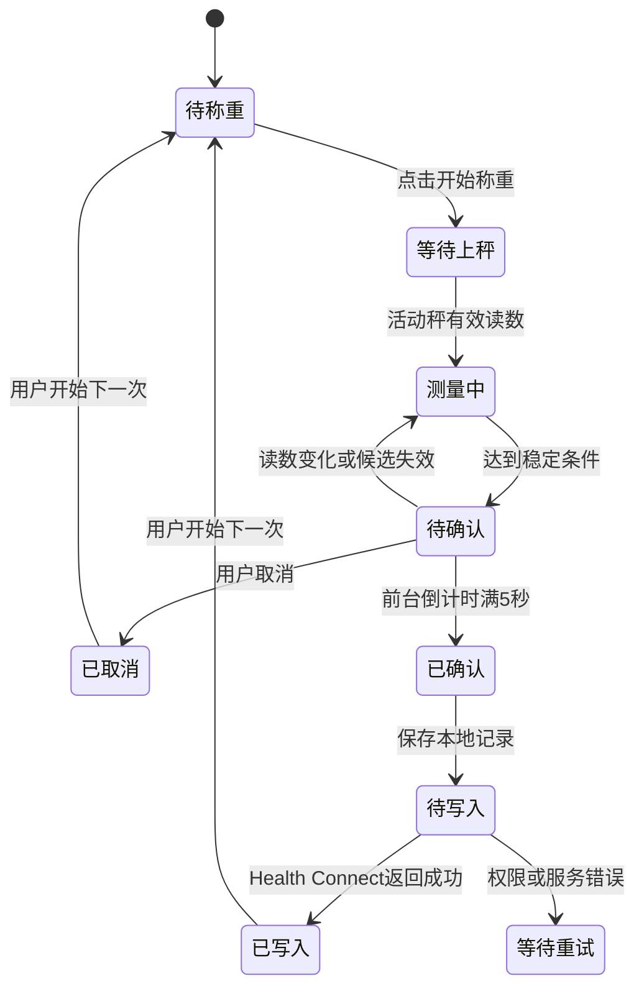

# ScaleMate 产品需求文档（首版）

> 历史需求：本文保留最初称重方案，部分引导、架构和页面已被后续实现取代。当前称伴同时以称重与饮食记录为核心，现状以代码及 [文档索引](../00-文档索引.md) 为准，发展过程见 [项目演进](../20-项目演进.md)。

> 目标：让原本不能接入 Google 健康生态的体重秤，通过 ScaleMate 采集体重并写入 Health Connect。首版支持云麦智能体脂秤 3 SE（内部型号 YMBS-M263），提供设备识别与绑定、多秤管理、实时称重、稳定后 5 秒自动确认和取消功能。用户提出的是使用诉求，本文中的协议、设备标识、稳定算法与后台范围均为依据实际情况整理的方案，待开发和实机验证。

---

## 目录

- [[#一、产品定位与首版决策]]
- [[#二、已验证能力与待验证事项]]
- [[#三、首次使用与权限引导]]
- [[#四、发现、识别与绑定设备]]
- [[#五、多秤管理]]
- [[#六、称重与五秒确认]]
- [[#七、保存、同步与去重]]
- [[#八、页面与交互]]
- [[#九、异常处理]]
- [[#十、架构与数据模型]]
- [[#十一、验收标准与交付顺序]]
- [[#十二、后续范围与参考资料]]

---

## 一、产品定位与首版决策

### 1.1 产品定位

ScaleMate 是体重秤与健康平台之间的连接工具。首版解决“我的秤能称重，但官方 App 无法把体重送到我使用的 Google 健康应用”的问题。

典型场景：用户首次完成授权并添加秤；以后打开 ScaleMate，选中秤并上秤，看到实时体重；读数稳定后出现 5 秒确认倒计时，用户不取消则保存并写入 Health Connect。

### 1.2 核心决策

| 项目 | 首版方案 |
| --- | --- |
| 产品名称 | 中文“称伴”，英文 ScaleMate |
| 正式项目目录 | `/home/rccoder/dev/ScaleMate` |
| 开发技术 | 原生 Android，Kotlin + Jetpack Compose + Material 3 |
| 系统支持 | 首版 Android 14 及以上；已测试手机为 Android 16 |
| 设备 | 云麦智能体脂秤 3 SE（YMBS-M263），支持绑定多台同型号设备 |
| 数据 | 仅体重及测量时间，不计算或同步体脂、阻抗等 |
| 输出 | Health Connect；引导 Google Fit 或 Google Health 读取 |
| 运行方式 | 前台打开称重页，用户点击“开始称重”；持续后台自动监听后续再做 |
| 确认方式 | 可信稳定读数后倒计时 5 秒，未取消则确认保存与写入 |
| 用户 | 单个使用者、单个健康账户；不自动识别人、不做家庭成员账户 |
| 登录与云端 | ScaleMate 无需注册或登录，无自建服务器 |
| 本地保存 | 已确认记录及同步状态；取消数据不进入正式记录 |

Google Fit 和 Google Health 是目标应用，Health Connect 是安卓上的数据交换层。ScaleMate 首版写入 Health Connect，不直接调用 Google Fit 云端 API。目标应用是否显示数据，由其版本、读取权限和同步行为决定。

首版 Android 14+ 是降低兼容成本的产品取舍，不代表 Health Connect 只能在 Android 14+ 使用；旧版本扩展单独评估。

### 1.3 首版不包含

体脂计算、未知秤通用适配、iOS、小米运动健康、多人自动识别、历史健康数据聚合、长期后台无感称重、复杂趋势分析。无需给首版引入付费、账号或云服务。

---

## 二、已验证能力与待验证事项

| 能力 | 当前证据 | PRD 处理 |
| --- | --- | --- |
| 接收用户的秤广播 | 电脑发现 `ED:68:00:69:8E:CA`，广播包含变化的数值 | 可作为首个适配样本，不把该地址硬编码为全部设备 |
| 体重字段解析 | 按报文解析为约 71～72 kg，用户确认与显示吻合 | 仍需核对多次称重、不同重量及完整会话 |
| 手机 Health Connect 写入 | 测试 APK 已安装；用户确认能在目标 Google 应用看到写入体重 | 基础输出链路可行 |
| 手机读取秤广播 | 测试 APK 0.2 已加入功能并安装 | 用户尚未反馈完整实秤验收，不宣称验证完成 |
| 稳定／最终状态位 | 相近云麦协议使用 01/02/03；M263 尚未完整验证 | 正式版自动确认前必须验证，不能直接当成最终事实 |
| 多台 M263 的识别 | 目前只有一台样本 | 识别规则需要第二台或额外抓包验证；首版可由用户确认型号 |
| 地址是否长期不变 | 当前只确认一次设备地址 | 实测重启、换电池及多次使用；支持重新识别绑定 |

测试版仅验证了部分链路，不等于正式 App 已完成。

---

## 三、首次使用与权限引导

### 3.1 首次说明

首次打开显示简短说明：

> ScaleMate 帮你把支持的体重秤数据送到健康应用。打开称重页并上秤，读数稳定后会倒计时 5 秒；你可以取消，不取消则保存并写入。请确保称重的人是当前健康账户的使用者。

配图或步骤只讲用户操作，不展示协议、MAC、SDK 等实现细节。

### 3.2 准备健康平台

步骤：说明用途 → 检查 Health Connect → 选择要使用的 Google 应用 → 授权 ScaleMate → 引导目标应用读取体重 → 添加秤。

- Android 14+ 检查系统 Health Connect 是否可用；必要时提示更新系统组件，不要求用户重复安装独立版。
- 目标应用支持 Google Fit 或 Google Health，按用户实际安装情况展示打开／安装入口；不同时强制安装两个应用。
- 在目标应用中开启 Health Connect 连接，允许读取体重。提供文字指南和打开应用入口；路径随版本变化，不承诺一条设置路径适用于全部版本。
- ScaleMate 可以检测自己的权限；不能在不能可靠获取的情况下声称目标 App 已授权或已同步。目标应用读取设置由用户完成并确认。
- 若目标应用尚未准备好，可以继续添加秤和本地称重；健康平台状态显示“待设置”。

### 3.3 最小权限

| 权限 | 请求时机 | 说明 |
| --- | --- | --- |
| 附近设备／蓝牙扫描 | 用户添加秤或开始称重时 | 找到秤并接收广播 |
| 蓝牙连接 | 设备管理涉及适配器状态、设备信息，或协议需要连接时 | 按实际实现声明；不能描述成所有秤都要配对 |
| Health Connect 写入体重 | 设置健康同步时 | 把确认后的体重写入 |
| 读取体重 | 首版默认不申请 | 本地记录足够用于历史展示；若增加读回验证则按需申请，仅读本应用记录 |

拒绝健康权限后仍可本地称重；拒绝蓝牙权限后无法采集，显示可重试的说明。正式版不沿用测试 App 默认申请体重读写两项的策略。

首次开启 5 秒自动确认前，单独清楚说明自动写入行为。用户点击“开启并继续”后启用；设置中可改为手动确认。重装后的首次使用重新说明，普通启动不重复展示。

无需把 Google 账号密码或登录令牌交给 ScaleMate。目标 Google 应用自行处理其账号。

---

## 四、发现、识别与绑定设备

### 4.1 添加设备流程

用户点击“添加秤” → 允许附近设备 → 提示轻踩唤醒并靠近手机 → 扫描 → 展示候选秤 → 选择候选 → 识别型号和兼容性 → 用户确认 → 保存设备 → 可选立即试称。

扫描列表只突出支持或可能支持的秤，避免把电视、窗帘等无关蓝牙设备塞给用户。发现多个候选时要求选择，不按最强信号自动认领。

列表显示：型号或候选名称、信号强弱、识别结果、设备标识末尾用于区分。未知设备可进入诊断信息页，不默认允许自动写入。

扫描一轮建议 30 秒，未发现时提示唤醒秤、检查电池、蓝牙和官方 App 占用，再允许重试；不使用持续加载动画掩盖无结果。

### 4.2 识别原则

协议适配器综合广播中的服务 UUID、数据格式、签名、设备名称和厂商数据验证候选。UUID 或名字单独匹配不能直接认定具体型号。

识别置信度：

| 结果 | 用户呈现 | 操作 |
| --- | --- | --- |
| 已验证识别规则且报文合法 | “识别为云麦智能体脂秤 3 SE” | 用户确认后绑定 |
| 符合协议族但型号不明确 | “疑似云麦秤，请核对底部型号” | 用户确认 M263，完成试称后可启用 |
| 未支持格式／校验不合法 | “暂不支持此设备” | 查看型号与诊断，不自动套用 M263 协议 |

首版只承诺 M263；不能因为收到相同 UUID 就宣称其他云麦秤也支持。

### 4.3 “绑定”与“配对”的区别

绑定是 ScaleMate 保存“这台实体设备使用哪个协议”的关系。配对是安卓与蓝牙设备建立的系统安全关系，两者不是同一件事。

当前 M263 的广播路径无需先建立 GATT 连接，因此界面使用“添加／绑定秤”，不显示虚假的配对步骤。未来适配器若需要连接或配对，才进入相应系统流程。

### 4.4 保存什么

保存应用内部设备 ID、用户名称、已确认型号、协议适配器 ID 和版本、广播设备标识、最近地址以及绑定时间。应用内部 ID 不随蓝牙地址变化。

不能把“某个 MAC 地址”作为某类秤的协议。协议属于型号／协议族，设备标识用于区分实体秤；一套协议可以服务多台实体秤。

地址可能变化。若协议存在稳定身份字段则优先使用；没有可靠字段时，用当前地址绑定并支持用户重新发现／确认。禁止仅凭相同型号或相似体重自动把新地址认作原设备。

### 4.5 首次试称

显示手机读数，让用户核对秤屏幕。按“手机与秤读数一致”完成验证；不一致可重试或报告不支持。未经协议和实机验收的稳定状态，不因用户确认型号就直接获得自动提交能力。

---

## 五、多秤管理

- 允许添加多台支持的秤，默认名称为型号，可改为“家里”“办公室”等。
- 首版每次只选中一台活动秤，称重页明确显示其名称。
- 记住上次选择；只有一台时自动选中，仍由用户点击开始称重。
- 多台同时广播时，仅活动秤能更新当前称重和启动倒计时，其他秤不自动写入。
- 测量中切换设备需要先停止当前会话；倒计时中切换先取消候选，再开始新会话。
- 移除设备仅解绑，保留历史记录中的来源名称；历史删除是独立操作。
- 重复添加相同可靠设备标识时打开现有设备，不产生两个绑定项。

同型号多秤与多人称重是两个问题。首版所有确认数据属于当前手机健康账户，不能仅靠体重推断是谁站上去。

---

## 六、称重与五秒确认

### 6.1 正常流程

### 6.2 实时显示

称重页显示大号体重、单位 kg、活动秤名称、状态说明。实时值变化平滑呈现，动画不遮蔽真实读数；精度按型号验证结果展示，不凭算法制造更高精度。

状态文案：“等待上秤”“测量中，请站稳”“体重已稳定，5 秒后保存”“已取消”“已保存，等待写入”“已写入 Health Connect”。

收到不合法、超范围或非活动设备的数据，不更新体重和倒计时。零值表示无人或复位，不保存为体重。具体合理范围由适配器和设备规格决定。

### 6.3 如何判断稳定

采用协议适配器输出的可信状态，并保留通用稳定规则。优先级：

1. 已经实秤验证的稳定／最终标志，加合法体重及校验结果，可以作为稳定候选。
2. 无可信稳定标志时，连续读数满足时间窗口与波动阈值才形成候选。
3. 仅拿到一帧或者不断回放过期数据，不算连续测量。

M263 试验起点：至少 3 秒窗口、至少 3 个不同接收时间的有效新广播、最大与最小差不超过 0.10 kg。新广播不要求体重不同，但不能把缓存中的一帧计成多个样本。阈值是待验证参数，需要针对分度值、广播频率和上秤过程实测，不能当成已证实标准。

目前的 02／03 状态语义尚未完整核对。正式版自动确认功能启用前必须验证其行为，或验收通用稳定算法；如果二者都未通过，只开放实时读取和手动确认。

### 6.4 五秒倒计时

- 稳定候选形成时固定候选体重、来源设备和测量时间，显示“5 秒后保存：71.30 kg”及明显的“取消”按钮。
- 使用单调时钟计算实际经过时间，不以动画帧数或收到广播次数计时。
- 相同会话重复稳定广播不重置倒计时。
- 倒计时中若有效体重偏离稳定窗口、出现新测量／复位标志，则候选失效，返回测量中；再次稳定后重新从 5 秒开始。
- 蓝牙关闭、设备切换、解析错误导致无法确认、最近有效数据超过 10 秒均使候选失效；短暂没广播不直接判定断开。
- 前台完整经过 5 秒且候选仍有效才提交；提交前再检查健康权限与候选状态。
- 首版应用进入后台、锁屏或进程重建时，取消待确认候选并停止扫描，不在用户看不到取消按钮时继续自动确认。返回后用户重新开始。
- 设置中的手动模式不自动倒计时提交，显示“确认保存”和“取消”。

5 秒是操作取消窗口，不是独立的稳定判断标准。

### 6.5 取消与下一次称重

点击取消后，本次候选不入正式本地历史、不写 Health Connect、不加入重试队列。取消状态保留；同一会话重复广播不能重新启动倒计时。

首版一次“开始称重”最多产生一条确认记录。确认或取消后结束该次会话并停止扫描，提供“开始下一次”按钮。这个规则明确处理了同体重重复广播、秤长期广播最终值、多人接连上秤等情况，不依赖不可靠的“体重不同就是新的一次”。

开始下一次后清空上一会话候选，只接受新的称重过程。适配器通过会话字段变化、无人／复位到上秤的转换或已验证的测量开始标记判断；只收到上一轮重复最终结果时显示“请下秤后重新上秤”。若 M263 缺乏可靠区分信号，需试称验证可操作的复位方式，不能用时间间隔伪装确定的新会话。

---

## 七、保存、同步与去重

### 7.1 保存顺序

倒计时完成 → 持久化已确认本地记录和写入任务 → 调用 Health Connect → 持久化返回结果。

本地保存失败不调用健康写入，显示失败并保留可重试候选。健康平台不可用时保留已确认记录，状态为待授权／待重试，不让用户重新称重。

### 7.2 同步状态的准确含义

| 状态 | 意义 |
| --- | --- |
| 待设置 | 尚未准备健康平台，仅本地可用 |
| 待授权 | 本地已保存，缺少体重写入权限 |
| 待写入／写入中 | 等待或正在调用 Health Connect |
| 已写入 Health Connect | API 返回成功，保存平台记录 ID |
| 写入失败，可重试 | 错误已记录，尚未确认写入成功 |

不能将 API 成功文案写成“Google Fit 已同步”。应用无法可靠得知目标 Google App 是否已展示这条数据；帮助页告诉用户如何核对。

### 7.3 去重与重试

- 每次称重会话生成一个本地 measurementId，作为所有重试共用的稳定标识。
- 使用对应的 Health Connect clientRecordId 和固定版本，重复提交同一条记录不会创建新记录。
- 重试不改变原测量时间、设备来源、体重或 measurementId。
- 不按“同一天、相同体重”简单去重，因为一天内可能真实称重多次。
- 已确认记录可重试；被取消或删除的记录永远不进入重试。
- 暂时服务错误有限次数退避重试；权限拒绝等待用户处理，不能频繁弹授权。
- 提交中进程退出时，重启恢复任务并以同一 clientRecordId 重试，处理“已经写入但尚未来得及本地标记成功”的情况。
- 待确认候选不在重启后自动恢复提交。
- 网络中断不阻止本机 Health Connect 写入；目标 App 云同步是否需要网络是其自身行为。

### 7.4 删除

记录详情提供删除操作，明确选择“仅删除本地记录”或“同时删除 ScaleMate 写入的 Health Connect 记录”。只能删除本应用对应记录，不能影响其他来源。

用户请求同时删除但健康删除失败时，保留可追踪的待删除任务／状态，不先丢失平台 ID。删除任务与写入重试互斥。已被目标 App 导入或上传的数据不保证随 Health Connect 删除而消失，界面说明需在目标 App 核对。

---

## 八、页面与交互

采用 Material 3，支持深色模式、动态配色、系统字体缩放和无障碍读屏。颜色之外同时提供文字状态；倒计时和取消操作不能只靠颜色区分。

底部导航三个页面：

| 页面 | 内容与动作 |
| --- | --- |
| 称重 | 当前秤选择、大号体重、状态、开始／停止、稳定后的 5 秒倒计时与取消 |
| 记录 | 时间倒序的已确认体重、来源秤、写入状态；详情支持重试与删除 |
| 设置 | 我的秤、健康平台准备情况、自动／手动确认、隐私与帮助 |

设备管理页提供添加、改名、重新识别、移除。技术信息放在详情的诊断区域，普通流程以设备名称和型号为主。

倒计时在称重页原位展示，不用会遮住实时值和取消按钮的短暂 Toast。成功后提供明显完成状态，不让重复广播把成功页改回倒计时。

加载、错误和空状态都提供明确下一步。首次无设备时提供“添加你的第一台秤”；无记录时解释完成一次称重即可生成记录。

---

## 九、异常处理

| 情况 | 行为 |
| --- | --- |
| 蓝牙关闭／权限撤销 | 停止扫描，取消候选，提示开启／授权 |
| 扫描找不到秤 | 提示唤醒、靠近、检查电池与官方 App，再扫描 |
| 添加时信号中断 | 不保存未经用户确认的设备 |
| 地址变化 | 引导重新发现并确认原秤，不自动替换绑定 |
| 候选是未知型号 | 标记未支持，不自动解析并写入 |
| 多台同时上报 | 只处理活动设备 |
| 非法报文、单位不明、范围异常 | 丢弃该数据并在诊断记录原因，不显示为合法体重 |
| 倒计时读数变化 | 候选失效，回到测量中 |
| 秤下电／广播停止 | 结合最后数据时间处理，超过阈值取消候选 |
| 用户取消 | 结束本次会话，重复报文不能再次提交 |
| 息屏／切到其他应用 | 首版取消候选并停止采集，返回可重新开始 |
| 健康权限未授权 | 正常保存确认记录，显示待授权 |
| Health Connect 错误 | 保存同步状态，允许重试，不重复称重 |
| 手机断网 | 保留本地和 Health Connect 路径，不误报本地写入失败 |
| Google App 没看到数据 | 提供读取权限、连接设置和手动核对指引，不宣称同步成功 |
| 家人站上秤 | 无法识别人；当前账户用户应取消，说明首版单使用者范围 |

一次前台称重扫描最长建议 120 秒，超时停止并提示重试。添加设备扫描与称重扫描超时分别控制。

---

## 十、架构与数据模型

### 10.1 模块边界

设备发现与 BLE 传输 → 协议适配器 → 统一称重事件 → 会话与稳定判断 → 确认与本地记录 → 健康输出适配器。

协议适配器负责设备识别、数据校验、单位转换、设备身份和协议状态。会话层负责选中设备、稳定候选、倒计时和取消。Health Connect 输出层负责权限、幂等写入及错误处理。

未来新增秤时不改写整套确认流程；未来新增健康平台时不改写秤协议。首版保留这些接口边界，不建设复杂插件市场或动态加载系统。

### 10.2 建议技术

Kotlin + Compose Material 3；ViewModel／StateFlow 驱动页面；Room 保存设备、记录和任务；Health Connect Jetpack SDK 作为输出接口；BLE API 用于传输。可用 WorkManager 处理已确认数据的有限重试，不把它当成持续实时扫描工具。

### 10.3 最小数据模型

| 实体 | 核心字段 |
| --- | --- |
| BoundScale | 内部 deviceId、名称、型号、adapterId／版本、identity 类型和值、lastAddress、确认时间 |
| MeasurementSession | sessionId、活动 deviceId、开始时间、会话状态、实时样本、候选体重／时间、倒计时起点 |
| WeightMeasurement | measurementId、deviceId、来源名称快照、weightKg、measuredAt、时区偏移、confirmedAt |
| SyncTask | measurementId、destinationId、clientRecordId、平台记录 ID、状态、重试次数、错误摘要 |
| Settings | 自动／手动确认、上次活动秤、引导版本、权限提示完成状态 |

待确认会话只在当前前台运行中有效；已确认数据才持久化成正式记录。设备移除后来源名称快照仍能说明历史记录来自哪里。

### 10.4 数据与隐私

默认数据留在手机。只存必要的设备标识、已确认体重和同步信息；不收集附近所有设备或账号凭据。诊断日志默认不长期保存体重原始报文；用户主动导出诊断时说明包含的数据并可脱敏。

首版不请求定位，不使用扫描推导位置；附近设备权限具体行为按安卓平台和实机验证落实。应用使用的权限与隐私说明保持一致。

---

## 十一、验收标准与交付顺序

### 11.1 首版必须通过

1. 新用户从说明到授权、添加 M263、完成一次称重，无需开发者模式或 ADB。
2. M263 以广播模式绑定，用户无需不必要的系统配对。
3. 收到有效报文后，前台界面更新目标不超过 1 秒；实际称重精度以设备规格和实测核对为准。
4. 完整实秤验证至少覆盖多次不同体重、上秤晃动、稳定、下秤、零值和最终广播重复；确认稳定状态或通用算法后才能启用自动提交。
5. 连续读数尚未稳定时不开始倒计时；再次变化时清除旧候选并重新判断。
6. 倒计时按实际经过 5 秒提交；提交之前点击取消不会生成记录或健康写入任务。
7. 同一次广播持续重复 30 秒，只能生成一条确认记录；取消后重复广播也不能重启确认。
8. 倒计时中息屏、返回桌面、切换秤、关闭蓝牙或进程重建，都不产生隐藏自动提交。
9. 一次称重健康写入成功，Google 目标应用实际显示相同体重和测量时间；这作为实机验收，不作为 API 可实时反馈的 UI 状态。
10. 写入失败、重复点击和提交后立即杀进程重试，都不产生重复 Health Connect 记录。
11. 没有健康权限时仍可保存确认记录；恢复授权后补写原记录，不改变测量时间。
12. 两台支持秤同时广播，只选中的秤能触发确认；若暂缺第二台实机，以回放测试覆盖逻辑，并明确多设备实测仍待完成。
13. 自动模式由用户在首次说明中开启，可切换手动模式；单使用者限制清楚可见。
14. 字体放大、深色模式和读屏下，体重、倒计时和取消动作可读可操作。

### 11.2 开发顺序

| 阶段 | 交付与退出条件 |
| --- | --- |
| A：协议验收 | 手机采集 M263 完整会话，核对设备身份、单位、稳定状态与重复广播；明确自动确认可用性 |
| B：正式项目基础 | ScaleMate Kotlin／Compose 项目、Material 主题、首次说明、权限与设备发现 |
| C：称重闭环 | 绑定、多秤选择、实时体重、稳定判断、5 秒取消、每会话一次提交 |
| D：数据可靠性 | Room 记录、Health Connect 幂等写入、失败重试、删除、状态文案 |
| E：实机发布准备 | 完整验收、权限与隐私、支持列表、发布方式；上架相关申报单独处理 |

---

## 十二、后续范围与参考资料

### 12.1 后续候选

更多云麦型号和其他品牌适配；Android 9～13 兼容；用户明确开启的后台称重模式与通知中的取消能力；多个使用者的确认与账户策略；体重趋势；其他健康输出平台。后台模式需独立设计，不承诺杀进程或厂商省电机制下始终可用。

### 12.2 上线前待验证的决策

- M263 的稳定／最终状态位和新会话识别方式。
- 同型号不同实体设备的识别签名与长期身份可靠性。
- 3 秒／0.10 kg 的候选参数是否适合实际报文频率和设备精度。
- 目标 Google 应用不同版本的体重读取和展示行为。

这些问题不改变用户的目标流程，但可能调整适配器规则、引导说明或首版兼容范围。

### 12.3 参考资料与证据范围

- [Health Connect 接入指南](https://developer.android.com/health-and-fitness/health-connect/get-started)：安装形态、权限和数据操作；本 PRD 的平台事实据此整理。
- [Google Fit 的 Health Connect 说明](https://support.google.com/fit/answer/12830119?hl=zh-Hans)：目标应用连接方式。
- [Google Health 使用 Health Connect](https://support.google.com/googlehealth/answer/14506680)：Google Health 数据连接和权限设置。
- [Android BLE 权限](https://developer.android.com/develop/connectivity/bluetooth/bt-permissions)：扫描／连接权限与位置用途约束。
- [Android BLE 后台通信](https://developer.android.com/develop/connectivity/bluetooth/ble/background)：后台运行机制与限制；前台首版是本文的产品取舍。
- [Compose Material 3](https://developer.android.com/develop/ui/compose/designsystems/material3)：主题与组件方案。
- [openScale 的 Yunmai X 协议说明](https://github.com/oliexdev/openScale/blob/master/android_app/app/src/main/java/com/health/openscale/core/bluetooth/scales/YunmaiXHandler.kt)：属于 YMBS-M268 的参考协议，不能视为 M263 的官方协议或完整验证。
- 本地试验项目 `/home/rccoder/dev/scale-health-test` 与用户反馈：当前设备体重字段及 Health Connect 写入的可行性证据。

文档版本：草案 v0.1；日期：2026-10-11。功能规则和试验参数是产品建议，未经实机验证部分已明确标注。
