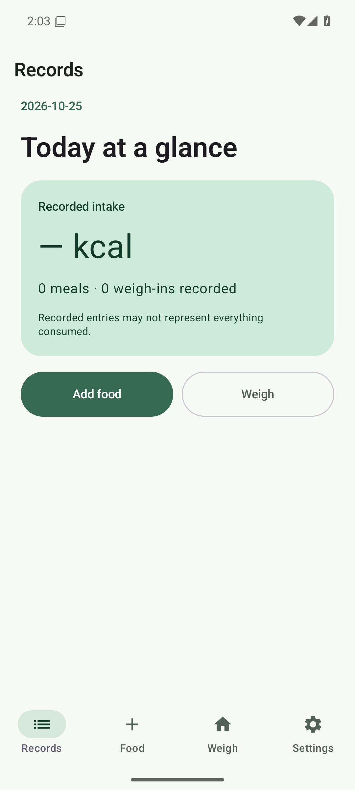
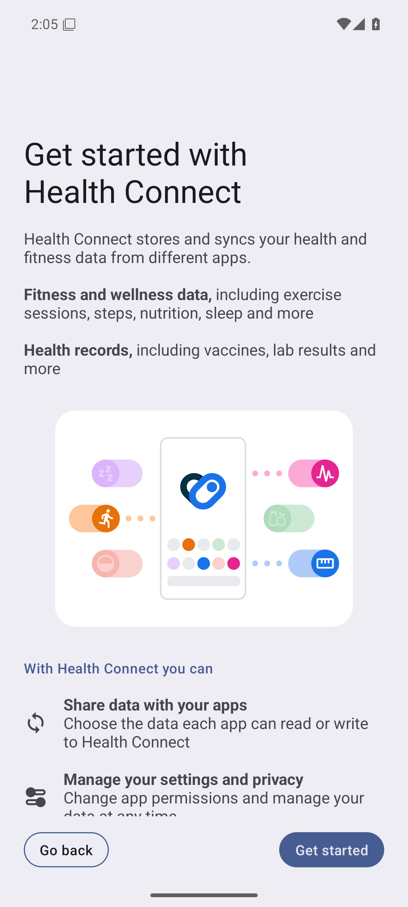

# Android 模拟器能力验证

- **日期**：2026-10-25
- **版本**：`0.3.3 / versionCode 13`（`7a71404` 基线上的未发布测试改动）
- **环境**：Arch Linux x86_64、KVM、16 核、27 GiB 内存、KDE Wayland 桌面、AMD Radeon 680M
- **设备**：`ScaleMate_API_36` AVD，Pixel 6，API 36 / Android 16，Google APIs，x86_64
- **性质**：工具链与验证边界探测，不是正式发布验收，也不是云麦秤真机兼容性结论

## 安装与启动

安装 Android Emulator 37.2.12 与 `system-images;android-36;google_apis;x86_64`。`avdmanager` 在非标准 SDK 根目录下生成了错误的模板值，已修正 AVD 配置：

- `image.sysdir.1` 使用镜像绝对路径。
- 补齐 `avd.id` 与 `avd.name`，移除临时 data partition 模板项。

冷启动验证三次：

| 启动 | 结果 |
| --- | --- |
| 首次 `-wipe-data` | 约 53 秒进入 Android 系统 |
| 第二次常规冷启动 | 约 29 秒；未擦除数据并保留已安装状态 |
| 第三次常规冷启动 | 约 32 秒；`avdmanager` 与镜像路径校验通过 |

`emulator -accel-check` 通过。最近一次运行已用 `adb -s emulator-5556 emu kill` 关闭，真机仍在设备列表。

## 可见窗口与图形加速

首轮为了稳定自动化使用 `-no-window -gpu swiftshader_indirect`，模拟器进程占用约 487% CPU，用户实际查看时动画和点击反馈明显不流畅。随后确认 KVM、宿主 OpenGL 与 `/dev/dri/renderD128` 可用，改用 `DISPLAY=:1 XAUTHORITY=/run/user/1000/xauth_BazBUO -gpu host` 启动可见窗口；模拟器进程 CPU 占用降至约 221%，冷启动约 1.5 秒，中文主页可正常交互。

窗口标题为 `Android Emulator - ScaleMate_API_36:5556`。这一轮最初使用 `-no-window`，所以用户只能看到截图、看不到独立模拟器窗口；后续有桌面会话时默认保留可见窗口并使用宿主 GPU。软件渲染只能用于无窗口自动化，不能据此评价 App 性能。

## 页面与仪器测试



安装隔离测试版 `app.scalemate.fooddev` 后：

- 冷启动约 2 秒，首次引导、主界面、Settings、Health data sync 页面均能渲染。
- `uiautomator dump` 可读取安全文本，`adb exec-out screencap` 可生成完整 1080×2400 截图。
- 模拟器证据只用于开发核对，未写入 README／Brand 的真实截图目录。

同一构建运行：

```sh
adb -s emulator-5556 shell am instrument -w \
  -e class app.scalemate.StoreTest,app.scalemate.FoodStoreTest,app.scalemate.AiFormatTest,app.scalemate.AiServicesTest \
  app.scalemate.test/androidx.test.runner.AndroidJUnitRunner
```

最终结果：**29 项通过、0 失败、0 跳过**。

首轮结果为 29 项、3 失败。三项均能单独复现并定位为测试夹具／断言问题，不是模拟器差异：

1. 开发版健康 schema 测试把夸大的 `version=5` 当作“旧版”数据库，`Store` 不会执行升级；已改成完整 v4 结构后验证升级。
2. 餐食建议持久化测试直接提交仍处于“份量待确认”的识别结果，违反本轮确认规则；测试现在先确认结果再提交。
3. AI 截断测试只捕获 `IllegalArgumentException`，实现使用专用 `AiWire.IncompleteResponse`；断言已改为对应异常类型。

修正仅涉及仪器测试，不改业务逻辑。

## 硬件与系统集成边界

### BLE

API 36 镜像具备 `android.hardware.bluetooth`、`android.hardware.bluetooth_le`，Bluetooth 服务状态为 ON。测试版申请并授予扫描／连接权限后，临时探针验证 `BleTransport.start` 能启动扫描器且 1 秒内无立即失败；探针已从源码与 APK 清除。

模拟器没有真实射频和云麦 YMBS-M263 广播源。该结果只证明权限、扫描器入口与故障回调没有在本镜像阻断，**不证明**扫描到真实秤、广播解析、连接、5 秒自动保存或真机兼容性。

### Health Connect



上图为授权入口证据，不是写入成功截图。

镜像包含 `healthconnect` 系统服务与 Google Health Connect Controller。实际完成首次引导，并为测试版授予 `WRITE_WEIGHT`；临时探针成功写入一条测试体重记录、取得平台记录 ID，再调用删除，两项测试均通过。

探针源文件、测试 APK 中的类以及模拟器内的 `app.scalemate.fooddev`／`app.scalemate.test` 包均已清理。因权限随目标包卸载失效，未保留测试授权；未提供独立查询入口，因此不能把“删除调用成功”扩大为“已核验全部 Health Connect 平台记录”。

未验证 Google Fit 或其他目标应用读取、营养写入、取消授权、权限撤销和健康数据同步回归。即使模拟器平台写入成功，也不能宣称目标应用已显示或真机授权行为一致。

## 相机与相册

模拟器报告相机和相册能力，但系统相机、真实相册、实况照片（Motion Photo）与厂商选择器不能由当前镜像替代。相关发布验收仍须真机，模拟器只能验证普通图片导入后的应用内路径。

## 未验证

- 云麦智能体脂秤 3 SE（YMBS-M263）实秤广播、连接和 5 秒自动保存。
- Health Connect 真实写入后的 Google Fit 等目标应用读取。
- 正式／预览覆盖升级、系统安装授权、取消重试与用户数据保留。
- 真实相机、实况照片、厂商权限与字体／屏幕差异。

## 结论

模拟器适合承担日常 UI、导航、存储、解析和大部分仪器回归，常规迭代效果损失较小；硬件与系统集成验收不能替代真机。后续常规验证优先使用 `emulator-5556`；手机 ADB 无法连接时直接用模拟器完成可覆盖的功能，发布前或涉及 BLE／Health Connect 目标应用读取／相机／升级时再连接实机。
