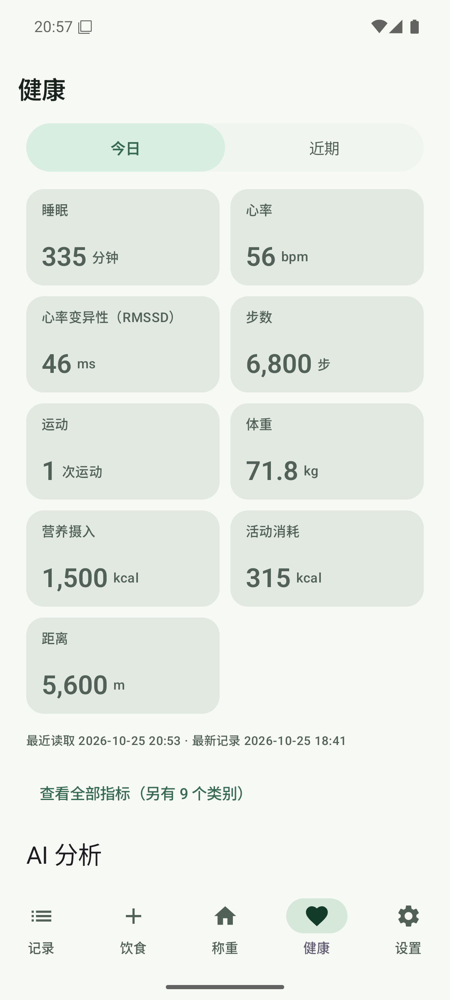
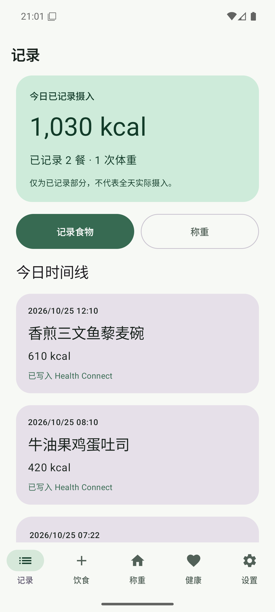
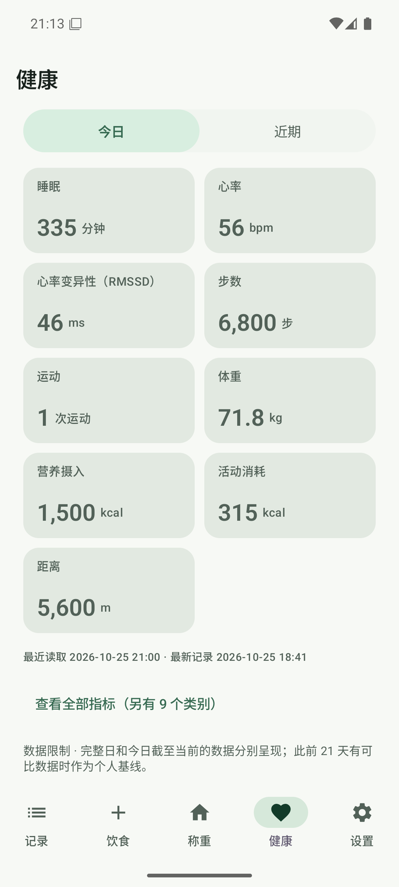
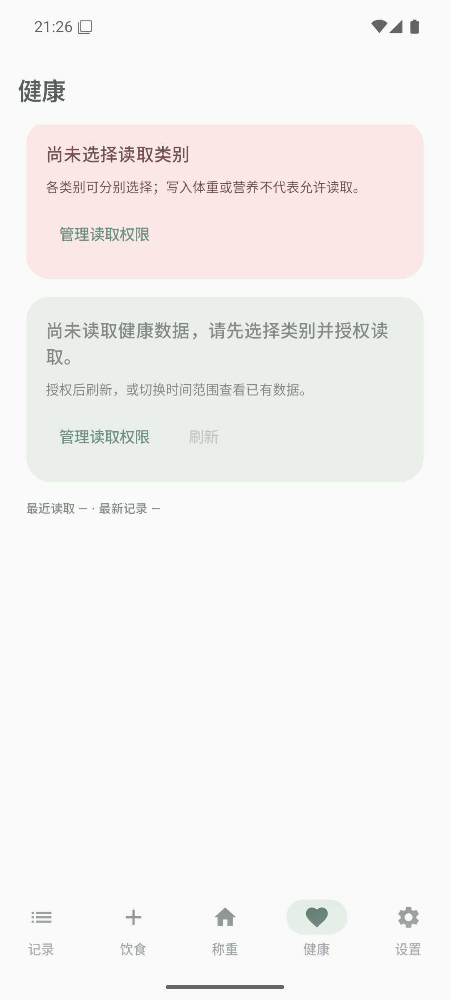
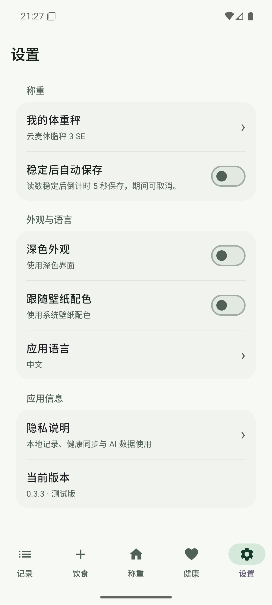
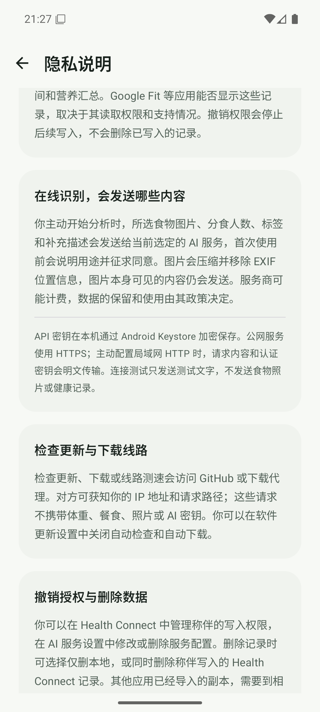

# 健康数据卡片与模拟器验收

- **日期**：2026-10-25
- **版本**：`0.3.3 / versionCode 13` 基线上的未发布测试改动
- **分支**：`codex/health-ai-analysis`
- **环境**：`ScaleMate_API_36` AVD，Pixel 6，API 36 / Android 16，Google APIs，x86_64，`emulator-5556`
- **性质**：健康页布局与交互的模拟器验收，不是发布验收

## 本轮改动

健康首页默认展示今日双列小卡片。展开“查看全部指标”后同样使用双列紧凑卡片：

- 今日指标：每个有数据的类别一张卡片，显示分类、数值、单位。
- 指标卡不重复显示日期；日期、来源、算法和覆盖度仍在点击打开的“查看依据”中展示。
- 删除首页末尾重复的“数据与来源”覆盖卡片列表，读取成功的状态不再重复罗列；部分失败保留一行提示。
- 仅当同类数据确有多个来源时，在健康设置组显示“优先来源”入口，不再同时显示两个指向同一页面的按钮。
- 下拉刷新只挂在健康页，触发阈值提高到 `120.dp`；其他页面和正常滚动不触发健康数据刷新。
- 健康 AI 分析及其对话、报告、导出、目标、提醒、隐私与历史入口按用户要求暂时关闭，通过 `BuildConfig.HEALTH_AI_ENABLED=false` 统一控制；健康指标、趋势、读取权限和“优先来源”继续可用。
- 关闭时清理旧的健康提醒任务，不改动已保存的健康快照、报告或会话数据。
- 关闭时忽略旧提醒通知深链，进程恢复遗留的 AI 子页面回退到健康首页。
- 通用“隐私说明”隐藏健康 AI 分析与历史章节；权限页和相关设置文案只描述当前开放的指标、趋势与读取权限。

## 验证

```sh
./gradlew -PfoodDev :app:testDebugUnitTest :app:lintDebug :app:assembleDebug --max-workers=2 --console=plain
```

- 构建成功。
- JVM 测试：169 项通过，0 失败，0 跳过。
- Lint：0 错误，133 条告警；告警未按零告警记录。
- 中英文资源检查：745 对字符串的名称和格式参数一致。
- 将同一构建覆盖安装到 `app.scalemate.fooddev`，沿用已有测试数据，未清空应用数据。
- 健康首页确认今日指标卡无重复日期，首页末尾不再出现“数据与来源”覆盖卡片。
- 健康页短距离下拉未刷新；超过阈值的下拉只刷新一次。切到“记录”页后长距离下拉未触发健康数据刷新。
- 健康首页不再显示“AI 分析”或健康功能设置组；编译产物确认 `HEALTH_AI_ENABLED=false`。
- 通过旧 `healthReminderId` 启动也不会进入“主动提醒”页面。
- 设置中的 Health Connect 摘要使用“健康数据读取”，不再暗示当前存在健康分析。
- 通用“隐私说明”不再显示已关闭的健康分析会读取什么、健康分析历史与导出章节。



截图来源为模拟器，只用于开发核对，不作为 README／Brand 的真机截图。






## 边界

- 验收使用已有隔离测试数据，不重新写入真实 Health Connect 记录。
- 未验证真机字体缩放、厂商系统栏、Google Fit 读取和发布覆盖升级。
- 健康 AI 的原有业务代码和数据库保留，但当前构建不展示入口、不注册提醒任务，也未调用真实健康 AI。
- 健康快照、报告、会话和提醒等旧数据未删除；重新开启功能后仍需单独复核历史数据展示与保留规则。
- 本轮没有饮食 Prompt 改动，未调用真实饮食 AI，也未执行饮食 Prompt 基准。
