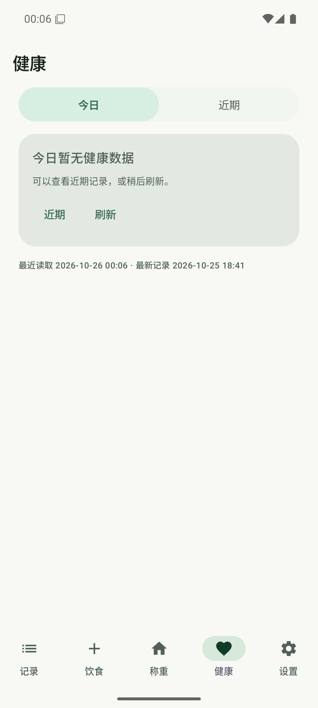
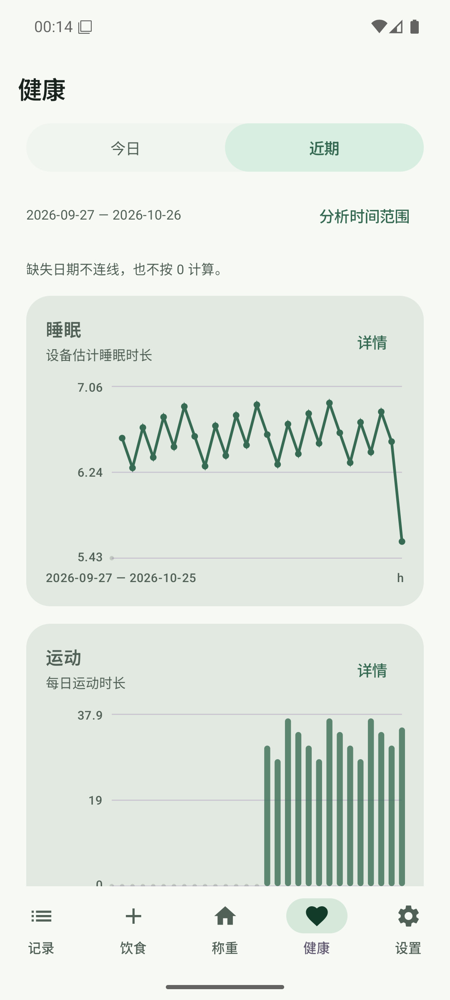
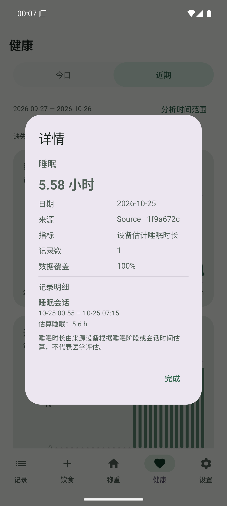

# 健康全量与增量同步

- 日期：2026-10-25 开始，2026-10-26 跨日复核和收尾；文件按开始日期编号。
- 分支：`codex/health-ai-analysis`；`0.3.3 / code 13` 基线上的未发布隔离测试版。
- 环境：API 36 / Android 16 Google APIs 模拟器，`emulator-5556`，`app.scalemate.fooddev`。
- 范围：健康读取、同步、统计与上一阶段待提交的详情／趋势改动；健康 AI 仍由 `HEALTH_AI_ENABLED=false` 关闭。

## 最终行为

首次授权或新增类型先取得变更令牌，再读取该类型当前可读的全部历史，保存归一化记录及平台日聚合。页面先显示本地快照；进入健康页超过 60 秒未读取时自动更新，授权回调立即更新。后续按类别消费新增、更新与删除事件；没有变化时保留缓存，切换已覆盖的 7／28／90 天或全部范围不重新扫描平台历史。

修改记录时，同时重算旧、新时间段涉及的本地日。普通记录与日聚合分开更新，避免重建汇总时删掉明细。变更记录、聚合和下一游标同事务提交；令牌无效／过期、历史权限或时区变化时按类别全量核对。读取部分失败保留该类别已有缓存和旧游标，其他类别仍可成功。

SQLite 从 v5 升至 v6，新增 `health_records`、`health_sync_state`，不改餐食、体重、设备、食物库、草稿和服务业务表。公开明细导出移除内部平台 ID。内部归一化缓存与导出有效期为 24 小时、下次运行清理的快照 JSONL 用途不同，详见 [数据能力与同步合同](../06-Health%20Connect%20数据能力与格式.md#81-全量增量与恢复合同)。

同批整理的已授权健康界面改动包括：睡眠按小时、运动会话总时长、皮肤温度基线与相对变化分开、点击查看记录摘要；近期使用有纵坐标的折线／柱状图，展开后继续为图表；“查看依据”改为“详情”。跨日没有今日数据时明确显示“今日暂无健康数据”，不误导用户重新授权，不用昨天或 0 填充。

## 自动验证

```sh
python3 scripts/check_i18n.py
./gradlew -PfoodDev :app:testDebugUnitTest :app:lintDebug :app:assembleDebug :app:assembleDebugAndroidTest --max-workers=2 --console=plain
git diff --check
```

- JVM：188 项通过，0 失败，0 错误，0 跳过。
- Lint：0 错误，133 条告警。
- 国际化：767 对字符串的名称与格式参数一致。
- Debug 和 AndroidTest APK 均构建成功，测试 APK 的 `targetPackage` 核对为 `app.scalemate.fooddev`。
- `HealthSyncLocalTest` 使用合成数据与独立 SQLite，覆盖首次导入早于展示区间的历史、无变化刷新、范围扩大、修改日期保留其他餐次、纯删除、聚合失败及重试、无效令牌与权限变化、跨午夜／夏令时边界。
- `HealthStoreLocalTest` 覆盖事务内游标写入失败时记录回滚、同步状态持久化和业务数据迁移保留；公开导出的回归验证内部平台 ID 不泄漏。

### 模拟器真实 Health Connect

```sh
adb -s emulator-5556 install -r app/build/outputs/apk/debug/app-debug.apk
adb -s emulator-5556 install -r app/build/outputs/apk/androidTest/debug/app-debug-androidTest.apk
adb -s emulator-5556 shell am instrument -w -r \
  -e class app.scalemate.HealthSyncDeviceTest \
  -e healthSyncLive true \
  app.scalemate.test/androidx.test.runner.AndroidJUnitRunner
```

`HealthSyncDeviceTest` 必须显式传入 `healthSyncLive=true`，并限制为模拟器及隔离包；普通测试运行不执行真实健康写入。它使用独立本地数据库，只写入一条带本轮随机客户端 ID 的合成营养记录，结束按该 ID 删除，保留其他来源与既有记录。

同一最终 APK 上通过 1 项真实平台集成测试，包含以下连续步骤：

1. 首次完整读取并保存有效令牌，再次无变化读取确认不重新全量。
2. 写入合成营养，消费增量后核对平台 ID 和当日能量聚合。
3. 用相同客户端 ID、更高版本将记录移至前一天并改数值，核对两个日期的汇总与平台一致。
4. 删除该记录，确认原始记录和旧聚合不残留，其他原始记录集合不变。
5. 把独立测试库的令牌设为无效值，确认增量异常后自动全量恢复，并保存新的有效令牌。

这使用模拟器内真实 Health Connect 服务，没有用固定返回值代替平台变更和聚合接口。结果见 [仪器测试日志](2026-10-25-07-emulator-evidence/health-sync-device.txt)；[检查摘要](2026-10-25-07-emulator-evidence/checks.json) 包含测试数量与最终 APK 摘要。

## 页面与数据核对

- 7、28、90 天与全部可读历史切换后，图表范围随选择更新；此前 2026-10-25 的样例营养保持 1,500 kcal，不再退化为单餐中位数 570 kcal。
- “最新记录”来自实际明细时间，不使用日聚合的区间终点，不再因无增量而变成空值。
- 在模拟器撤销营养读取权限后，从设置进入系统授权页重新允许；返回权限页时九类同步时间已更新，无需进入健康页或手动刷新。随后返回健康页，仍可读取历史数据。
- 实际跨越 10 月 25 日至 26 日后，近期时间范围自动移到 26 日；今日无记录时呈现独立空状态，历史图表与详情仍可查询。
- 睡眠详情显示 5.58 小时及来源会话的起止、记录数和阶段覆盖度；图表按类别选择折线或柱状，AI 区域保持关闭。








截图为公开合成数据的模拟器证据，不是用户手机健康数据或 README 真机截图。

## 首次失败与修复

早期迭代发现范围替换未清掉旧记录、全量聚合没有进入本地缓存，以及增量统计同时产生平台日聚合和原始单餐中位数的问题。模拟器曾出现 1,500 kcal 变成 570 kcal、最新记录为空。随后将日聚合持久化，在统计时按同日同字段采用平台总量，并让增量只替换受影响的聚合桶；最终的单元与真实平台验证均通过。

另外补查了“更新日期需重算旧日期”和“重算聚合不能删除明细”，以真实新增／移动／删除流程核对。跨日首次界面复核发现空状态沿用“尚未授权”文案，已修正并重新构建和复核。

## 手机与边界

- 已把最终 APK 正常覆盖到手机已有橙色测试版。安装前核对包名与同一 debug 证书；安装前后对设备、体重、餐食、模板、食物库、AI 服务和饮食设置七张业务表进行只读摘要比较，一致。未卸载 App、清空数据或在手机写入合成健康记录。
- 手机端只确认覆盖安装与业务表保留；未重新操作手机健康授权和测量读取耗时，不能把模拟器结果当成厂商设备或目标应用读取结果。
- 模拟器仪器测试完成后移除 `app.scalemate.test`；手机没有安装额外测试工具。
- 本轮没有发版、改版本号或打 Tag；不代表已发布。
- 未新增后台周期同步，未开启健康 AI；未改饮食识别 Prompt，因此未调用真实饮食 AI 基准。
- 运动路线逐条授权、医疗数据、Google Fit 等目标应用显示、实秤和厂商后台行为不在本轮真实平台测试范围内。
