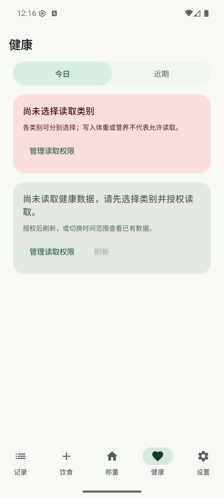

# 健康数据预览版发布与附件核验

- 日期：2026-10-31（Asia/Shanghai）
- 发布提交：`e0ad6c68655143cb692873e963a7788380522833`
- Tag／版本：`v0.4.0-preview.1` / `0.4.0-preview.1` / versionCode `14`
- Release：[称伴 · ScaleMate 0.4.0-preview.1](https://github.com/rccoder/ScaleMate/releases/tag/v0.4.0-preview.1)

## 发布门槛

发布提交的 [Android CI](https://github.com/rccoder/ScaleMate/actions/runs/41166228286) 与 [Signed Android Release](https://github.com/rccoder/ScaleMate/actions/runs/41166543974) 均成功。Tag 指向发布提交，Release 为非草稿 prerelease，包含 `ScaleMate.apk`、`SHA256SUMS`、`signing-certificate.txt`、`update.json`、`update.json.sig`、`releases.json`、`releases.json.sig` 七份附件；正式 Latest 仍为 `v0.3.3`。

实际下载的 APK 为 25,775,420 字节，SHA-256：

```text
cb28eff09aba1dd5e4625188b0bbdeb00416085359c6a53d0a5c2d0888208169
```

`SHA256SUMS`、包名 `app.scalemate`、版本名、versionCode、非调试属性与固定证书均通过 `check_release.py` 核验。证书 SHA-256 为 `9836e7ea5e5dc782be63e7b21c39cb0fa9f6a9633d18952664e83cfaa8172ed5`，与仓库内固定指纹一致。

下载后的 `update.json`、`update.json.sig`、`releases.json` 和 `releases.json.sig` 已用仓库外固定发布密钥导出的公钥验签；更新清单中的 Tag、版本码、APK 大小和摘要与实际附件一致。Release 正文与 `docs/releases/v0.4.0-preview.1.md` 一致，仅 GitHub API 返回末尾多一个换行。

## 应用内升级

在 API 36 Google APIs 模拟器先安装正式版 `0.3.3 / code 13`，保持正式通道时未发现预览更新；主动选择预览通道后，应用发现 `0.4.0-preview.1 / code 14`，经 GitHub 官方线路完成应用内下载、清单校验与 Android 系统安装确认。覆盖安装后包版本变为 `0.4.0-preview.1 / code 14`，应用正常启动并显示新增“健康”Tab。

本轮模拟器没有业务记录，因此只证明通道切换、应用内发现／下载／签名校验、系统覆盖安装和启动路径，不声称已验证非空餐食、体重、草稿或真实 Health Connect 数据的保留。升级方式为正常覆盖安装，没有卸载、清数据或降低版本码。



## 下载线路

实际附件测速中，GitHub 官方、`gh-proxy.com` 和 `ghproxy.net` 返回的 APK 大小与 SHA-256 均正确。`ghfast.top`、`gh-proxy.org` 在 180 秒总时限内超时，`gh.llkk.cc` 建立连接后被重置。完整结果见 [source-report.json](2026-10-31-01-health-preview-release-evidence/source-report.json)；失败的线路没有被描述为可用，也不保证线路长期稳定。

## 未覆盖边界

- 未在用户手机完成应用内升级；手机包、真实业务记录和非空数据迁移仍需后续验收。
- 未在手机验证真实 Health Connect 授权、目标来源数据、读取耗时和不同来源字段完整性。
- 模拟器健康页未授予读取类别，截图只证明新版本和页面入口可用，不代表真实健康数据读取成功。
