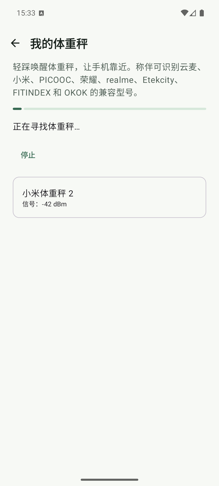
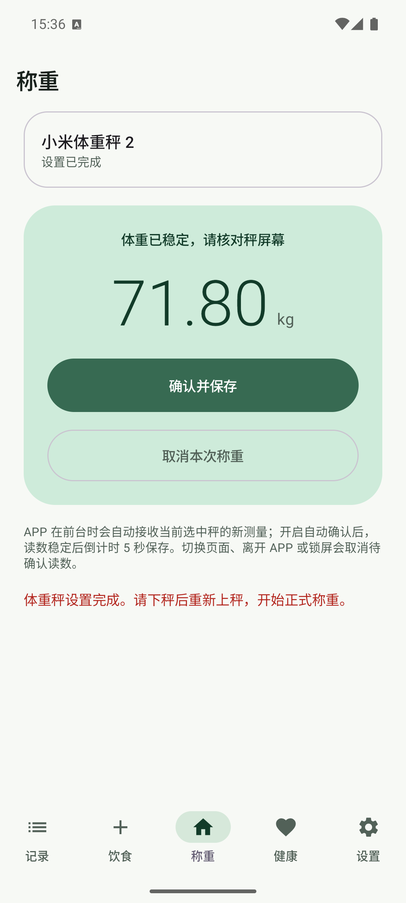
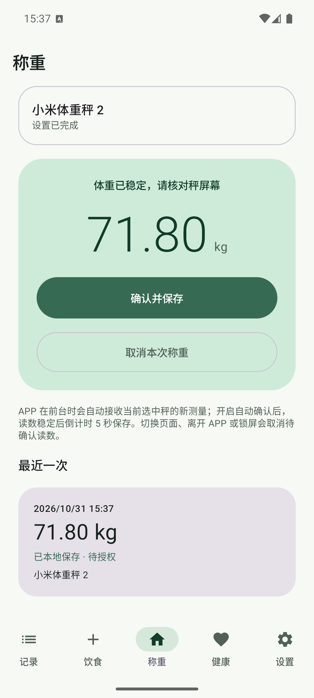

# 蓝牙体重秤 GATT 协议与模拟器 Mock 验收

- **日期**：2026-10-31
- **版本**：`0.4.0-preview.2 / versionCode 15`（工作区未发布改动）
- **设备**：`ScaleMate_API_36` AVD，API 36 / Android 16，x86_64，`emulator-5556`
- **包**：`app.scalemate.fooddev`，Debug 隔离测试版
- **性质**：JVM 协议回归与模拟器 Mock UI 验收；不是真实蓝牙或真实 Health Connect 验收

## 本轮范围

本轮补齐广播以外的 GATT 连接路径，接入小米体重秤 2／体脂秤 2、云麦 Mini/SE、PICOOC 连接型、荣耀 AH100/CH100 与 realme RMH2011 的本地协议实现，并扩展测试版扫描提示和型号目录。

同时修正两个传输边界：

- GATT 协议中的 `DISCONNECT` 操作现在会实际调用 `BluetoothGatt.disconnect()`。
- 云麦 GATT 最终帧会校验末尾 XOR 字节，错误帧不再产生体重。

## JVM 与构建

| 检查 | 结果 |
| --- | --- |
| `python3 scripts/check_i18n.py` | 797 组中英文资源通过；名称与格式参数一致 |
| `./gradlew :app:testDebugUnitTest :app:lintDebug :app:assembleDebug` | 通过；263 项单测，0 失败，0 跳过 |
| `./gradlew -PfoodDev :app:assembleDebug :app:assembleDebugAndroidTest` | 通过；测试版 APK 与仪器测试 APK 均产出 |
| `git diff --check` | 通过 |

协议测试覆盖广播解析、GATT 命令顺序、鉴权／混淆、校验、单位换算和最终帧。荣耀 CH100 的两组厂商真实抓包向量已通过解析，但仍不能替代称伴实机连接。

## 模拟器 Mock 流程

Mock 仅在 Debug 构建中通过 `mockScales=true` 启动参数注入，不进入 Release。Mock 设备固定为 `AA:BB:CC:DD:EE:FF`，型号为小米体重秤 2，最终读数为 `71.8 kg`。

实际操作路径：

1. 扫描发现小米体重秤 2，信号为 `-42 dBm`。
2. 选择设备并完成首次试称，界面显示 `71.80 kg`。
3. 核对读数并选择“每次手动保存”，秤状态变为“设置已完成”。
4. 启动下一次称重，确认并保存 `71.80 kg`。
5. 因未授权 Health Connect，记录按预期保留在本地并显示“待授权”。







只读查询测试版数据库后确认绑定与测量都保存了真实型号 ID，而不是回退到默认云麦：

```text
scales: name=xiaomi-mi-smart-scale-2, address=AA:BB:CC:DD:EE:FF, verified=1, modelId=xiaomi-mi-smart-scale-2
measurements: source=xiaomi-mi-smart-scale-2, kg=71.8, status=permission, modelId=xiaomi-mi-smart-scale-2
```

## 验证边界

- Mock 绕过 Android BLE 扫描、GATT 服务发现、通知订阅、写回调和真实射频，只证明 UI 状态机、型号目录、本地绑定与保存路径。
- 除云麦 YMBS-M263 外，本轮新增型号均未完成称伴实机连接、连续读数、断线重连或固件差异验收。
- 未授权或写入 Health Connect，不能据此宣称目标健康应用已收到体重。
- 未读取或展示体脂率、阻抗、心率等人体成分；即使协议帧包含这些字段，当前产品只保存体重。
- 仪器测试 APK 已构建但本轮未执行 `connectedDebugAndroidTest`；模拟器验收采用 Debug Mock UI 流程。
