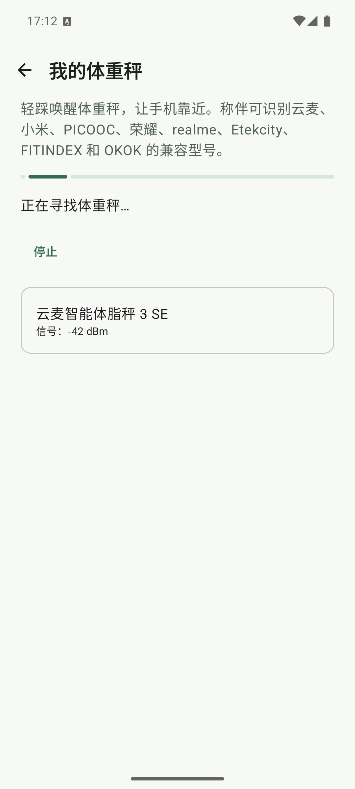
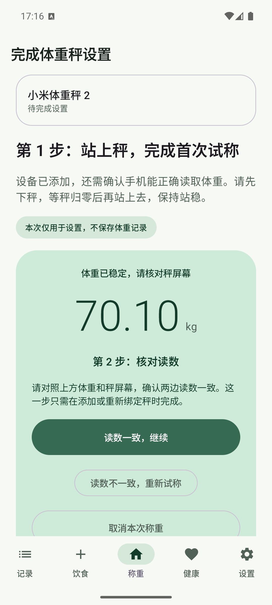
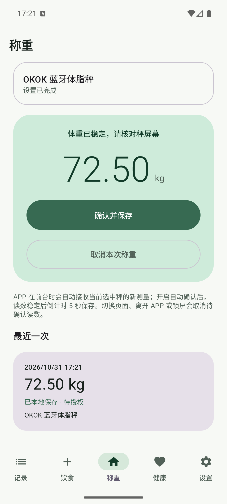

# 蓝牙体重秤全型号 Mock 交互验收

- **日期**：2026-10-31
- **版本**：`0.4.0-preview.2 / versionCode 15`（工作区未发布改动）
- **设备**：`ScaleMate_API_36` AVD，API 36 / Android 16，x86_64，`emulator-5556`
- **包**：`app.scalemate.fooddev`，Debug 隔离测试版
- **性质**：16 个已接入型号的模拟器 Mock UI 验收；不是真实蓝牙、真实硬件或 Health Connect 验收

## 为什么补做

上一轮只完整走通了小米体重秤 2 的模拟器流程，不能证明其他型号在设备发现、候选确认、绑定、首次试称、保存模式选择、再次称重和数据库落库时没有型号特有问题。本轮对 `ScaleCatalog` 中全部 16 个目录型号逐一执行同一套真实 UI 操作。

BLE 发现结果和称重帧由 Debug-only Mock 传输层提供；除此之外，页面跳转、按钮点击、确认对话框、状态机、本地绑定、测量保存和数据库查询都使用称伴实际实现。

每测一个型号前移除上一台，只是为了隔离该型号的绑定状态，不代表产品只能保存一台秤。多台不同型号共存、首页切换和称重来源归属另见 [多秤绑定与切换验收](2026-10-31-06-蓝牙体重秤多秤绑定与切换验收.md)。

## 实测路径

每个型号都执行以下步骤：

1. 从设置页实际点击“我的体重秤”进入设备管理。
2. 如果已有绑定，实际点击“移除体重秤”，确认从设备页消失。
3. 实际点击“扫描附近的秤”。
4. 核对扫描结果中的对外显示名、`-42 dBm` 信号和对应 Mock 型号。
5. 点击候选设备，核对“确认这台秤”对话框中的型号名称。
6. 点击“添加并开始试称”，等待首次稳定读数，并核对页面显示的 Mock 体重。
7. 点击“读数一致，继续”，选择“每次手动保存”，等待“设置已完成”。
8. 完成设置后启动下一次称重，点击“确认并保存”。
9. 核对首页出现“已本地保存 · 待授权”的最近记录。
10. 只读查询测试版 SQLite，确认绑定和测量都保存了对应 `modelId`。

底部导航的系统触摸注入在模拟器上不稳定，因此 Debug 启动参数使用 `startPage=settings` 直接进入设置页。进入“我的体重秤”之后的路径没有绕过页面或业务状态机，全部是实际点击与 UI 文本断言。

## 型号结果

Mock 地址从 `AA:BB:CC:DD:EE:01` 递增到 `10`，每项使用不同的体重，避免不同型号共享同一份成功状态而未真正重新走流程。

| # | 对外显示名 | 型号 ID | Mock 地址 | 体重 | 结果与证据 |
| --- | --- | --- | --- | --- | --- |
| 1 | 云麦智能体脂秤 3 SE | `yunmai-smart-body-fat-scale-3-se` | `AA:BB:CC:DD:EE:01` | 68.00 kg | [通过](2026-10-31-05-bluetooth-scale-all-models-mock-evidence/01-yunmai-smart-body-fat-scale-3-se/validation.json) |
| 2 | 云麦 mini 系列智能体脂秤 | `yunmai-mini-gatt-body-fat-scale` | `AA:BB:CC:DD:EE:02` | 68.30 kg | [通过](2026-10-31-05-bluetooth-scale-all-models-mock-evidence/02-yunmai-mini-gatt-body-fat-scale/validation.json) |
| 3 | 云麦 SE 智能体脂秤 | `yunmai-se-gatt-body-fat-scale` | `AA:BB:CC:DD:EE:03` | 68.60 kg | [通过](2026-10-31-05-bluetooth-scale-all-models-mock-evidence/03-yunmai-se-gatt-body-fat-scale/validation.json) |
| 4 | YUNMAI X 智能秤 | `yunmai-x-smart-body-fat-scale` | `AA:BB:CC:DD:EE:04` | 68.90 kg | [通过](2026-10-31-05-bluetooth-scale-all-models-mock-evidence/04-yunmai-x-smart-body-fat-scale/validation.json) |
| 5 | 云麦智能体脂秤 mini 2S | `yunmai-mini-2s-smart-body-fat-scale` | `AA:BB:CC:DD:EE:05` | 69.20 kg | [通过](2026-10-31-05-bluetooth-scale-all-models-mock-evidence/05-yunmai-mini-2s-smart-body-fat-scale/validation.json) |
| 6 | PICOOC 有品智能体脂秤 Mini Lite | `picooc-mini-lite-body-fat-scale` | `AA:BB:CC:DD:EE:06` | 69.50 kg | [通过](2026-10-31-05-bluetooth-scale-all-models-mock-evidence/06-picooc-mini-lite-body-fat-scale/validation.json) |
| 7 | PICOOC 有品连接型体脂秤 | `picooc-connection-body-fat-scale` | `AA:BB:CC:DD:EE:07` | 69.80 kg | [通过](2026-10-31-05-bluetooth-scale-all-models-mock-evidence/07-picooc-connection-body-fat-scale/validation.json) |
| 8 | 小米体重秤 2 | `xiaomi-mi-smart-scale-2` | `AA:BB:CC:DD:EE:08` | 70.10 kg | [通过](2026-10-31-05-bluetooth-scale-all-models-mock-evidence/08-xiaomi-mi-smart-scale-2/validation.json) |
| 9 | 小米体脂秤 2 | `xiaomi-mi-body-composition-scale-2` | `AA:BB:CC:DD:EE:09` | 70.40 kg | [通过](2026-10-31-05-bluetooth-scale-all-models-mock-evidence/09-xiaomi-mi-body-composition-scale-2/validation.json) |
| 10 | 荣耀体脂秤（AH100/CH100） | `honor-body-fat-scale-ah100` | `AA:BB:CC:DD:EE:0A` | 70.70 kg | [通过](2026-10-31-05-bluetooth-scale-all-models-mock-evidence/10-honor-body-fat-scale-ah100/validation.json) |
| 11 | realme 真我智能秤 | `realme-smart-scale-rmh2011` | `AA:BB:CC:DD:EE:0B` | 71.00 kg | [通过](2026-10-31-05-bluetooth-scale-all-models-mock-evidence/11-realme-smart-scale-rmh2011/validation.json) |
| 12 | Etekcity Fit 8S 智能健身秤 | `etekcity-fit-8s-body-fat-scale` | `AA:BB:CC:DD:EE:0C` | 71.30 kg | [通过](2026-10-31-05-bluetooth-scale-all-models-mock-evidence/12-etekcity-fit-8s-body-fat-scale/validation.json) |
| 13 | FITINDEX FT-26R-W 智能体重秤 | `fitindex-ft-26r-w-smart-scale` | `AA:BB:CC:DD:EE:0D` | 71.60 kg | [通过](2026-10-31-05-bluetooth-scale-all-models-mock-evidence/13-fitindex-ft-26r-w-smart-scale/validation.json) |
| 14 | OKOK 蓝牙体脂秤（V20） | `okok-v20-smart-scale` | `AA:BB:CC:DD:EE:0E` | 71.90 kg | [通过](2026-10-31-05-bluetooth-scale-all-models-mock-evidence/14-okok-v20-smart-scale/validation.json) |
| 15 | OKOK 蓝牙体脂秤（V11） | `okok-v11-smart-scale` | `AA:BB:CC:DD:EE:0F` | 72.20 kg | [通过](2026-10-31-05-bluetooth-scale-all-models-mock-evidence/15-okok-v11-smart-scale/validation.json) |
| 16 | OKOK 蓝牙体脂秤（VF0） | `okok-vf0-smart-scale` | `AA:BB:CC:DD:EE:10` | 72.50 kg | [通过](2026-10-31-05-bluetooth-scale-all-models-mock-evidence/16-okok-vf0-smart-scale/validation.json) |

16 个型号的 `validation.json` 均包含：

- `scan-found`、`confirm-dialog`、`trial-stable`、`verify-choice`、`setup-verified` 和 `measurement-saved`。
- `scales.verified=1`，且 `scales.modelId` 与当前型号一致。
- `measurements.modelId` 与当前型号、Mock 体重一致，状态为 `permission`。
- 首页截图中可以同时看到对应型号名、体重和“已本地保存 · 待授权”。

## 最终回归

| 检查 | 结果 |
| --- | --- |
| `python3 scripts/check_i18n.py` | 797 组中英文资源通过；名称和格式参数一致 |
| `./gradlew :app:testDebugUnitTest` | 263 项测试通过，0 失败，0 错误，0 跳过 |
| `./gradlew :app:lintDebug` | 通过；133 条 warning，无阻断错误；包含依赖版本、未使用资源、KTX 建议等非本轮功能失败项 |
| `./gradlew :app:assembleDebug` | 通过 |
| `./gradlew -PfoodDev :app:assembleDebug :app:assembleDebugAndroidTest` | 通过；隔离测试版与 AndroidTest APK 均产出 |
| `git diff --check` | 通过 |

## 截图证据

证据目录：[2026-10-31-05-bluetooth-scale-all-models-mock-evidence](2026-10-31-05-bluetooth-scale-all-models-mock-evidence/)

共 16 个型号目录、64 张 `1080×2400` PNG。每个型号目录固定包含：

| 文件 | 场景 |
| --- | --- |
| `01-found.png` | 扫描结果中的对外名称与信号 |
| `02-trial.png` | 首次试称与 Mock 体重 |
| `04-verified.png` | 手动保存模式与“设置已完成” |
| `06-saved.png` | 再次称重后“已本地保存 · 待授权” |

复现脚本：[validate_all_scale_ui.py](2026-10-31-05-bluetooth-scale-all-models-mock-evidence/validate_all_scale_ui.py)。脚本默认把截图和 `validation.json` 写入自身所在的证据目录，调用时传入型号、显示名、体重和序号。

## 验证边界

- Mock 只替代 BLE 发现和称重帧发送。它绕过 Android 射频、真实广播包、GATT 服务发现、通知订阅、写入回调和固件差异。
- 本轮证明 16 个型号在称伴 UI、绑定数据、型号路由、首次试称、手动保存和本地落库路径上没有发现型号特有问题。
- 本轮不证明真实硬件兼容。除云麦 YMBS-M263 有过历史实机验收外，其余型号仍必须在真机上完成扫描、连续读数、重连和稳定性验收。
- 未执行 Health Connect 授权和写入，因此不能据此宣称目标健康应用已经收到体重记录。
- JVM 协议测试、本轮模拟器 Mock UI 和真机实秤是三个独立层级；任一层通过都不能替代另外两层。
