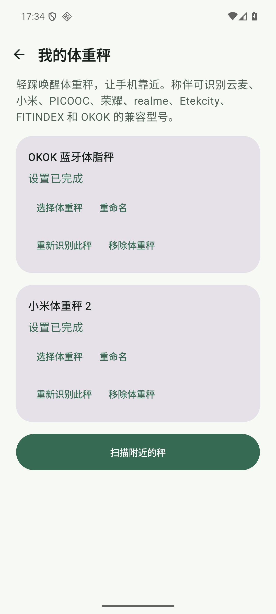
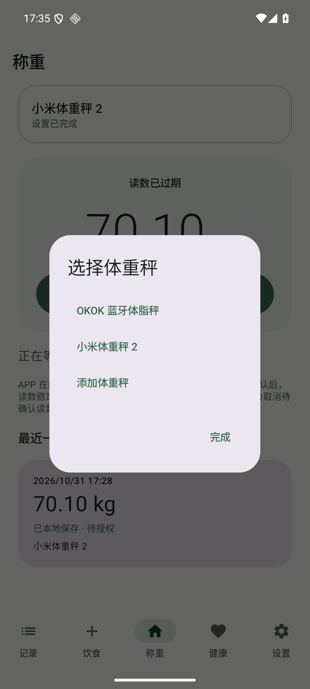

# 蓝牙体重秤多秤绑定与切换验收

- **日期**：2026-10-31
- **版本**：`0.4.0-preview.2 / versionCode 15`（工作区未发布改动）
- **设备**：`ScaleMate_API_36` AVD，API 36 / Android 16，x86_64，`emulator-5556`
- **包**：`app.scalemate.fooddev`，Debug 隔离测试版
- **性质**：多台秤共存、选择和称重路由的模拟器 Mock UI 验收；不是多台真实 BLE 硬件并行连接验收

## 结论

称伴支持在同一台手机上保存多台秤。用户可以保留已经绑定的小米、云麦、PICOOC、荣耀、realme、Etekcity、FITINDEX 或 OKOK 设备，并从首页或设备页选择其中一台作为当前称重设备。

这里的“支持多秤”是指：

- 数据库可以同时保存多条设备绑定。
- 设备管理页会列出全部已绑定设备。
- 首页选择器会列出全部设备，并允许切换当前设备。
- 当前设备 ID 保存到本地偏好，重启应用后继续使用上次选择。
- 同一时间只连接和称重一台当前设备，避免多台设备同时推送读数造成归属不清。
- 移除一台秤不会删除其他绑定；历史称重记录仍保留原设备来源。

## 实际验证

初始数据库中已有 OKOK VF0。随后在不清空已有设备的情况下，通过完整 UI 添加小米体重秤 2：

1. 从设置页进入“我的体重秤”。
2. 点击“扫描附近的秤”。
3. 选择小米体重秤 2，完成确认、首次试称和手动保存模式设置。
4. 再次称重并保存 `70.10 kg`。
5. 设备页同时显示 OKOK VF0 和小米体重秤 2，两台状态均为“设置已完成”。
6. 首页点击当前秤卡片，选择器同时显示两台设备和“添加体重秤”。
7. 从小米切换到 OKOK，确认本地 `active` 偏好更新为 OKOK 的设备 ID。
8. 使用 OKOK Mock 保存 `72.50 kg`，数据库记录的 `deviceId`、`source` 和 `modelId` 都是 OKOK。
9. 从 OKOK 切回小米，确认本地 `active` 偏好更新为小米设备 ID。
10. 使用小米 Mock 保存 `70.10 kg`，数据库记录的 `deviceId`、`source` 和 `modelId` 都是小米。

两台设备的最后记录分别为：

```text
OKOK: 219e850e-...|okok-vf0-smart-scale|72.5|okok-vf0-smart-scale
Xiaomi: 56360cb8-...|xiaomi-mi-smart-scale-2|70.1|xiaomi-mi-smart-scale-2
```

## 截图证据

证据目录：[2026-10-31-06-bluetooth-scale-multi-binding-evidence](2026-10-31-06-bluetooth-scale-multi-binding-evidence/)

| 文件 | 场景 |
| --- | --- |
| `01-xiaomi-mi-smart-scale-2/01-found.png` | 保留 OKOK 的情况下发现小米体重秤 2 |
| `01-xiaomi-mi-smart-scale-2/02-trial.png` | 小米首次试称 |
| `01-xiaomi-mi-smart-scale-2/04-verified.png` | 小米设置完成 |
| `01-xiaomi-mi-smart-scale-2/06-saved.png` | 小米首次保存 |
| `02-home-active-xiaomi.png` | 首页当前设备为小米 |
| `03-two-scales-devices.png` | 设备页同时显示 OKOK 和小米 |
| `04-scale-picker.png` | 首页选择器同时提供两台秤 |
| `05-home-active-okok.png` | 切换后首页当前设备为 OKOK |
| `06-okok-weighing-after-switch.png` | OKOK 称重保存，归到 OKOK |
| `07-home-active-xiaomi-after-switch.png` | 再切回小米称重保存，归到小米 |





## 自动化覆盖

`StoreTest#multipleDistinctScalesCoexistAndCanBeRemovedIndependently` 新增了数据层回归：

- 两个不同地址、不同型号的设备可以同时保存。
- 获取设备列表时保持两台设备。
- 移除其中一台后，另一台仍保留。

## 验证边界

- 本轮 Mock 仍然只替代 BLE 发现和称重帧发送；绑定、列表、选择器、偏好持久化和 SQLite 写入都走真实应用逻辑。
- 同一时间只监听当前选中的一台秤，这是产品设计，不是多台秤同时连接或并行称重。
- 本轮没有验证两台真实设备在蓝牙射频层的切换时序、重连和系统蓝牙缓存行为。
- 未执行 Health Connect 授权或写入；多设备记录已正确落到本地 SQLite。
