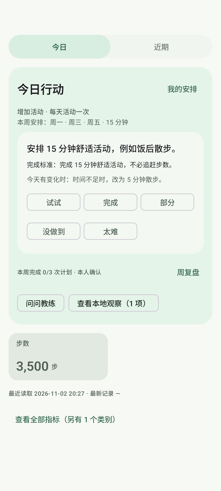
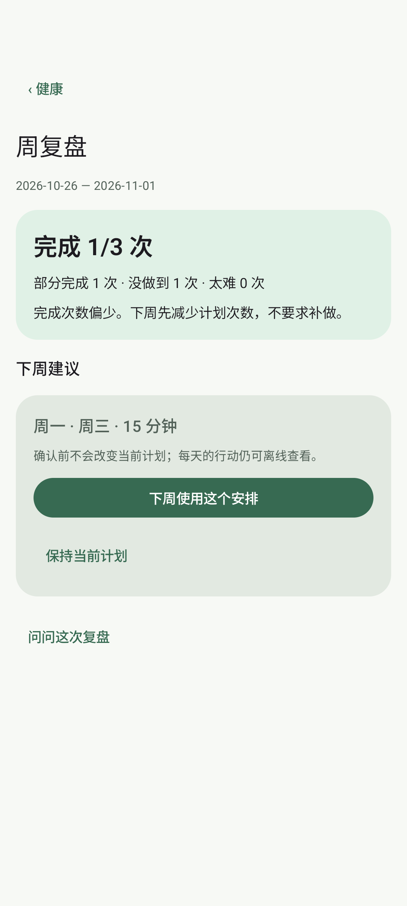
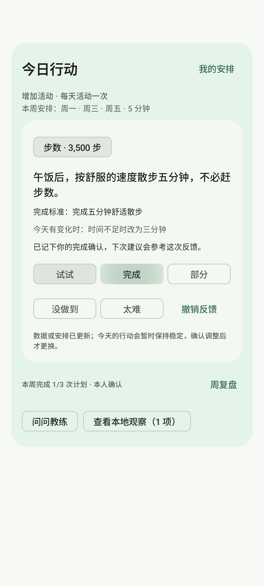
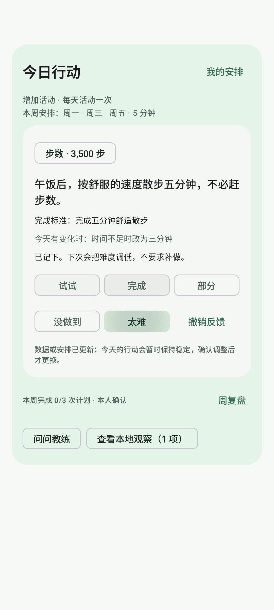
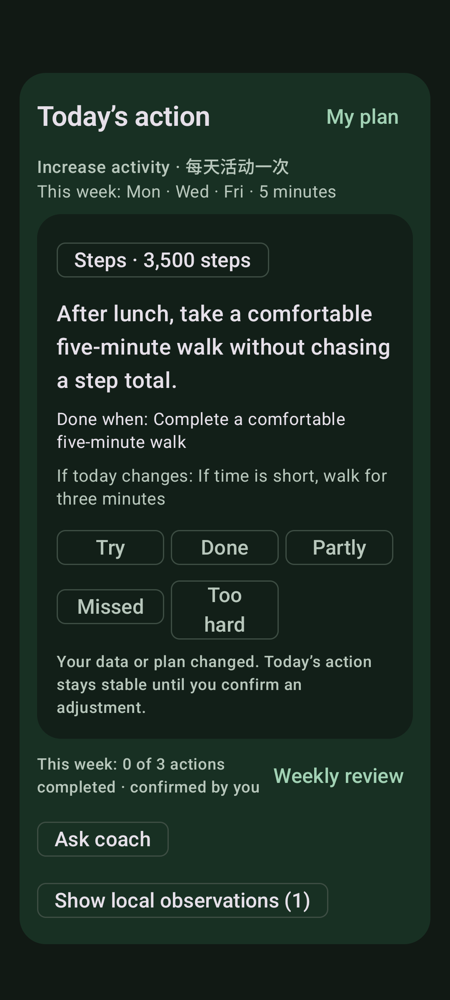

# 健康教练连续闭环：模拟器与真实模型验收

> 日期：2026-11-02
> 分支：`codex/health-coach-follow-through`
> 代码基线：`79e87e3`，本轮后续修改见分支 HEAD
> 范围：今日行动、完成反馈、本周进度、周复盘、下周计划确认，以及无 AI／休息日／旧行动降级。

## 一、结论

健康教练已从“指标加问答”推进到本地优先的连续闭环：

`今日行动 → 用户反馈 → 本周进度 → 周复盘 → 用户确认下周计划`

今日行动不再依赖每天调用 AI。保存周计划后，应用按已确认的计划日自动生成当天行动；用户确认完成、部分完成、没做到或太难度后，本地进度立即变化。周复盘由本地记录统计，只有用户确认后才应用下周日期和时长。

本轮同时修正了三个实际体验问题：

- 今日行动原先接近一整张报告，占满首屏；现在压缩为“一个行动、完成标准、替代方案、清晰反馈”，首屏仍能看到主要指标和“查看全部”。
- AI 不再默认承担每日行动生成；本地计划不展示无意义的“更新 AI 解读”入口，AI 仅在主动追问、首次规划或用户要求解释时参与。
- 今天不是计划日时，不再把旧行动伪装成今日行动；页面明确显示“今日安排／今天是休息日／下一次计划”。

## 二、交互变化

- 今日行动置顶，目标、周安排和行动放在同一视觉层级内，完整指标后移。
- 反馈固定为 `3＋2` 两行：`试试／完成／部分`、`没做到／太难`；反馈后可直接改选或撤销。
- “我的安排”仍是目标和计划入口，教练记忆从“我的安排”进入，不再占用首页主卡。
- 本周完成次数与“周复盘”合并到一行，减少独立按钮和说明。
- 周复盘展示完成、部分完成、没做到、太难次数，并给出维持、减少次数或缩短动作的下一步；用户确认前不改变旧计划。
- 休息日显示下一次计划，不回放上一次行动。
- 中英文、深色模式和大字体使用同一结构，不用固定宽度假定中文长度。

## 三、本地行为验证

`HealthCoachHomeDeviceTest` 已改为真实验证完整本地路径，而不是预置当天行动：

1. 只保存目标、计划日和上一周反馈。
2. `HealthViewModel` 重载后自动生成当天本地行动。
3. 今日行动来源为 `local`，不需要配置 AI 服务。
4. 重新创建 ViewModel 后，当天计划仍只有一条，不重复生成。
5. 周复盘确认后，计划日从原来的安排变为下周候选安排。

## 四、模拟器与测试结果

设备：`emulator-5554`，API 36 `sdk_gphone64_x86_64`。

- `./gradlew testDebugUnitTest lintDebug :app:assembleDebug :app:assembleDebugAndroidTest -PfoodDev`：通过
- JVM：344 项，0 失败、0 错误、0 跳过
- Lint：0 错误、152 条告警
- `HealthCoachInteractionDeviceTest`：5 项通过
- `HealthCoachHomeDeviceTest`：1 项通过

本轮截图使用合成目标、合成 3,500 步数据和固定本地行动，不含用户健康记录：

## 五、真实模型闭环

从 API 36 模拟器的 Health Connect 合成季度数据读取健康快照，使用宿主环境提供的真实 Anthropic 兼容模型 `codex/gpt-6.1-sol`。模型请求通过 `adb reverse` 访问本机代理，端点、密钥和原始回答不进入仓库或日志。

`HealthCoachFlowDeviceTest` 真实验证了：

1. 真实健康快照 + 真实模型生成首个行动。
2. 用户选择“太难”。
3. 在“我的安排”中改为 5 分钟并标记今天有点累。
4. 模型按反馈生成更轻松的替代行动。
5. 用户确认完成。
6. 重新创建 ViewModel 后行动、反馈和目标保持。
7. 使用无效模型触发失败路径，旧行动和完成状态不丢失。

结果：1 项通过，总耗时 30.41 秒。测试使用隔离数据库，结束后删除。

## 六、首次失败与处理

- 首次真实运行没有选中文本服务；改为测试显式传入临时服务，不写用户服务配置。
- 随后缺少健康快照；在模拟器写入公开合成季度 Health Connect 数据并执行正常同步后重跑。
- 第一次模型请求出现 `ConnectException`，因为模拟器不能直接访问宿主机的 `127.0.0.1` 代理；使用 `adb reverse` 后通过。
- 一次偏好交互测试没有滚动到“5 分钟”，读到旧值 15；修复测试的滚动和选中断言后通过，产品逻辑未改。
- 最终重跑前旧模拟器离线；同一 AVD 无快照重启后，最终 6 项交互和真实模型流程均通过。

## 七、边界

- 真实模型只验证本轮一条完整生产通路，不代表所有供应商、模型和网络条件都稳定。
- 健康数据是 API 36 模拟器中的合成数据，不是用户手机真实 Health Connect 数据。
- 本轮没有做真机覆盖升级、公开包发布、后台通知或真实训练动作级数据验证。
- 月度目标进展、跨月自动进阶、计划版本历史和训练 RPE／组数仍是 P1／P2。
- 本轮没有修改饮食识别 Prompt，因此不需要重跑四张饮食 Prompt 基准图。
