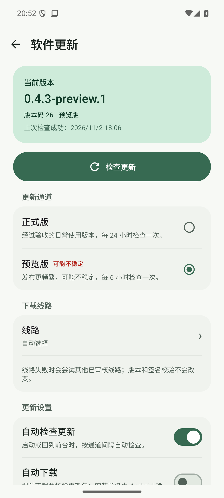
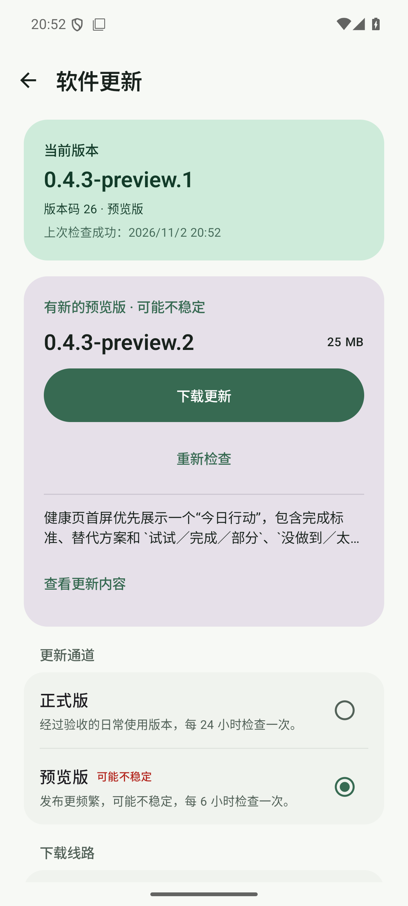
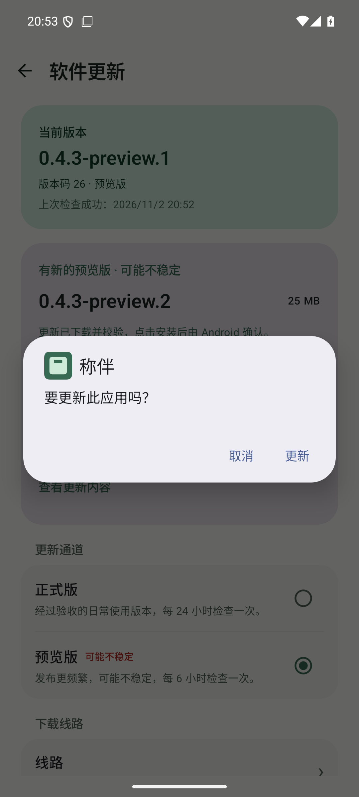
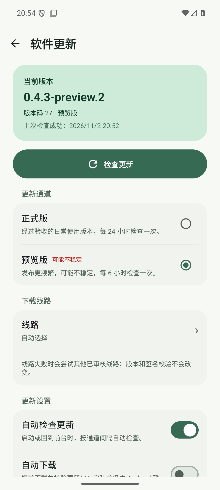
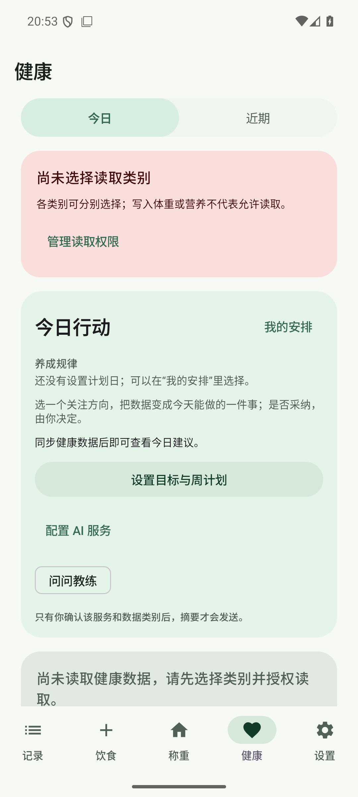

# 健康教练连续闭环预览版发布与附件核验

> 日期：2026-11-02
> 版本：`0.4.3-preview.2 / versionCode 27`
> 发布提交：`7c3c38652c3646832a8c07cc214c9c19ba1d8180`
> 范围：同提交 CI、固定签名 Release、实际附件、更新清单签名、下载线路与模拟器应用内覆盖升级。

## 一、结论

`v0.4.3-preview.2` 已发布为 GitHub prerelease，包含 7 份预期附件，Latest 仍为 `v0.4.2`。下载后的 APK、签名、版本与更新元数据均通过独立核验；API 36 模拟器从已安装的 `0.4.3-preview.1` 通过应用内预览通道发现 `.2`，完成下载、校验、Android 确认和覆盖安装，启动后进入新版健康页并显示“今日行动”。

- Release：https://github.com/rccoder/ScaleMate/releases/tag/v0.4.3-preview.2
- 同提交 CI：https://github.com/rccoder/ScaleMate/actions/runs/41446655390
- 固定签名发布：https://github.com/rccoder/ScaleMate/actions/runs/41447460185

## 二、发布门槛

- 工作区从 `codex/health-coach-follow-through` 合入 `main`，发版提交只增加版本号、Release 说明和文档状态。
- `python3 -m unittest discover -s scripts -p 'test_*.py'`：15 项通过。
- `python3 scripts/check_release.py --tag v0.4.3-preview.2 --check-previous-code`：通过，版本码 27 高于两个通道历史版本。
- `./gradlew testDebugUnitTest lintDebug :app:assembleDebug :app:assembleDebugAndroidTest`：成功。
- JVM：344 项通过，0 失败、0 错误、0 跳过。
- Lint：0 错误，152 条既有告警。
- 同提交 Android CI 在 5 分 30 秒后成功，之后才创建 annotated Tag。

## 三、实际附件

从 GitHub Release 下载实际产物到临时目录后核验，附件数量为 7：

| 附件 | 字节 |
| --- | ---: |
| `ScaleMate.apk` | 26,426,544 |
| `SHA256SUMS` | 80 |
| `signing-certificate.txt` | 957 |
| `update.json` | 2,087 |
| `update.json.sig` | 512 |
| `releases.json` | 1,950 |
| `releases.json.sig` | 512 |

APK：

- SHA-256：`7ad12ecb24f3295321cf104b4bcfc64a4e0a0b01c6ed9be7efb4ed7a7d646bbc`
- `SHA256SUMS`：校验通过
- 包名：`app.scalemate`
- 版本：`0.4.3-preview.2 / versionCode 27`
- 调试属性：未设置 `debuggable`
- 签名：v2 校验通过，固定证书 SHA-256 为 `9836e7ea5e5dc782be63e7b21c39cb0fa9f6a9633d18952664e83cfaa8172ed5`

更新元数据：

- `update.json.sig` 使用固定发布公钥验签通过
- `releases.json.sig` 使用同一固定发布公钥验签通过
- `update_manifest.py verify` 通过，Tag、版本、版本码、APK 摘要与大小一致
- `update.json.channel` 为 `preview`

## 四、下载线路

使用发布附件中的 `SHA256SUMS` 对六个配置线路执行实际下载与摘要核验：

- 成功：`github-official` 3.9 秒、`gh-proxy-com` 2.8 秒、`ghproxy-net` 100.8 秒、`gh-proxy-org` 2.4 秒。
- 失败：`ghfast-top` 读取超时 74.0 秒，`gh-llkk-cc` 返回 HTTP 522。
- 成功线路下载大小和 SHA-256 均与 Release 附件一致。

原始结果见 [source-report.json](2026-11-02-08-health-coach-loop-preview-evidence/source-report.json)。

## 五、模拟器覆盖升级

设备：`emulator-5554`，API 36 `sdk_gphone64_x86_64`。

1. 升级前确认已安装 `0.4.3-preview.1 / code 26`，应用内选择的通道为“预览版”。
2. 在“软件更新”中检查到 `0.4.3-preview.2 / code 27`，显示 25 MB 更新和预览风险提示。
3. 应用内下载完成后显示“更新已下载并校验”，点击安装后出现 Android 系统“要更新此应用吗？”确认框。
4. 确认覆盖安装，未卸载应用或清除数据。
5. 安装后包信息为 `0.4.3-preview.2 / code 27`，`firstInstallTime` 保持 `2026-10-31 12:09:19` 不变。
6. 启动后进入健康页，首屏显示“今日行动”和“设置目标与周计划”入口；应用内版本页显示 `0.4.3-preview.2 / 版本码 27 · 预览版`。

截图（均为模拟器合成环境，不含用户健康记录）：

## 六、Release 状态

- `isDraft=false`
- `isPrerelease=true`
- GitHub Latest 仍指向 `v0.4.2`，预览版没有占用 Latest
- Release 正文与本版 [Release 说明](../releases/v0.4.3-preview.2.md) 一致

## 七、边界

- 模拟器没有非空餐食、体重、AI 服务或真实 Health Connect 授权数据；本轮只能证明应用覆盖安装、首次安装时间保持和新版页面可启动，不能声称非空业务数据跨版本迁移已通过。
- 本轮没有在用户真机重新验证 Health Connect 授权、真实健康数据、蓝牙秤或真实模型；这些边界保持未覆盖。
- 下载线路结果只代表本轮网络环境，代理速度和可用性不作长期承诺。

