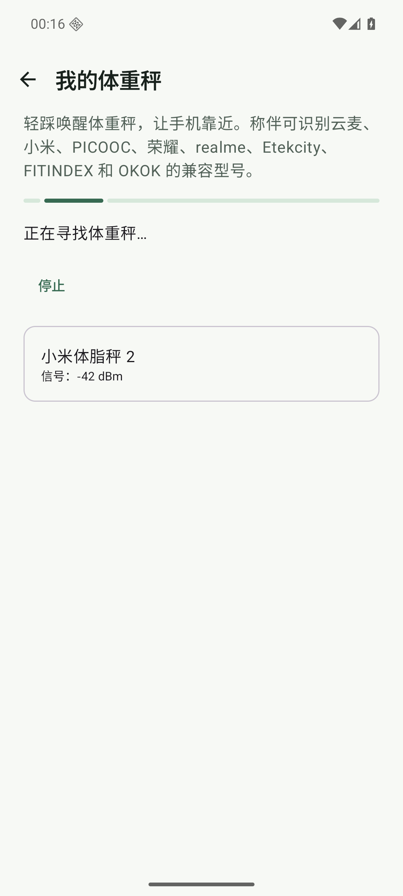
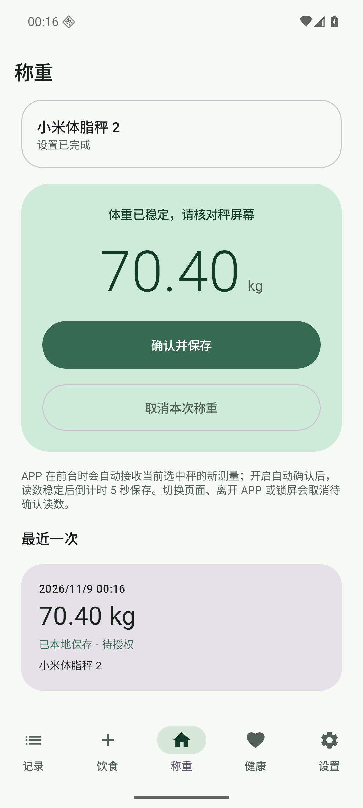

# 小米体重秤与体脂秤广播协议验收

- **日期**：2026-11-09
- **设备**：`ScaleMate_API_36` AVD，API 36 / Android 16，x86_64，`emulator-5556`
- **包**：`app.scalemate.fooddev`，Debug 隔离测试版
- **性质**：公开协议向量单测与模拟器 Mock UI 验收；不是小米实秤、真实射频或 Health Connect 验收

## 发现的问题

旧实现把小米体重秤和体脂秤都接到 `0x181D / 0x2A9D` 标准 GATT 体重服务。这个路径只能覆盖暴露标准 Weight Measurement 的小米体重秤或兼容固件，没有解析体脂秤常见的 `0x181B` 13 字节广播，因此旧文档中的“小米体脂秤 2 已支持”只代表型号目录和 Mock 流程，不代表真实协议已接通。

用户提供的 `qbbr/mi-scale-2` 采用 MIT 许可，可作为 `0x181D` 初代体重秤的参考，但它本身没有覆盖 `0x181B` 体脂秤路径，也没有协议测试，不能直接复制后宣称兼容体脂秤 2。本轮按公开协议字段重新实现，没有复制该仓库代码。

## 采用口径

小米同代协议并不需要因型号不同而各写一套解析器，因此目录按两个型号族管理：

| 型号族 | 型号 | 广播 | 帧长 | 体重转换 |
| --- | --- | --- | --- | --- |
| 小米体重秤／2 | `XMTZC01HM`、`XMTZC04HM` | `0x181D` | 10 字节 | kg 与 jin 为 `raw / 200`；lbs 为 `raw / 100 × 0.45359237` |
| 小米体脂秤／2 | `XMTZC02HM`、`XMTZC05HM` | `0x181B` | 13 字节 | kg 为 `raw / 200`；lbs 为 `raw / 100 × 0.45359237` |

两套协议都只在稳定且未移除负载时产生起始测量状态，离秤帧归零以重置连续监听。体脂秤帧中的阻抗字段不读取、不计算、不保存，也不对外展示人体成分。

`MIBCS`、`MIBFS` 与 `MI SCALE2` 存在代际和固件差异，本轮只把它们作为同一小米协议族的发现名称，不按名称推断用户拥有的是初代还是第二代，避免误标型号。

## 实现

- 删除旧的 `0x181D / 0x2A9D` 单一 GATT 适配器。
- 新增 `0x181D` 10 字节广播解析和 `0x181B` 13 字节广播解析。
- 支持 kg、jin、lbs、稳定、离秤与重复帧 token。
- 增加长度、单位、最大体重、地址、服务与移除负载边界测试。
- 更新中英文兼容列表和 README 型号族说明。

## 验证

首次定向测试 20 项中 1 项失败，原因是负例把 `60001` 写成了大端字节序，实际被解析为 `125.33 kg`。修正测试向量为小端后通过，产品解析代码未因该失败改变。

最终结果：

| 检查 | 结果 |
| --- | --- |
| 定向协议、路由与目录测试 | 通过 |
| `./gradlew :app:testDebugUnitTest` | 349 项通过，0 失败、0 错误、0 跳过 |
| `./gradlew :app:lintDebug` | 0 错误、153 条既有告警 |
| `./gradlew :app:assembleDebug :app:assembleDebugAndroidTest` | 通过 |
| `./gradlew -PfoodDev :app:assembleDebug` | 通过，安装到 API 36 模拟器 |
| `python3 scripts/check_i18n.py` | 957 组中英文资源通过 |
| `git diff --check` | 通过 |

## 模拟器交互

Mock 只替代蓝牙发现和称重帧，其他步骤全部走实际应用逻辑：

1. 进入“我的体重秤”，扫描并识别型号。
2. 点击候选秤并核对确认对话框。
3. 添加后完成首次稳定试称。
4. 选择“每次手动保存”并完成设置。
5. 再次称重、确认并在本地保存。
6. 只读查询 SQLite，确认绑定和测量的 `modelId` 与当前型号一致。
7. 移除本轮绑定，避免残留测试设备。

| 型号 | Mock 地址 | 体重 | 结果 |
| --- | --- | --- | --- |
| 小米体重秤 2 | `AA:BB:CC:DD:EE:08` | 70.10 kg | [validation.json](2026-11-09-01-xiaomi-broadcast-mock-evidence/08-xiaomi-mi-smart-scale-2/validation.json) |
| 小米体脂秤 2 | `AA:BB:CC:DD:EE:09` | 70.40 kg | [validation.json](2026-11-09-01-xiaomi-broadcast-mock-evidence/09-xiaomi-mi-body-composition-scale-2/validation.json) |

## 未覆盖

- 没有连接用户真实的小米体脂秤 2，未验证具体固件是否按 `0x181B` 13 字节广播、单位开关时序和离秤帧行为与公开向量完全一致。
- 模拟器没有真实 BLE 射频，Mock 不能证明扫描距离、连接时序、重连、低电量或固件差异。
- 未执行 Health Connect 写入；本轮只证明体重解析、型号路由、绑定和本地保存。

## 来源

- [qbbr/mi-scale-2](https://github.com/qbbr/mi-scale-2)：MIT 许可的 `0x181D` 初代体重秤参考，不包含 `0x181B`。
- [Theengs Decoder：XMTZC04HM/XMTZC01HM](https://github.com/theengs/decoder/blob/development/docs/devices/XMTZC04HM.md)
- [Theengs Decoder：XMTZC05HM/XMTZC02HM](https://github.com/theengs/decoder/blob/development/docs/devices/XMTZC05HM.md)
- [ESPHome Xiaomi Miscale](https://esphome.io/components/sensor/xiaomi_miscale/)
