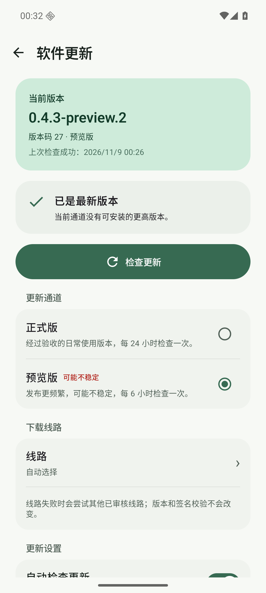
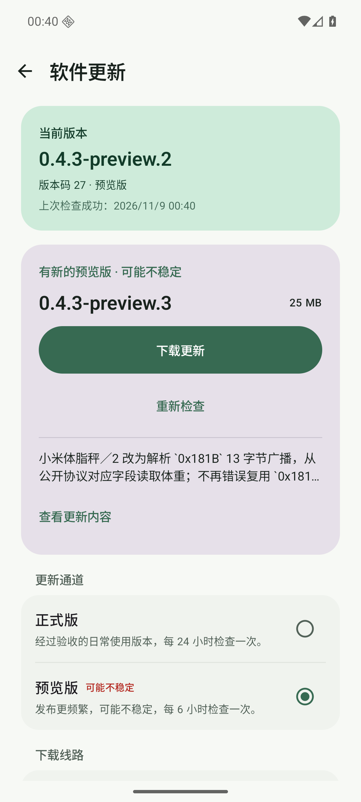
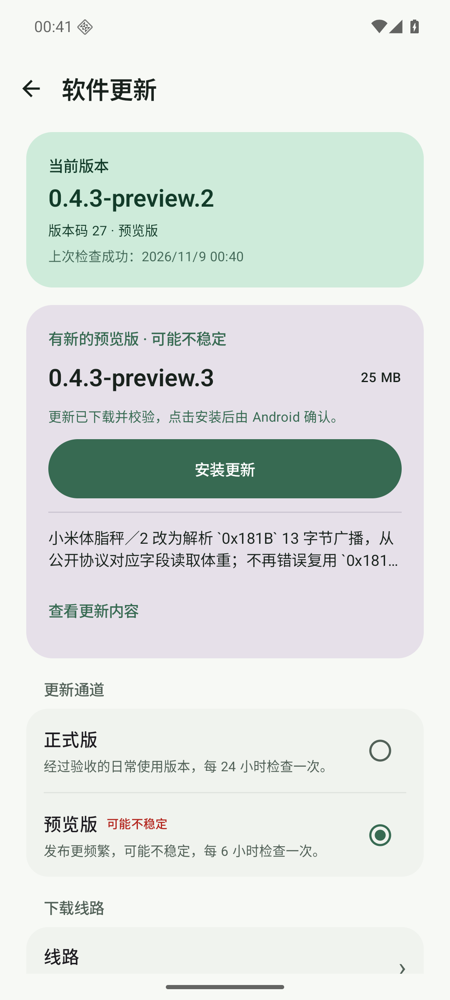
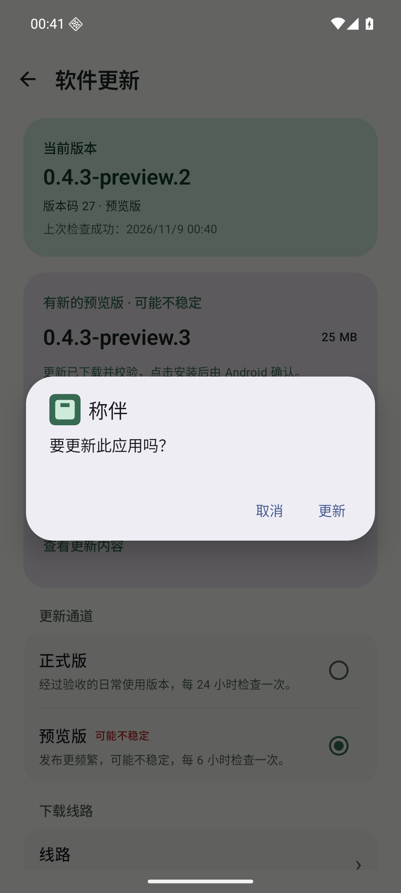
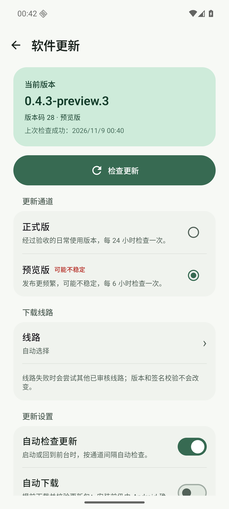
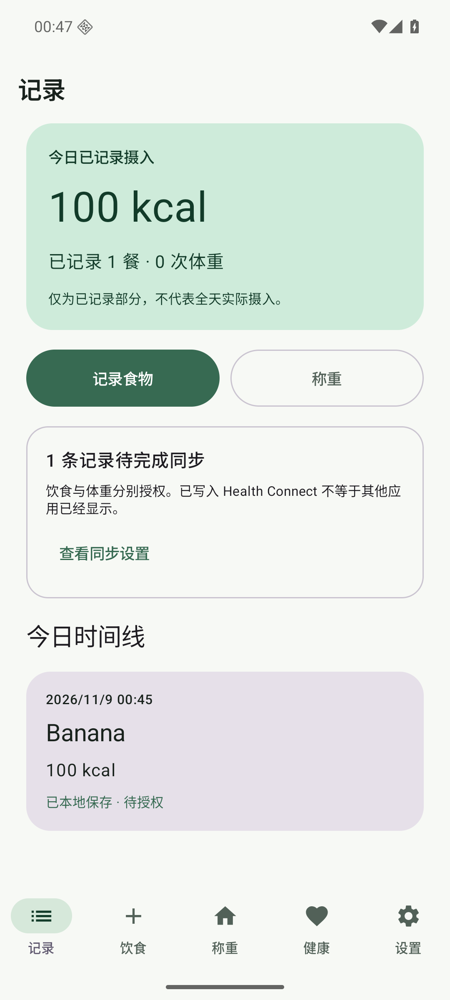

# 小米广播协议预览版发布与附件核验

> 日期：2026-11-09
> 版本：`0.4.3-preview.3 / versionCode 28`
> 发布提交：`f7ea8ace6d10e0bf29c3d159df3013a1ae0481ef`
> 范围：同提交 CI、固定签名 Release、实际附件、更新清单签名、下载线路、模拟器覆盖升级、取消重试和非空样例数据保留。

## 一、结论

`v0.4.3-preview.3` 已发布为 GitHub prerelease，包含 7 份预期附件，Latest 仍为 `v0.4.2`。从 GitHub 实际下载的 APK、证书和更新元数据均通过独立核验；API 36 模拟器从 `0.4.3-preview.2 / code 27` 通过应用内预览通道升级到 `.3 / code 28`，首次安装时间未变化。Android 安装确认先取消再重试成功，已有 1 餐香蕉样例记录在覆盖升级后保留。

- Release：https://github.com/rccoder/ScaleMate/releases/tag/v0.4.3-preview.3
- 功能提交 CI：https://github.com/rccoder/ScaleMate/actions/runs/42499404794
- 发版提交 CI：https://github.com/rccoder/ScaleMate/actions/runs/42499845182
- 固定签名发布：https://github.com/rccoder/ScaleMate/actions/runs/42500278017

## 二、发布门槛

- 功能提交 `2a29e310faf8b1376684e378e89740689d491ae5` 的 Android CI 成功，用时 4 分 52 秒。
- 发版提交 `f7ea8ace6d10e0bf29c3d159df3013a1ae0481ef` 的 Android CI 成功，用时 4 分 53 秒；之后才创建 annotated Tag。
- 脚本测试：15 项通过。
- 翻译检查：957 组名称与格式参数一致。
- `python3 scripts/check_release.py --tag v0.4.3-preview.3 --check-previous-code`：通过，版本码 28 高于两个通道历史版本。
- JVM：349 项通过，0 失败、0 错误、0 跳过。
- Lint：0 错误，153 条既有告警。
- Debug 与 AndroidTest 构建成功。

## 三、实际附件

从 GitHub Release 下载实际产物后核验，附件数量为 7：

| 附件 | 字节 | SHA-256 |
| --- | ---: | --- |
| `ScaleMate.apk` | 26,426,540 | `299bef1a63328e681717d339fa3cbedef299d92d1d2047748ba73b5170733433` |
| `SHA256SUMS` | 80 | `632772d83bfbe5277f0fc9cd03a3bb430f5de47a9e7c0602c9ca4a0b8548cfef` |
| `signing-certificate.txt` | 957 | `7101d592bccd52f047dac7d1687cdf67aad27ae799e9fc0c4eaca182aa13f846` |
| `update.json` | 1,911 | `0a2572e0bce02614c4a61b109946b8f2e53bf0dd8054e721b630a0e3ac4f5f06` |
| `update.json.sig` | 512 | `b1c0f0f5dbc6a7b20305d7a87833e5e641cc614ea45af69b16ae509c91ae8784` |
| `releases.json` | 1,774 | `f9874b5130cd7873f2577a408703553565bf58028a412bf14e8f6aba6d568b03` |
| `releases.json.sig` | 512 | `8a729a20493f00838a89db497283ea24b1002ae3238455620a0cc7df81550c19` |

APK：

- `SHA256SUMS` 校验通过。
- 包名：`app.scalemate`
- 版本：`0.4.3-preview.3 / versionCode 28`
- 调试属性：未设置 `debuggable`
- 签名：仅一个签名者，APK Signature Scheme v2 校验通过
- 固定证书 SHA-256：`9836e7ea5e5dc782be63e7b21c39cb0fa9f6a9633d18952664e83cfaa8172ed5`
- 公钥 SHA-256：`159749322f1e08c8ef648ba4de38cf295d98ff098ac1f5220f84f664d1c27c7f`
- 模拟器最终安装 APK 的 SHA-256 与 Release 附件一致。

更新元数据：

- `update.json.sig` 与 `releases.json.sig` 使用客户端内置固定公钥验签通过。
- `update_manifest.py verify` 通过，Tag、版本、版本码、APK 摘要与大小一致。
- `validate_update_index.py` 通过，索引与更新清单一致。
- `update.json.channel` 为 `preview`。
- GitHub Release 正文与仓库内 [v0.4.3-preview.3 更新说明](../releases/v0.4.3-preview.3.md) 一致。

## 四、下载线路

使用实际 Release APK 与 `SHA256SUMS` 复测内置线路：

- 成功：`github-official` 7.0 秒、`gh-proxy-com` 6.3 秒、`ghfast-top` 9.9 秒、`ghproxy-net` 102.1 秒、`gh-proxy-org` 7.0 秒。
- 失败：`gh-llkk-cc` 读取超时 21.9 秒。
- 成功线路下载大小和 SHA-256 均与 Release 附件一致。

原始结果见 [source-report.json](2026-11-09-02-xiaomi-broadcast-preview-evidence/source-report.json)。

## 五、模拟器覆盖升级

设备：`emulator-5556`，API 36 `sdk_gphone64_x86_64`。

1. 升级前为公开的 `0.4.3-preview.2 / code 27`，应用内选择“预览版”。
2. 在“软件更新”中发现 `0.4.3-preview.3 / code 28`，显示 25 MB 更新和预览风险提示。
3. GitHub 官方线路下载完成后显示“更新已下载并校验，点击安装后由 Android 确认”。
4. Android 系统显示“要更新此应用吗？”；先点“取消”，应用返回仍可继续“安装更新”的状态。
5. 再次点击安装并确认，完成覆盖安装，没有卸载或清除数据。
6. 升级后包信息为 `0.4.3-preview.3 / code 28`，`firstInstallTime` 前后均为 `2026-10-31 12:09:19`。
7. 为确认非空数据保留，在模拟器本地保存 1 餐 `Banana / 100 kcal`；仅用同签名公开 `.2` 重置测试起点后再从应用内升级到 `.3`，升级后该记录仍显示在今日时间线。
8. 安装后应用正常启动，软件更新页显示 `0.4.3-preview.3 / 版本码 28 · 预览版`，预览通道保持选中。

完整机器可读结果见 [verification.json](2026-11-09-02-xiaomi-broadcast-preview-evidence/verification.json)。

## 六、Release 状态

- `isDraft=false`
- `isPrerelease=true`
- GitHub Latest 仍指向 `v0.4.2`，预览版没有占用 Latest
- 七个附件均为 `uploaded` 状态

## 七、边界

- 模拟器中的香蕉记录是合成验收样例，不是用户真实餐食或健康数据。
- 本轮没有连接真实小米体脂秤 2、小米体重秤 2 或其他 BLE 硬件；模拟器协议与 UI 通过不等于真实固件、射频、重连、低电量或固件差异已验证。
- 本轮未验证真实 Health Connect 写入、目标健康应用读取或真机公开包覆盖升级。
- 本轮没有修改饮食识别 Prompt，不触发 4 张真实 AI Prompt 基准。
- 下载线路耗时只代表本轮网络环境，代理可用性不作长期承诺。
