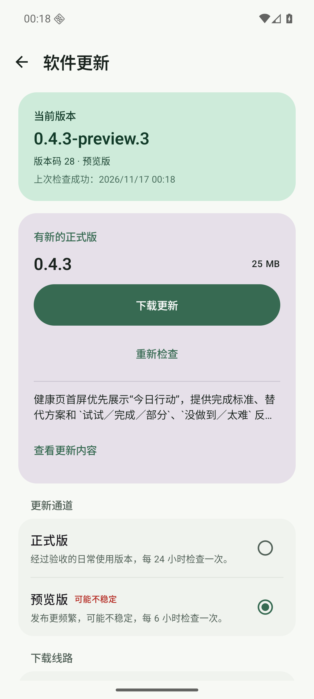
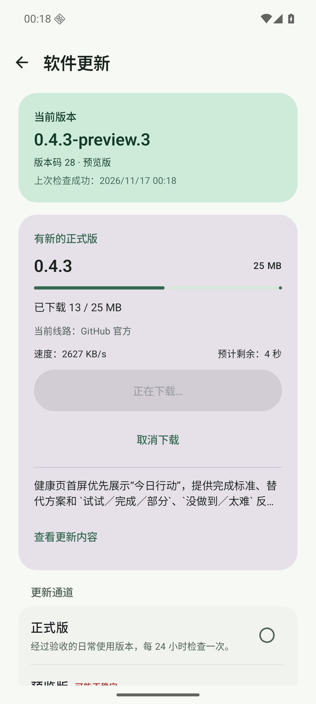
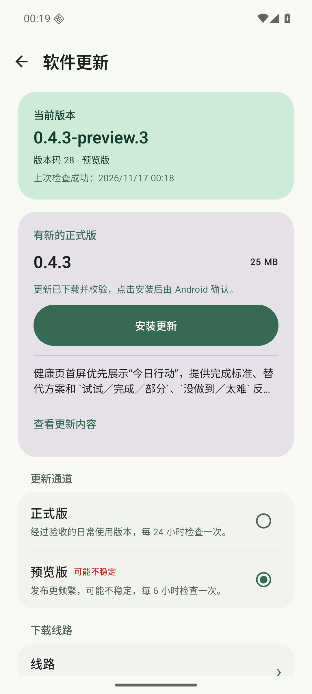
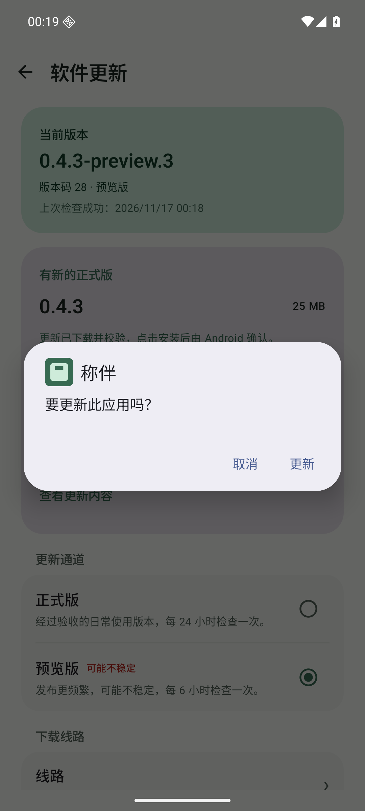
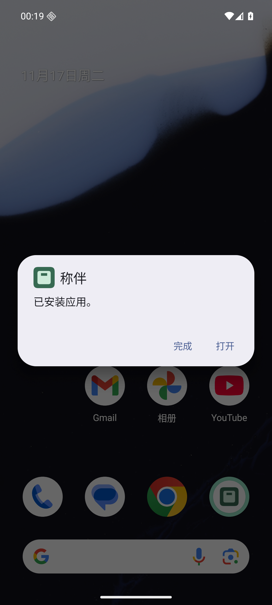
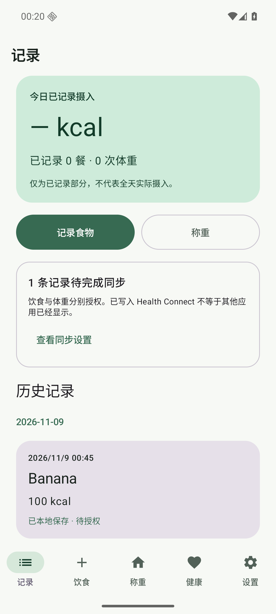
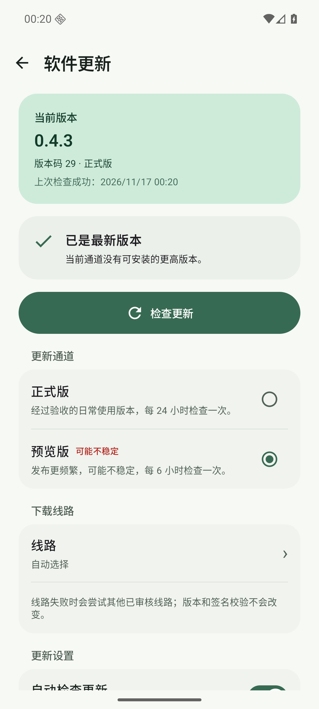

# 0.4.3 正式版发布与附件核验

> 日期：2026-11-17（Asia/Shanghai）
> 版本：`0.4.3 / versionCode 29`
> 发布提交：`24a5371330c2609bffe2878a1b4b9d161914da17`
> 范围：同提交 CI、固定签名 Release、实际附件、更新清单签名、下载线路、模拟器应用内覆盖升级、安装取消重试和非空样例数据保留。

## 一、结论

`v0.4.3` 已作为普通 Release 发布，包含 7 份预期附件，Latest 已更新为 `v0.4.3`。从 GitHub 实际下载的 APK、证书和更新元数据均通过独立核验；API 36 模拟器从公开的 `0.4.3-preview.3 / code 28` 通过应用内预览通道发现更高版本码的正式版，并覆盖升级至 `0.4.3 / code 29`。Android 安装确认先取消、再重试成功，首次安装时间未变化，已有 1 餐香蕉样例记录在升级后保留。

- Release：https://github.com/rccoder/ScaleMate/releases/tag/v0.4.3
- 发版提交 CI：https://github.com/rccoder/ScaleMate/actions/runs/43903693294
- 固定签名发布：https://github.com/rccoder/ScaleMate/actions/runs/43904642354

## 二、发布门槛

- 发版提交 `24a5371330c2609bffe2878a1b4b9d161914da17` 的 Android CI 成功，之后才创建并推送 annotated Tag `v0.4.3`。
- 脚本测试：15 项通过。
- 翻译检查：957 组名称与格式参数一致。
- `python3 scripts/check_release.py --tag v0.4.3 --check-previous-code`：通过，版本码 29 高于两个通道历史版本。
- JVM：349 项通过，0 失败、0 错误、0 跳过。
- Lint：0 错误，153 条既有告警。
- Debug 与 AndroidTest 构建成功。

## 三、实际附件

从 GitHub Release 下载实际产物后核验，附件数量为 7：

| 附件 | 字节 | SHA-256 |
| --- | ---: | --- |
| `ScaleMate.apk` | 26,426,532 | `5035e1767d0855afaafb9ba49d478da44ba18dd8f21df989f69a9ba46f411c19` |
| `SHA256SUMS` | 80 | `18e6a051f4a299b21cae7fba9008ed26086c003569b780b8d652291a077fc90b` |
| `signing-certificate.txt` | 957 | `7101d592bccd52f047dac7d1687cdf67aad27ae799e9fc0c4eaca182aa13f846` |
| `update.json` | 2,223 | `0c431d20c8e297a4e84f36bd38c3426828b982cfa10e6e3c6dfc613cf02394f5` |
| `update.json.sig` | 512 | `1521817c1b10158a714ad925c67f8956d4b45345674e78fd5001fab74aba45bf` |
| `releases.json` | 2,099 | `329a10b13ff0643c5b894bd95047844d68fa394be663e0d245a3354ee175c5db` |
| `releases.json.sig` | 512 | `6a574bfbd84389c2725a26bb9d4141f43f60482083bf774c612f7ec20873b53b` |

APK：

- `SHA256SUMS` 校验通过。
- 包名：`app.scalemate`
- 版本：`0.4.3 / versionCode 29`
- 调试属性：未设置 `debuggable`
- 签名：仅一个签名者，APK Signature Scheme v2 校验通过
- 固定证书 SHA-256：`9836e7ea5e5dc782be63e7b21c39cb0fa9f6a9633d18952664e83cfaa8172ed5`
- 公钥 SHA-256：`159749322f1e08c8ef648ba4de38cf295d98ff098ac1f5220f84f664d1c27c7f`
- 模拟器最终安装 APK 的 SHA-256 与 Release 附件一致。
- Latest 固定下载入口 `https://github.com/rccoder/ScaleMate/releases/latest/download/ScaleMate.apk` 返回同一摘要。

更新元数据：

- `update.json.sig` 与 `releases.json.sig` 使用客户端固定公钥验签通过。
- `update_manifest.py verify` 通过，Tag、版本、版本码、APK 摘要与大小一致。
- `validate_update_index.py` 通过，发布索引与更新清单一致。
- `update.json.channel` 为 `stable`。
- GitHub Release 正文与仓库内 [v0.4.3 更新说明](../releases/v0.4.3.md) 一致。

## 四、下载线路

使用实际 Release APK 与 `SHA256SUMS` 复测内置线路：

- 成功：`github-official` 3.1 秒、`gh-proxy-com` 4.4 秒、`gh-proxy-org` 2.5 秒。
- 失败：`ghfast-top` 总时限 180 秒超时、`ghproxy-net` TLS 握手 20 秒超时、`gh-llkk-cc` 返回 HTTP 522。
- 成功线路下载大小和 SHA-256 均与 Release 附件一致。

原始结果见 [source-report.json](2026-11-17-01-v0.4.3-stable-release-evidence/source-report.json)。线路可用性与耗时只代表本轮网络环境。

## 五、模拟器覆盖升级

设备：`emulator-5556`，API 36 `sdk_gphone64_x86_64`。

1. 升级前为公开的 `0.4.3-preview.3 / code 28`，模拟器中有 1 餐 `Banana / 100 kcal` 合成样例。
2. 保持预览通道，应用内主动检查后发现更高版本码的正式版 `0.4.3 / code 29`。
3. GitHub 官方线路快速下载完成，应用内显示“更新已下载并校验，点击安装后由 Android 确认”。
4. 点击安装后 Android 系统显示“要更新此应用吗？”；先点“取消”，应用返回仍可继续“安装更新”的状态。
5. 再次点击安装并确认，完成覆盖安装，没有卸载或清除数据。
6. 升级后包信息为 `0.4.3 / code 29`，`firstInstallTime` 前后均为 `2026-10-31 12:09:19`。
7. 打开应用后，原有 `Banana / 100 kcal` 记录仍显示在历史记录中。
8. 软件更新页显示 `0.4.3 / 版本码 29 · 正式版`，再次检查显示“已是最新版本”；预览通道与自动选线偏好保留。

完整机器可读结果见 [verification.json](2026-11-17-01-v0.4.3-stable-release-evidence/verification.json)。

## 六、Release 状态

- `isDraft=false`
- `isPrerelease=false`
- GitHub Latest 为 `v0.4.3`
- 七个附件均为 `uploaded` 状态

## 七、边界

- 模拟器中的香蕉记录是合成验收样例，不是用户真实餐食或健康数据。
- 本轮没有唤醒或覆盖安装用户手机，未验证真机非空业务数据、设备配置、私人 AI 服务和健康授权的跨版本迁移。
- 本轮没有连接真实小米体脂秤 2、小米体重秤 2 或其他 BLE 硬件；模拟器协议与 UI 通过不等于真实固件、射频、重连、低电量或固件差异已验证。
- 本轮未验证真实 Health Connect 写入、目标健康应用读取或真实 AI 服务。
- 本轮没有修改饮食识别 Prompt，不触发 4 张真实 AI Prompt 基准。
