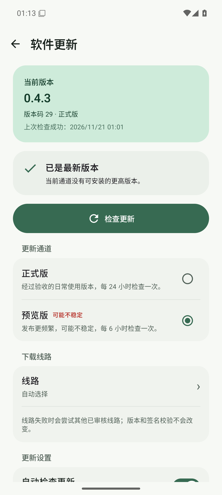
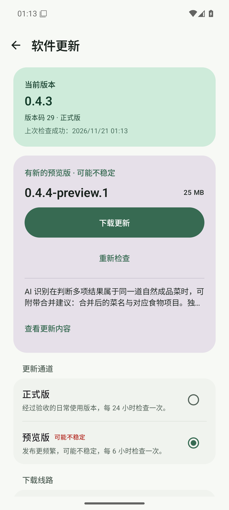
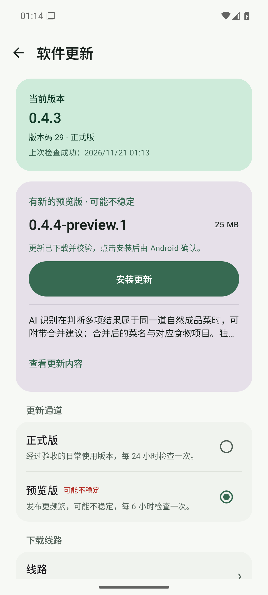
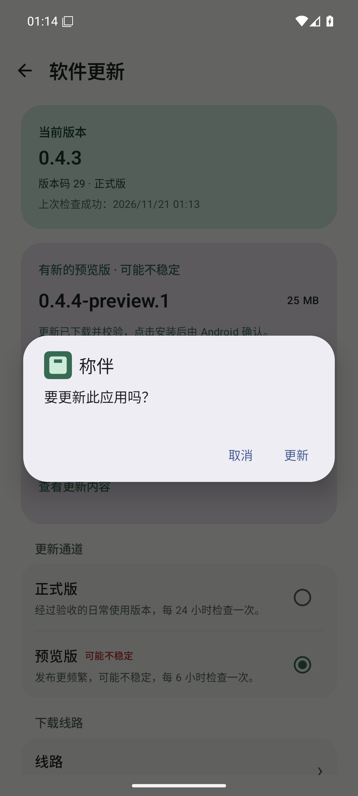
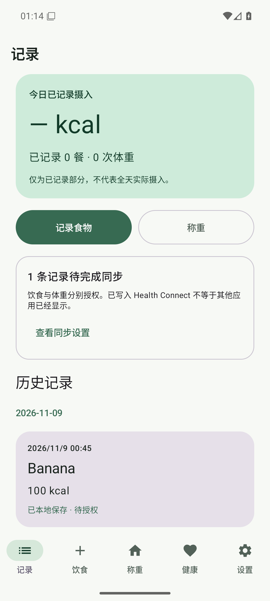
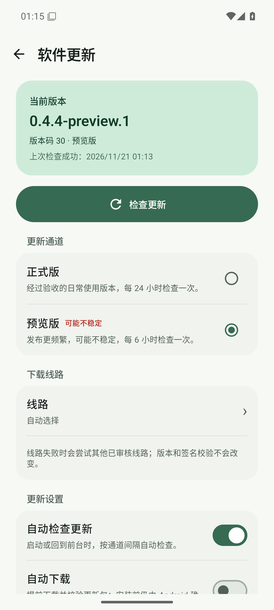
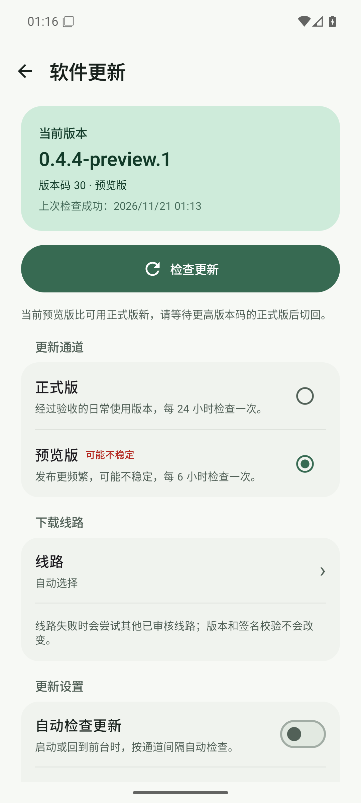

# 0.4.4-preview.1 发布与附件核验

> 日期：2026-11-21（Asia/Shanghai；GitHub 时间戳为 UTC 2026-11-20）
> 版本：`0.4.4-preview.1 / versionCode 30`
> 发布提交：`e0db7c4145da3897310d13c4e2371133880dbae9`
> 范围：同提交 CI、固定签名 Release、实际附件、更新清单签名、下载线路、模拟器应用内覆盖升级与取消重试、样例餐食及待同步记录保留。

## 一、结论

`v0.4.4-preview.1` 已作为 GitHub prerelease 发布，包含 7 份预期附件，Latest 仍为 `v0.4.3`。从 Release 实际下载的 APK、证书和更新元数据均通过独立核验；API 36 模拟器在预览通道发现本版，完成下载校验、Android 安装确认、取消后重试和覆盖升级，版本从 `0.4.3 / code 29` 变为 `0.4.4-preview.1 / code 30`。首次安装时间未变化，已有 1 餐香蕉样例记录和 1 条待同步状态保留。

本版功能为菜品合并建议：AI 识别时可返回自然合并菜名与项目，结果页据此预选并预填，不再要求手写菜名；没有建议时不显示合并入口。

- Release：https://github.com/rccoder/ScaleMate/releases/tag/v0.4.4-preview.1
- 发版提交 CI：https://github.com/rccoder/ScaleMate/actions/runs/44779023857
- 固定签名发布：https://github.com/rccoder/ScaleMate/actions/runs/44779947992
- 功能提交 CI：https://github.com/rccoder/ScaleMate/actions/runs/44778141947

## 二、发布门槛

- 功能提交 `a96ea46` 与发版提交 `e0db7c4` 的 Android CI 均成功；发版提交 CI 通过后才创建并推送 annotated Tag `v0.4.4-preview.1`。
- Tag 对象 `180493c628a9079e9d073cae5630ce1fcc3315cd`，指向提交 `e0db7c4145da3897310d13c4e2371133880dbae9`。
- `python3 scripts/check_release.py --tag v0.4.4-preview.1 --apk ScaleMate.apk --check-previous-code`：通过，版本码 30 高于正式与预览两个通道的全部历史版本。
- 固定签名发布工作流在 Tag 推送后成功，上传 7 份附件。
- 仓库内更新说明 [v0.4.4-preview.1](../releases/v0.4.4-preview.1.md) 与 Release 正文一致。

## 三、实际附件

从 GitHub Release 下载实际产物后核验，附件数量为 7：

| 附件 | 字节 | SHA-256 |
| --- | ---: | --- |
| `ScaleMate.apk` | 26,426,972 | `743c6fd33a6eb21c30f8828d7daf67a670fc55196c0ef7d48413eef8b4b0728f` |
| `SHA256SUMS` | 80 | `639ff876256d4efa938692391bb262bf8a52e3343eba92a08a4d73f544010e25` |
| `signing-certificate.txt` | 957 | `7101d592bccd52f047dac7d1687cdf67aad27ae799e9fc0c4eaca182aa13f846` |
| `update.json` | 2,064 | `5fdc04c46957ce5677b15d0c96f46a8e2a8de3b54c926d4d504e086dc6ba8b32` |
| `update.json.sig` | 512 | `6586cd907bfd61063b8bd5d4289f34065ba11f86e84be934d889111e42e1b565` |
| `releases.json` | 1,927 | `0b49a31a62dd442b743fd94f588a9f35a86bf9fc3eeb2d132fe130b26c5f44f6` |
| `releases.json.sig` | 512 | `64953abe6a05e68c58609992fd37e94bf897917284ae89134eda7620bab0c77c` |

APK：

- `SHA256SUMS` 校验通过。
- 包名：`app.scalemate`
- 版本：`0.4.4-preview.1 / versionCode 30`
- 调试属性：未设置 `debuggable`
- 签名：仅一个签名者，APK Signature Scheme v2 校验通过（未启用 v1）
- 固定证书 SHA-256：`9836e7ea5e5dc782be63e7b21c39cb0fa9f6a9633d18952664e83cfaa8172ed5`
- 公钥 SHA-256：`159749322f1e08c8ef648ba4de38cf295d98ff098ac1f5220f84f664d1c27c7f`
- 模拟器最终安装 APK 的 SHA-256 与 Release 附件一致。
- Latest 下载入口仍指向 `v0.4.3`；现有 Latest APK 摘要为 `5035e1767d0855afaafb9ba49d478da44ba18dd8f21df989f69a9ba46f411c19`，未被预览版替换。

更新元数据：

- `update.json.sig` 与 `releases.json.sig` 使用客户端固定公钥验签通过。
- `update_manifest.py verify` 通过，Tag、版本、版本码、APK 摘要与大小一致。
- `validate_update_index.py` 通过，发布索引与更新清单一致。
- `update.json.channel` 为 `preview`，`releases.json` 标记 `prerelease=true`。
- `update.json` 的 `knownIssues` 为通用预览提示；本版具体风险写在版本更新说明中。

## 四、下载线路

使用实际 Release APK 复测内置线路：

- 成功：`github-official` 3.3 秒、`gh-proxy-org` 2.8 秒、`gh-proxy-com` 5.1 秒、`ghfast-top` 23.2 秒。
- 失败：`ghproxy-net` TLS 握手 20 秒超时、`gh-llkk-cc` 返回 HTTP 522。
- 成功线路下载大小和 SHA-256 均与 Release 附件一致。

原始结果见 [source-report.json](2026-11-21-01-0.4.4-preview.1-release-evidence/source-report.json)。线路可用性与耗时只代表本轮网络环境。

## 五、模拟器覆盖升级

设备：`emulator-5556`，API 36。

1. 升级前为 `0.4.3 / code 29`，更新通道为预览版；记录首页显示 `0 次体重`，历史中有 1 餐 `Banana / 100 kcal`，并提示 1 条记录待完成同步。
2. 在预览通道检查更新，发现 `0.4.4-preview.1 / 25 MB`，更新内容摘要与本版说明一致。
3. 通过内置线路下载，应用内显示“更新已下载并校验，点击安装后由 Android 确认”。
4. 点击安装后 Android 显示“要更新此应用吗？”；先点“取消”，应用返回仍保留“安装更新”按钮。
5. 再次点击安装并确认，完成覆盖安装，没有卸载或清除数据。
6. 升级后包信息为 `0.4.4-preview.1 / code 30`，`firstInstallTime` 前后均为 `2026-10-31 12:09:19`，`lastUpdateTime` 为 `2026-11-21 01:14:36`。
7. 打开应用后，历史中的 `Banana / 100 kcal` 和 1 条待同步状态仍保留。
8. 软件更新页显示 `0.4.4-preview.1 / 版本码 30 · 预览版`。
9. 尝试切回正式通道时，应用提示“当前预览版比可用正式版新，请等待更高版本码的正式版后切回。”，保持预览通道；这是版本码保护逻辑，不是升级失败。
10. 称重页与升级前一致，显示“添加你的第一台秤”；本轮升级前该模拟器没有体重记录，因此没有可验证的体重记录保留项。

完整机器可读结果见 [verification.json](2026-11-21-01-0.4.4-preview.1-release-evidence/verification.json)。

## 六、Release 状态

- `isDraft=false`
- `isPrerelease=true`
- GitHub Latest 仍为 `v0.4.3`，本预览版不占正式下载入口
- 七个附件均为 `uploaded` 状态

## 七、边界

- **真实 AI 基准回归未执行**：模拟器没有私有 AI 配置，尚未使用 [4 张基准样例](fixtures/food-prompt-baseline/README.md) 验证模型是否稳定返回 `mergeSuggestions`、菜名语言和分组合理性；Release 说明已标注该风险，不能以固定草稿界面验证替代。
- 该模拟器升级前没有体重记录或已配对秤，本轮未验证体重记录跨版本保留；已保留的样例餐食和待同步状态均为合成验收数据。
- 本轮没有覆盖安装用户手机，未验证真机非空业务数据、设备配置、私人 AI 服务和健康授权的跨版本迁移。
- 未验证真实 Bluetooth 秤、真实 Health Connect 写入或目标健康应用读取。
- 应用内切回正式通道被版本码保护阻止，属于预期行为；如需恢复正式通道，应等待更高版本码的正式版发布后切换，不能通过降级或清数据绕过。
