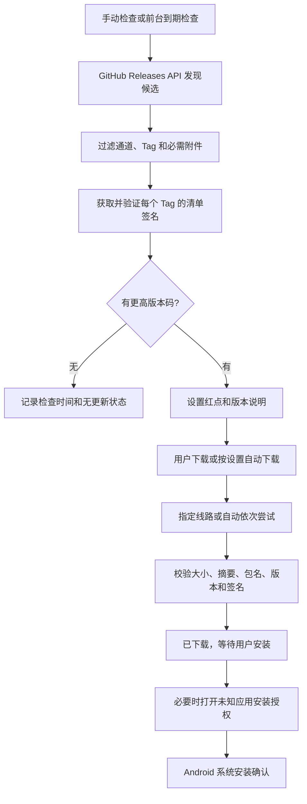

# 称伴应用更新与双通道发版产品需求文档

> 日期：2026-10-18。首个预览版 `0.3.0-preview.1` 已公开发布并验证应用内升级，正式版按发布门槛推进。正式版／预览版共用包名和固定签名，GitHub Releases 是唯一发布附件源；用户可选择官方或免费公共代理线路。自动更新包含检查与可选下载，安装始终由 Android 确认。

## 目录

- [产品目标与范围](#产品目标与范围)
- [版本通道与升级规则](#版本通道与升级规则)
- [界面与提醒](#界面与提醒)
- [检查、下载与安装](#检查下载与安装)
- [公共代理调研与实测](#公共代理调研与实测)
- [更新协议与安全](#更新协议与安全)
- [发布流程](#发布流程)
- [验收与上线条件](#验收与上线条件)

## 产品目标与范围

称伴继续以蓝牙自动称重、饮食记录为核心；更新不能阻塞记录、AI 分析或健康同步，也不能清除已有数据。用户应能检查新版本、查看说明、选择下载线路，并完成覆盖安装。

本次范围：手动检查、前台按间隔自动检查、正式版与预览版切换、自动下载开关、流量限制、进度与取消、失败重试、更新提醒、下载与安装校验、安装权限引导，以及双通道发布工作流。

暂不包含：App 关闭后的后台定时任务／通知、断点续传、静默安装、强制更新、独立对象存储或付费 CDN、任意自定义代理、远程下发新代理域名、自动降级。网络恢复后可重新操作；取消或失败后的半成品从头下载。

**分发仍依赖 GitHub。** 公共代理只转发同一 GitHub Release 附件，可能有缓存或边缘网络；它们不构成称伴独立运营的 CDN，也不能在 GitHub 全面故障时保证更新可用。中国大陆不同运营商、时段的访问情况不同，提供换线能增加可达机会，不能保证所有用户必然可用。

## 版本通道与升级规则

| 项目 | 正式版 stable | 预览版 preview |
| --- | --- | --- |
| 使用对象 | 默认日常使用 | 用户主动选择尝鲜 |
| 稳定性 | 完成相应验收 | 更频繁，可能存在崩溃、耗电、同步等问题 |
| 包名与签名 | `app.scalemate`，固定发布签名 | 相同包名、相同签名 |
| 版本名示例 | `0.3.0` | `0.3.1-preview.1` |
| Tag 示例 | `v0.3.0` | `v0.3.1-preview.1` |
| GitHub 标记 | 非 prerelease | prerelease，不占 Latest |
| 前台自动检查间隔 | 24 小时 | 6 小时 |
| 更新候选 | 仅正式版 | 预览版及更高版本码的正式版 |

- 所有公开版本共享全局递增 `versionCode`，每次发布必须大于两个通道的历史最大值。示例：正式版 code 6 → 预览版 code 7、8 → 转正 code 9。
- 按版本码判断更新，不能按版本名字符串、发布时间或 Release 标题判断；相同或更低版本码不安装。重复版本码视为发布异常。
- 全新安装根据安装包类型默认通道；用户主动选择后持久保存。版本类型和更新通道是两回事：预览通道可以安装更新的正式版，通道偏好仍保留。
- 切到预览版需确认不稳定风险。切回正式版时，如果当前安装的是预览版且没有更高版本码正式版，提示等待，不改通道、不提供卸载或清数据降级。
- 通道切换与检查／下载不能并发改动同一个候选。
- 两个通道共用本地记录与设置，不能并存。`app.scalemate.fooddev` 是独立测试包，数据隔离，不是公开预览版，也不开放更新入口。

## 界面与提醒

### 设置入口

沿用现有设置样式、分组与统一 24dp 页面横向边距。设置 → 应用信息 → 当前版本进入软件更新页；不再叠加一层页面横向 padding。

检查确认有可安装新版本后：

1. 底部导航的“设置”图标显示红点。
2. “当前版本”标题旁显示红点，副标题显示“当前版本 · 有可用更新”。
3. 红点在下载、等待安装和失败重试期间保留；检查中不因暂时状态切换而消失。更新安装完成后，重新读取本机版本，清除过期提醒。
4. 自动检查不弹阻塞弹层，也不主动打开安装器。仅切换预览版时显示风险确认；用户点击安装后才进入 Android 系统流程。

### 软件更新页

- 当前版本、安装包类型、版本码、上次成功检查时间；手动检查按钮。
- 状态：检查中、当前通道无更高版本、有可用更新、下载中、校验中、等待安装、错误与重试。
- 候选卡片：版本、通道、大小、变化摘要、预览版已知问题、完整 Release 说明入口。
- 更新通道：正式版／预览版，预览风险确认与禁止降级说明。
- 下载线路：自动、GitHub 官方、代理 A～E；明确第三方属性，两条慢线路额外提示。
- 自动检查默认开；自动下载默认关；自动下载的“不计流量网络限制”默认开。手动下载不受这一开关限制。
- 安装权限提示、下载／安装失败原因、更换线路和重试入口。

线路选择持久化。手动选线失败时只提示该线失败，不悄悄改用其他线。检查版本列表使用单独的 API 可用线路，不因选到“只支持文件下载”的代理而丧失检查能力；候选清单与 APK 文件走选定文件线路。

## 检查、下载与安装

### 发现版本

1. 请求 `api.github.com/repos/rccoder/ScaleMate/releases`，通过官方或 API 可用代理读取列表，无需登录或 Token。
2. 过滤草稿、非法 Tag、Tag 与 prerelease 不一致，以及缺 `ScaleMate.apk`、`update.json`、`update.json.sig` 的 Release。历史版本没有清单时直接跳过，避免逐个请求不存在的附件。
3. 对合法候选下载签名清单，通过内置公钥验证，再读取可信版本码与摘要。官方 API 返回的字段不直接作为 APK 安装信任依据。
4. 正式通道仅选择正式版；预览通道也接受正式版；最终选择可升级候选里最大版本码。
5. 请求失败时保留此前已验证候选并说明失败；成功且无候选时更新检查时间并清除旧候选。不能把网络失败显示成“已是最新”。
6. 当前实现列表读取最近 100 个 Release，最多校验当前通道最近 20 个带清单的候选。高频发布积累后需扩展分页与候选窗口，避免正式版被大量预览版挤出窗口。

### 下载与安装

- 自动模式依次尝试官方与备用线路；手选模式只有所选线路。文件路径从内置模板生成，不执行任意远端 URL。
- 展示大小与进度；支持取消。半成品删除，不能提供给系统安装器。取消的请求退出后才能重新下载，避免旧请求覆盖新文件。
- 连接和读取有超时；APK 下载单条线路设约 180 秒总时限（在读操作间检查，可能额外受单次读取超时影响），避免有响应但极慢的线路无限占用。慢线路本轮完整测速成功不代表应用会等其完成。
- 私有目录保存 APK，不写公共 Download。同一候选的有效文件可在 24 小时内复用，复用和再次安装前重新校验；换版本时清理其他版本文件。
- 自动下载只下载校验，不打开安装器。手动点击“下载并安装”在校验后请求系统安装。
- 未授权时打开本 App 的“允许安装未知应用”页；返回后由用户点击“安装已下载版本”，保留校验文件，无需再下载。
- 用户取消系统安装可以重试。进程退出后不直接恢复“已校验”信任，重新检查、获取签名清单并复验本地文件后再使用。
- Android 安装确认不可绕过。正常同签名覆盖升级通常保留本地数据，但数据库迁移必须单独验收。

## 公共代理调研与实测

方案内置五条免费公共线路。首页说明与实际能力分开看：部分服务首页支持浏览器访问，不等于 API 或 Release 文件都可用。[gh-proxy.com](https://gh-proxy.com/) 宣称支持 Release、Raw 和 API；[ghproxy.net](https://ghproxy.net/) 说明以 Release／Archive 文件代理为主；[gh.llkk.cc](https://gh.llkk.cc/) 明确提供 GitHub API 代理。`gh-proxy.org` 首页当前跳转到 `gh-proxy.com`，不能把这两个域名当成两个独立服务商或独立故障域。

### 实际 APK 下载

2026-10-18 在本轮开发网络完整下载公开 `v0.2.1/ScaleMate.apk`，六份均为 **23,489,466 字节**、同一 SHA-256：

`68594d1868911664d28b55097d3a4ac036d5ffe3b40ae2ed92e7c900714a9210`

| UI | 线路 | 完整下载耗时 | API 复测 | APK Range 复测 | 用途 |
| --- | --- | ---: | --- | --- | --- |
| 官方 | GitHub | 7.3 秒 | 200 | 206 | 检查与下载 |
| A | `gh-proxy.com` | 6.5 秒 | 200 | 206 | 检查与下载 |
| B | `ghfast.top` | 1974.6 秒 | 403 | 206 | 慢速文件备用，不用于 API |
| C | `ghproxy.net` | 151.7 秒 | 403 | 206 | 慢速文件备用，不用于 API |
| D | `gh.llkk.cc` | 2.9 秒 | 200 | 206 | 检查与下载 |
| E | `gh-proxy.org` | 3.3 秒 | 200 | 206 | 检查与下载，可能与 A 共享服务 |

API／Range 最新复测：2026-10-18 20:36（北京时间）。Range 只取前 1024 字节，不能代替前一轮完整下载摘要检查。详细方法、历史结果与原始报告见 [线路探测记录](testing/应用更新线路探测-2026-10-18.md)。

自动文件顺序：GitHub → E → D → A → B → C。API 顺序：GitHub → A → D → E。不采用网页测速或瞬时延迟动态排序；“自动”表示按既定顺序失败切换。

这些服务无需称伴账户或代理账号，不向其发送 GitHub Token、AI 密钥或健康记录。服务会看到请求 IP 和公开附件路径，可能记录访问。没有面向称伴的可用性协议；本轮测试不覆盖中国大陆所有地区／运营商，也不保证长期可用。

### 用户低流量测速

下载线路弹窗提供“测速 · 约 384 KB”，由用户主动触发，不在每次进入设置或启动应用时消耗流量。每条线路请求同一个 APK 的 `Range: bytes=0-65535`，并发最多 2 条；六条线路的试读正文合计约 384 KB，另有连接、TLS 和网络缓冲开销。

- 优先试读已发现候选；没有新候选时使用当前安装版本对应的公开 Tag，界面显示样本 Tag 和测量时间。未公开的本地构建 Tag 可能全部失败，不伪造速度。
- 显示每条试读 64 KB 的耗时、平均有效速度（包含连接等待）、等待状态、超时／不可用，并标记已测线路中最快的线路。用户点击该线路才改变选择，不悄悄替用户改设置。
- 请求即使收到 200 而非 206，也最多读取 64 KB，随后主动断开，不把整包读完；HTML、数据不足或非 APK 文件头不参与推荐。
- 连接／单次读取超时各 4 秒；试读循环约 8 秒总限时，可能额外受当前阻塞读取和重定向影响。支持停止，关闭弹窗或选择线路时取消队列，活动请求在读操作退出后关闭。
- 结果仅保存在本次 App 会话，不当作实时测速或长期排名；部分完成后停止时，只能比较已测线路。64 KB 可能命中缓存，不能预测完整 APK 的持续下载速度，也不能代替签名与完整性校验。
- 自动下载仍用既定失败回退顺序，不把一次小样本测量自动变成永久默认线路。

## 更新协议与安全

### 每个 Release 的附件

| 附件 | 用途 |
| --- | --- |
| `ScaleMate.apk` | 同包名、同固定签名的正式构建 |
| `SHA256SUMS` | 人工及发布脚本复验 APK |
| `signing-certificate.txt` | 公开证书指纹信息 |
| `update.json` | 版本、通道、变化摘要、已知问题、APK 大小与 SHA-256 |
| `update.json.sig` | 清单原始字节的 RSA SHA-256 签名，Base64 文本 |
| `releases.json`、`releases.json.sig` | 工作流额外生成的单版本审计索引；本次客户端不以它发现版本 |

实际使用 `SHA256withRSA`，公钥来自当前固定发布证书并内置于 APK；不是 Ed25519，也没有受控 CDN 上的远程双通道索引。公钥导出时检查与 Android 编译配置一致，私钥和密码不进入 Git。

清单 schema 1 包含 `channel`、`tag`、`versionName`、`versionCode`、`publishedAt`、`highlights`（最多 5 条）、`knownIssues`（最多 10 条）、`apk.fileName`／`sha256`／`sizeBytes`。预览版 `knownIssues` 必须非空。`sourceUrls` 为审计信息，客户端仍按内置域名与路径模板生成地址，不允许清单扩张主机白名单。

安装前必须全部通过：清单签名有效；Tag／通道／版本字段一致；APK 大小与 SHA-256 匹配；包名为 `app.scalemate`；版本名与版本码吻合且比本机新；非调试包；APK 恰好一个当前签名者，证书指纹与固定发布签名一致。失败删除文件，不允许“忽略校验继续安装”。点击已下载文件的安装按钮时再次校验，避免取消后或文件被修改后复用旧结果。

公共代理仍可能隐藏新 Release 或返回有效旧清单；签名防止篡改，版本码防止安装降级，但不能保证镜像永远新鲜。失败时换线或查看官方 Release；不能伪称所有攻击都能检测。

## 发布流程

沿用当前 `main` 发布提交 → 同提交 Android CI 成功 → annotated Tag → 签名 Release → 下载附件复验的流程，不建立另一套发布分支。

1. 正式版用 `X.Y.Z`；预览版用 `X.Y.Z-preview.N`。更新版本名、全局递增版本码及同名非空 `docs/releases/v*.md`。
2. `check_release.py --check-previous-code` 读取完整 Git Tag 历史，排除当前 Tag，再比较两个通道的历史版本码；不能只读未记录版本码的旧 Release 正文。
3. Release 工作流 checkout 完整历史，执行 Python 测试、翻译、JVM、Lint，恢复固定 keystore 构建 APK；退出步骤时清除临时私钥。
4. 核验 APK 后，单独恢复 keystore 生成和签名清单，并本地验签；不能跨步骤引用已清理的密钥文件。
5. 正式版创建普通 Release；预览 Tag 创建 prerelease。上传全部附件；发布后从 GitHub 和可用代理下载实际附件核验。
6. 不移动已公开 Tag，不修改既有 APK 掩盖错误。修复必须发布新版本和更高版本码。
7. 第一个包含更新器的版本仍需用户手动下载安装一次；已公开 `v0.2.1` 没有更新器和签名清单，不能让旧版本凭空获得自动更新。

具体命令见 [发布指南](发布指南.md)。本轮已发布 `v0.3.0-preview.1` 并验证云端附件、真实应用内升级及数据保留；正式版继续按同一流程验收，最终证据见 [双通道发布与升级记录](testing/应用更新双通道发布与升级验收-2026-10-18.md)。

## 验收与上线条件

| 场景 | 预期 |
| --- | --- |
| 正式通道存在更高预览版 | 不提示该预览版 |
| 预览通道存在更高正式版 | 能提示并升级，保留通道偏好 |
| 当前预览版高于正式版 | 禁止降级，说明等待 |
| 当前版本已升级，缓存是旧候选 | 红点和旧更新不再出现 |
| 成功检查没有候选 | 记录时间，清除旧候选 |
| 检查失败但有已验证候选 | 保留更新信息，说明本次失败 |
| 历史 Release 没有清单 | 直接跳过，不长时间请求不存在文件 |
| 手选不可用线路 | 报错并允许换线，不自动换域名 |
| 自动选线遇到错误文件／超时 | 丢弃文件，尝试下一线；所有失败可重试 |
| 清单篡改、错误签名、错包名／版本、debug APK | 阻止安装 |
| 下载取消后重试 | 半成品不被误用，旧请求不覆盖新下载 |
| 首次安装权限、返回、系统安装取消 | 可重新操作已校验文件，不丢应用记录 |
| 自动下载 | 遵守流量开关，不自行弹安装器 |
| 设置提醒 | 两处红点与文字提示，不弹阻塞更新弹层 |
| 页面宽度 | 与设置、同步设置等现有页统一边距 |

上线前仍须验证真实“较旧固定签名版本 → 较新预览版 → 更高正式版”的应用内下载与系统覆盖安装、数据保留和迁移。协议固定响应、模拟传输、ADB 覆盖安装与真实 Release 更新应分别记录，不能互相冒充。当前通过、首次失败、重试与未验证项见 [本轮验收](testing/应用更新实现与验收-2026-10-18.md)。
