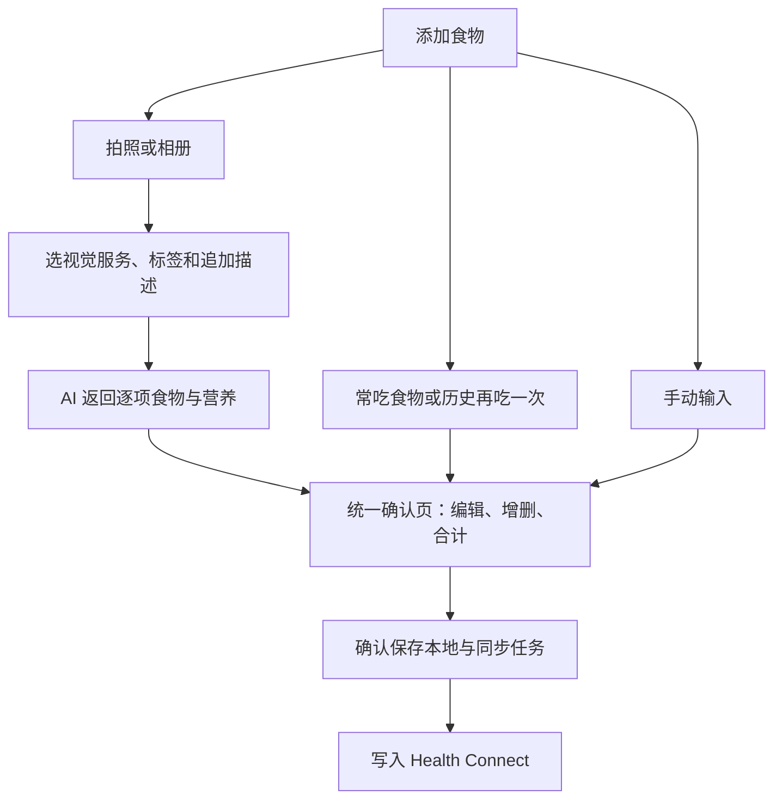

# 称伴食物 AI 记录产品需求文档

> 在现有 ScaleMate Android App 内，把“拍一张食物照片”变成可校正、可保存、可写入 Health Connect 的饮食记录。首版完成拍照／相册识别、手动补充、确认、日汇总、修改删除和营养同步闭环。配套文档：[总述](称伴%20AI%20功能规划总述.md)、[健康 AI 分析 PRD](称伴健康%20AI%20分析产品需求文档.md)。日期：2026-10-17；状态：草案 v0.2。

---

## 目录

- [一、问题与目标](#一问题与目标)
- [二、范围与成功标准](#二范围与成功标准)
- [三、入口与主流程](#三入口与主流程)
- [四、识别与校正规则](#四识别与校正规则)
- [五、记录与 Health Connect 同步](#五记录与-health-connect-同步)
- [六、数据模型与项目接入](#六数据模型与项目接入)
- [七、异常与隐私](#七异常与隐私)
- [八、验收与交付](#八验收与交付)

---

## 一、问题与目标

用户希望用称伴记录“吃了什么、摄入多少”，把饮食与已有体重记录连起来，不必为了写入 Google 健康生态再维护另一个饮食 App。

目标用户是希望管理体重、日常摄入或蛋白质的人。首版服务个人记录，不包含家庭多人账户、临床营养治疗或对特定疾病开具饮食处方。

核心承诺：拍照后给出可解释的营养估算，用户能修正份量、食材和数值，再保存并同步。照片不能可靠测出重量、烹饪油和隐藏配料；不把估算包装成检测结果。

本功能独立于体重秤绑定和健康 AI 分析；无需先有秤、先导入历史或启用教练。

---

## 二、范围与成功标准

### 2.1 功能优先级

| 级别 | 功能 |
| --- | --- |
| P0，首版必须 | 拍照／单张相册图片识别；多食物拆分；可编辑名称、份量、时间、餐别；热量、蛋白质、碳水、脂肪；确认保存；本地历史与今日汇总；NutritionRecord 写入、编辑重试、删除；拍照后标签与自定义描述；常吃食物与历史再次添加；离线手动记录 |
| P1，后续增强 | 营养标签识别、条码与食物数据库、餐前餐后对比、常用组合餐、更多营养素、自然语言独立记餐入口 |
| 暂不纳入 | 连续录像、全自动无确认写入、以照片判断过敏安全、自动医疗饮食计划、无用户份量说明的自动推断他人摄入、强制上传照片社区 |

首版采用用户自带 API Key，可配置多个服务；食物拍照／相册识别必须选择已声明支持图片的模型。没有视觉服务时提供手动录入、常吃食物和历史复用，不调用文本模型替代识图。服务设置与切换遵循总述第四章。

### 2.2 可衡量目标

以下是候选验收目标，不是已达到的成绩：

- 常规餐食在识别结果返回后，用户可在一页完成核对和保存；不强制填写非必要营养项。
- 已配置且可用的参考模型：正常网络下识别目标 P95 ≤ 30 秒，45 秒超时可重试或手动录入；实测记录模型、网络和图片大小。
- 经用户确认后，固定样例的数值换算、日汇总和 Health Connect 单位映射全部精确通过；每次重复重试只产生同一餐的一条平台记录。
- 视觉质量用不少于 40 张自有或授权图片评测，覆盖家常混合菜、便当、饮品、单食物及非食物。主要可见食物识别可用率目标 ≥ 85%；失败样本必须可校正。份量不可见时不得仅靠该指标承诺营养误差。
- 有营养标签或称重配方的子集另测热量／宏量误差，记录中位相对误差和严重偏差，不把开放餐食宣称为“误差不超过 X%”。模型和公开准确度承诺在数据评测后定案。

不增加默认远程行为追踪；记录耗时、识别失败和用户修正仅用于本地诊断，远程评测须另有清楚用途和同意。

---

## 三、入口与主流程

### 3.1 页面

| 页面 | 主要内容 |
| --- | --- |
| 饮食首页 | 日期、已记录摄入热量与蛋白质等、餐次列表；拍照、相册、手动、常吃食物、历史入口 |
| 拍照后补充 | 图片预览、当前视觉服务、多选预设标签、自定义描述、开始分析；标签可选可跳过 |
| 识别中 | 图片预览、进度说明、取消／转手动；不显示虚假百分比 |
| 确认餐食 | 时间与餐别、多食物列表、份量及营养值、整餐合计、估算依据／待确认项、保存按钮 |
| 餐食详情 | 已保存食物与合计、估算或标签来源、平台同步状态、编辑／删除／存为常吃／再吃一次 |
| 记录页饮食分类 | 按日期餐次检索，可查看和重新尝试同步 |

首页写“已记录摄入”，不默认写“今日实际摄入”。支持用户主动标记某日“记录完整”，可撤销；未标记时不推断少记的餐食为未进食。

### 3.2 主流程

首次使用在线识别前说明图片将发送到当前模型服务，按总述的 AI 服务同意设计执行。申请系统相机权限仅在直接调用相机能力需要时；相册使用系统 Photo Picker，不申请整个相册读取权限。

识别过程中返回或取消，不创建正式营养记录；确认页退出前可保存本地草稿。草稿不进入今日正式汇总、不写入 Health Connect。

保存成功必须先反映本地结果；Health Connect 暂不可用时显示“已保存，待授权／待同步”，不要求重新拍照。

---

## 四、识别与校正规则

### 4.1 拍照后补充信息与标签

拍照／选图后先进入补充页，用户可跳过标签直接分析；也可多选标签、填写自定义描述再开始分析，避免先消耗一次请求后才收集份量信息。常用预设支持参数输入：

| 分组 | 预设示例 | 作用范围 |
| --- | --- | --- |
| 分食 | 自己吃、2 人均分、自定义人数 | 照片中共享菜的默认分配；个人主食／饮品可单独覆盖 |
| 实吃比例 | 全部、1/2、1/3、自定义比例 | 明确为照片整份或分到自己后的份量，必须标清分母 |
| 烹饪补充 | 少油、少酱、不喝汤 | 作为重新估算依据，不直接套固定热量折扣 |
| 指定食物 | 米饭只吃 1/3、去皮等 | 对识别后某食物项生效；未识别前先保留为描述 |

同组互斥值（例如 2 人与 3 人均分）单选，不同组可多选。标签必须能取消、改参数并在结果页回看；自定义内容为本次描述，不强制存入全局标签。自定义常驻标签可后续再做。

**必须区分照片整份、分到自己、实际吃下三个层次。** 模型先返回照片可见整份的营养估算和对描述的结构化解释，确认页再明确每项实吃份量；不能模型先减半后客户端又减半。

- “2 人均分、米饭只吃了 1/3”若表达不清，结果页要求选择：米饭是照片这碗的 1/3，还是分给自己那份的 1/3。两者分别是整碗的 1/3 与 1/6，不能静默决定。
- 采用绝对比例“照片中这碗的 1/3”时覆盖米饭的默认分配；采用相对比例“我分到这份的 1/3”时才在 1/2 上继续乘 1/3。共享菜和个人饭分别设作用范围。
- 已结构化的比例由本地统一换算；模型返回的是原份值还是实吃值必须在输出合同中指定，不通过自然语言猜。
- 纯描述如“米饭没吃完”不能强制变成某个比例，列为待确认。新描述与标签冲突时定位到具体食物让用户确认，不自动叠乘两份相同含义。
- 份量变化只作本地计算；烹饪／隐藏食材变化需用户主动重新分析。重新分析保留手动字段并展示更新差异，用户采纳后替换。

### 4.2 识别输出与可编辑结果

每份食物包含名称、建议份量、单位、可选克数、四项营养、信息来源、估算假设及待确认问题。允许“无法识别”或“缺少份量”，不能强制模型填满所有数值。

- 一张照片可返回多个食物；用户可增删、合并同类项，纠正“牛肉”误判为“猪肉”。
- 默认估算照片中的整份，另行展示每项分配与实吃比例，按 4.1 的规则计算实际摄入；不让模型和客户端各减一次。
- 更改克数时按原有每克估算线性换算，显示沿用原估算；更改食物／烹饪方式时需要重新估算或手动填写，不沿用旧营养密度。
- “碗／份／杯”若没有可靠换算，显示假设重量并让用户确认，不暗中假定每碗一样重。
- 对油、酱料、汤底和隐藏食材给出明确假设；支持用户补一句“少油”“没喝汤”等后重新估算。
- 数值置信度不做未经校准的百分数；用“已知标签／用户输入／AI 估算／份量待确认”等依据说明。
- 只有模型确有合理范围时才显示区间；不凭空生成“±10%”精度。最终写入点估计值在确认页可见。

### 4.3 数值校验

| 规则 | 处理 |
| --- | --- |
| 内部统一 kcal、g；标签可输入 kJ | 显式按 1 kcal = 4.184 kJ 换算；不把 cal 当 kcal |
| 负值、非有限数、字段类型错误 | 拒绝该输出，保留图片和用户已编辑内容，可重试／手动 |
| 缺失值与零 | 缺失存 null，不自动补零；界面显示“未提供” |
| AI 识别路径 | 请求四项营养；缺项时提示补全或明确选择保留缺项 |
| 手动最小记录 | 名称、时间、至少一项有效营养值；缺少其他项可保存，但合计提示不完整 |
| 宏量与热量不一致 | 用 4×蛋白质+4×碳水+9×脂肪作粗校验，显著不符时提示核对；纤维等可导致差异，不强行重写标签值 |
| 份量异常或克数已知时宏量和明显超过食物重量 | 提醒核对，禁止静默写入；合理例外由用户修正数据或说明 |

所有整餐合计在本地按最终已确认的食物项计算，显示层按 kcal 整数、g 一位小数；存储保留计算精度，舍入不逐项累积。

### 4.4 结果展示与逐项编辑

识别、手动、常吃食物和历史复用统一进入同一确认页，允许一餐混合多个来源。每项默认展示：**水煮牛肉｜估算热量 XXX kcal｜实际吃下的份量**；展开后可改名称、克数／份数、实吃比例，以及蛋白质、碳水、脂肪与热量。整餐合计固定在页面可见区域，只合计当前确认的实吃值。

用户可新增遗漏食物、删除误识别项，逐项查看“照片整份估算 → 分到自己 → 实际吃下”的计算依据。修改一项后立即更新整餐，不重新发起 AI。

直接改营养数值的编辑框标明“本次实际摄入值”，保存时转换为当前实际份量基准；之后改份量基于该新基准缩放，不能再次套用旧分食比例。模型后续分析不得无提示覆盖这些修改。

### 4.5 常吃食物与历史复用

建议面向用户命名 **“常吃食物”**，保存动作 **“存为常吃”**，历史快捷动作 **“再吃一次”**；“速记”可作描述而非另建难理解概念。命名是产品建议，其对应的复用能力为首版必需。

- 任意已确认单食物项可存为常吃，来源可以是拍照、手动或历史记录；保存时可改名，选择每份或每 100 g 为基准。没有已知克数时只保存每份，不能伪造每 100 g。
- 保存基准使用明确的一份和相应营养；如果来自“2 人均分后吃一半”，要显示当前这份对应量，避免以后复用时再减半。模板记录营养来源和估算说明，不把 AI 估算升级成标签实测。
- 添加时可搜索常吃食物和历史食物，支持一次选择多个，逐项填份量；离线可用，不调用 AI。首版不依赖批量复制整餐才能实现复用。
- 历史“再吃一次”直接复制最终确认值为新食物项，默认时间是当前时间、餐别重新推断、生成新 mealId；不沿用旧同步状态、旧记录 ID 或旧分配操作。
- 同一确认页可以混用本次拍照结果、常吃食物与手动项，合计并最终写为一餐；选择一个食物不立即保存或写平台。
- 常吃食物是快照。新餐修改不回写旧餐和模板；更新模板需显式“更新常吃食物”。删除模板不删除历史，删除来源餐食也不使模板失效；图片只作可选装饰，不是复用前提。
- 确认保存餐食后可选存为常吃；不强迫每餐收藏。重复名称允许保留，但提示份量／来源以区分，不静默覆盖已有项。

---

## 五、记录与 Health Connect 同步

### 5.1 平台映射

首版一餐对应一条 NutritionRecord，食物明细保存在称伴本地；平台记录保存整餐合计，避免按单项加总和整餐再写造成双重摄入。

| 本地字段 | 平台含义 |
| --- | --- |
| 餐食标题／食物摘要 | mealName，界面不承诺目标应用显示每个食物项 |
| 时间、时区 | 用户确认的用餐时段与 zone offset；仅有时点时采用不超过 1 分钟的内部表示规则，确认后保持稳定 |
| 早餐／午餐／晚餐／加餐／未指定 | 对应平台 mealType；时间推断只是默认，可修改 |
| energyKcal | 平台 Energy；当前原生 API 使用 `Energy.fromCalories(kcal * 1000)` |
| proteinG、carbsG、fatG | 对应 Mass.fromGrams；未知不写成 0 |
| mealId、revision | 带业务前缀的 clientRecordId 与递增 clientRecordVersion |
| 记录方式 | 用户确认的手动录入方式，不伪造体重秤设备元数据 |

健康分析从 Health Connect 读取到本应用 NutritionRecord 时，不再把本地同餐加一次；未同步的本地餐食只能以明确去重规则作为补充。

### 5.2 保存、修改与删除

- 与现有称重一致：先本地持久化，再写平台；沿用可重试状态的产品语义，平台结果只表述为“已写入 Health Connect”。
- 正式包首次同步时按需申请 WRITE_NUTRITION；拒绝后继续本地记餐。仅记饮食不请求其他健康读取权限。
- 重试沿用 mealId、用餐时间和 revision。编辑递增 revision；异步返回旧版本时不得把新版本标为已同步。
- 用户修改餐食后本地立即生效，平台未更新时标识“修改待同步”。删除和更新以单餐互斥方式串行执行。
- 删除可选“仅本地”或“本地及称伴写入的平台记录”。后者先保存删除任务，平台确认成功后清理；失败可重试。只删除本应用记录。
- 平台未写入的本地餐食删除后取消待写任务；即使存在在途写入，也要以删除墓碑最终清理，不能在重启后恢复已删除餐食。
- 重装或本地清空不能保证找回食物项和图片；后续可读取平台整餐数据，但不得假称能完整恢复本地明细。
- 本地写入不依赖网络；目标 Google 应用展示可能延迟，其已导入副本不保证随平台删除而消失。

有限退避自动重试与手动重试分开计数，权限错误不循环弹窗。食物模块的任务不沿用体重记录类型的硬编码扫描。

---

## 六、数据模型与项目接入

### 6.1 建议实体

| 实体 | 关键字段 |
| --- | --- |
| Meal | id、revision、timeStart/timeEnd、zoneId/offset、mealType、title、totals、completeness、status、platformId、attempts、deletedAt |
| FoodItem | id、mealId、name、baseQuantity/unit、baseGrams、baseNutrients、sharingScope、shareFactor、consumedFraction/basis、effectiveNutrients、valueSource、assumptions、userEdited、templateSnapshotId |
| MealDraft | id、图片私有引用、标签／参数／作用范围、additionalText、歧义确认状态、serviceId/configVersion、识别状态、已编辑内容、createdAt、expiresAt |
| FoodTemplate | id、revision、name、baseQuantity/unit、baseGrams、nutrients、source、sourceFoodId（可空）、assumptions |
| NutritionSyncTask | mealId、targetRevision、operation、state、nextAttemptAt、lastError |
| NutritionDayStatus | localDate、zoneId、用户标记完整与否、updatedAt |

建议仅在用户选择“保留餐食照片”时长期保留图片。未选择时图片在确认保存或取消后清理；中断草稿默认 24 小时后清理。具体保留时长为可调整的产品建议。

### 6.2 当前项目改动清单

| 位置 | 计划改动 |
| --- | --- |
| `ScaleMateApp.kt` | 新饮食入口；拆分 FoodScreen、MealEditor、MealDetail 等组件；记录页增加分类 |
| 新 `FoodViewModel`、`FoodRepository` | 草稿、识别任务、校正、保存及独立同步状态 |
| `data/Store.kt` 及新业务 Store | 按实际发布顺序递增版本，显式建新表和索引；不删除原 scales／measurements |
| 新 `platform/NutritionOutput` | 原生 HealthConnectManager 写入／更新／删除，复用现有回调与协程模式 |
| `MainActivity.kt`、Manifest | 按需申请营养写权限与所选拍照方案权限，新增网络权限；不再以 WRITE_WEIGHT 代表营养权限 |
| 新 AI 适配层 | 视觉服务选择、标签与文本补充、原份营养和份量解释的结构化输出；共享多服务配置与能力路由 |
| `PrivacyActivity.kt`、strings 资源 | 图片用途、模型接收方、本地保留、中英文提示和写入状态 |

数据库迁移策略需与健康 PRD 统筹：若两个功能同版发布，可一次升级；分版发布必须有连续版本迁移，不能两边都独占“版本 2”。

称重候选在启动相机／离开前台时按现有规则取消，返回后恢复现有等待称重行为；不得为了拍照绕过称重稳定和确认机制。

---

## 七、异常与隐私

| 异常 | 用户结果 |
| --- | --- |
| 无视觉服务／服务余额不足 | 保留草稿，提供手动输入／常吃食物及服务设置；不向纯文本模型发送照片，不静默切换服务 |
| 非食物／图片模糊／份量不明 | 说明原因并请求必要补充，不编造数值 |
| 上传失败／超时／用户取消 | 终止任务，不写入；重试不新建第二餐 |
| 相机中断／进程被杀 | 恢复可用草稿或明确说明未保存；不后台自动提交 |
| 平台权限撤销／不可用 | 本地保存并标待授权；其他功能继续可用 |
| AI 返回越界字段或夹带指令 | 只解析约定食物字段；模型文字不作为执行命令 |

图片仅发送食物识别必要内容，压缩并去除 EXIF 位置信息；提示用户尽量避免拍入人脸、票据和个人信息。餐食照片、模型凭据及完整响应不进普通日志。服务端与供应商的保留／训练政策不能由客户端凭空保证；实际接入时披露并选择符合用途的服务。

识别“花生”等不能作为无过敏原保证；首版不提供药物、疾病或特殊人群的自动营养处方。

---

## 八、验收与交付

### 8.1 验收用例

1. 从 0.1.1 升级后原有称重功能、设备、记录和设置保留；无须绑定秤即可进入饮食。
2. 一图多食物可增删改，半份和克数换算正确；未知营养不当作零，食物变更不套用旧营养密度。
3. 500 kcal、蛋白质 30 g、碳水 50 g、脂肪 20 g 的合成餐写入平台单位正确，目标 Google 应用实机可读；其界面显示差异记录到兼容说明。
4. 同餐重试、断网、进程退出、先编辑后旧请求返回、写入中删除，不产生重复或复活记录。
5. 修改后递增版本，删除只影响本应用该餐；删除失败保留追踪和重试入口。
6. 拒绝相机、模型发送或营养写入权限，分别可走相册／手动／仅本地路径。
7. 今日合计只计正式未删除餐食；跨日与时区一致；“未完整记录”不会显示为饮食达标或饥饿结论。
8. 取消识别不计餐、不写健康数据；服务失败可重试且不覆盖用户已经修改的字段。
9. 中英文、大字体、深色模式、网络慢及无障碍读屏均可完成确认保存。

10. “2 人均分＋米饭 1/3”分别选择整碗或个人份为基准时，米饭得到原份 1/3 或 1/6；共享菜不误用米饭比例，模型与本地不重复扣减。
11. 标签互斥与自定义描述冲突可定位解决，取消或改份量只本地计算；更改烹饪说明重新分析不得覆盖用户修正。
12. 常吃食物与历史记录无需图片／网络／Key 即可再次添加；新时间、新 ID、无旧同步状态，历史和模板不被新餐修改。
13. 水煮牛肉等逐项展示 kcal 和实吃份量，展开可编辑宏量；混合多个来源后整餐合计正确，添加行为不提前写入平台。
14. 服务 A 无视觉、B 有视觉时，图片识别只能选 B；声明与实际不符保留草稿，用户可切换，不暗中将照片发给其他服务。

### 8.2 交付包与开放决策

交付包括正式 `app/` 内功能、数据库迁移、合成样本、营养单位与并发同步测试、模型图片评测记录和正式包实机验证。测试工具 APK 不作为交付替代品。

AI 接入已确定为首版 BYOK、多服务和按能力路由，不再保留官方额度作为本功能的发布阻塞项。标签命名、默认选项和视觉服务兼容名单按本文方案评审与验证；不把产品建议误标为用户已逐项确认。

参考：[NutritionRecord](https://developer.android.google.cn/reference/android/health/connect/datatypes/NutritionRecord)、[Health Connect 写入与记录版本](https://developer.android.com/health-and-fitness/health-connect/write-data)、[Google Fit 连接说明](https://support.google.com/fit/answer/12830119?hl=en)。平台支持不等于任意 Google 应用版本显示全部字段，必须以正式包实测为准。
